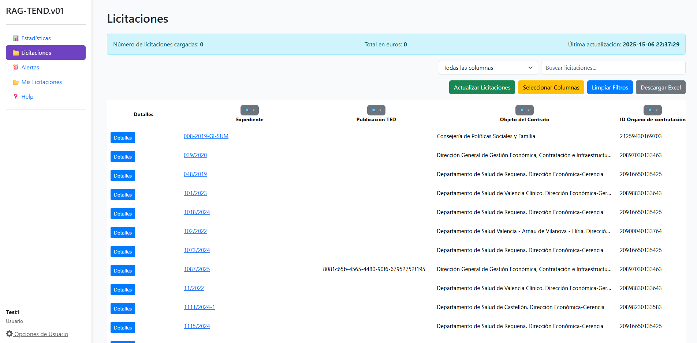
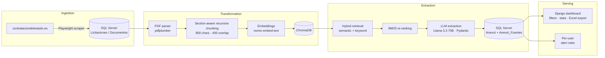
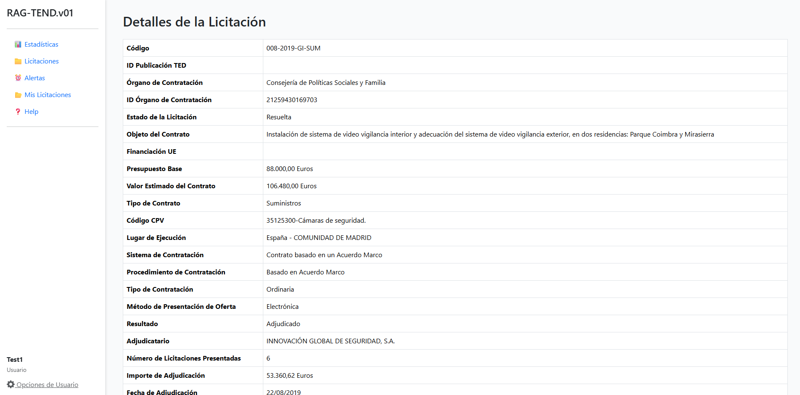
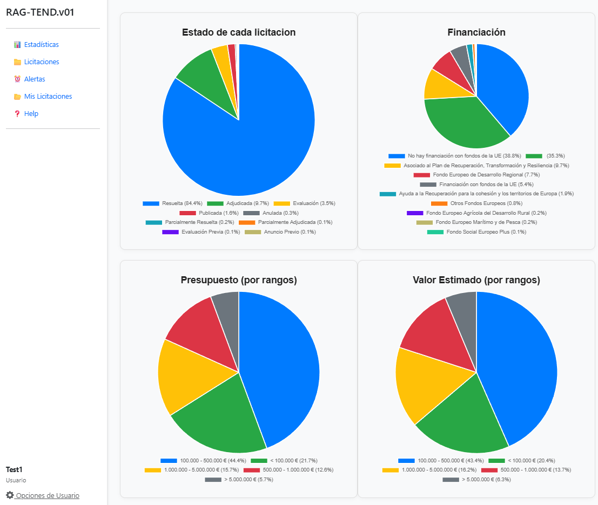
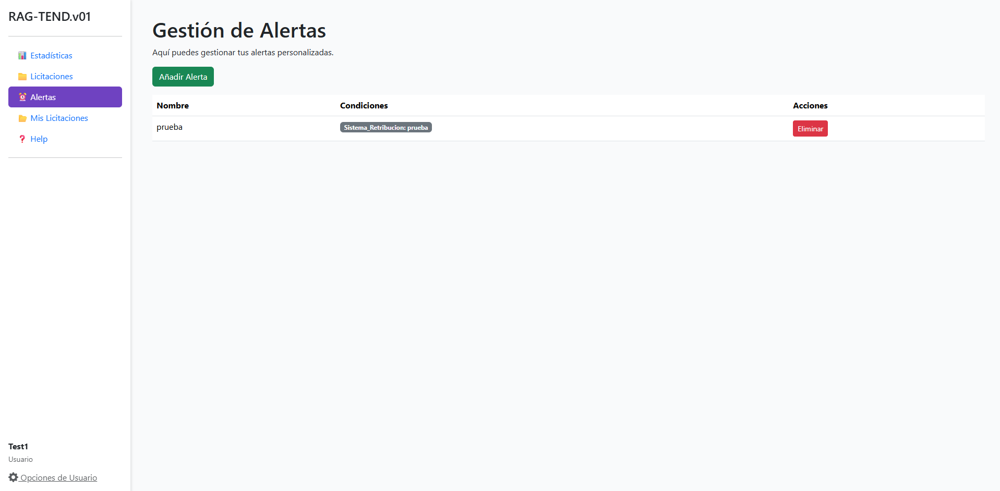
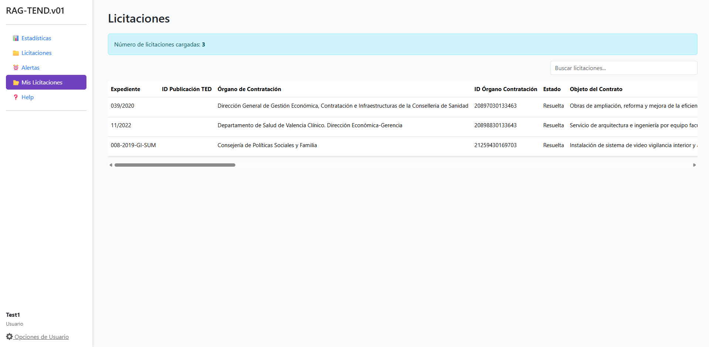

# RAG-TEND

**End-to-end data pipeline that turns unstructured Spanish public-tender documents into a queryable, structured database, using web scraping, a vector store and LLM-based extraction.**


> Bachelor's thesis, Computer Engineering, Universitat Politècnica de València (2025). [Read the full thesis (Spanish)](docs/thesis/memoria.md).



## The problem

Public tenders in Spain are published on the [Plataforma de Contratación del Sector Público](https://contrataciondelestado.es). The useful information (budget, execution period, award criteria, pricing formulas, guarantees...) is buried in long PDF, DOCX and ODT annexes. Each contracting body writes them with its own layout and vocabulary. Companies that bid on tenders spend hours reading them by hand.

## What RAG-TEND does

RAG-TEND automates the full path from source documents to analytics:

1. **Ingests** tender metadata and attached documents from the official platform (Valencia region) with a Playwright scraper.
2. **Parses and chunks** heterogeneous documents into section-aware JSON.
3. **Indexes** the chunks as embeddings in ChromaDB.
4. **Extracts 47 structured fields** per tender with a retrieval-augmented LLM, keeping a source reference for every extracted value.
5. **Loads** the results into SQL Server and serves them through a Django dashboard with filters, statistics, Excel export and per-user alert rules.

## Architecture



| Stage | What happens | Key tools |
|-------|--------------|-----------|
| Ingestion | Navigates the platform, filters by region, stores tender metadata and document URLs. Retries on timeouts. | Playwright (async), pyodbc |
| Parsing | Downloads each annex and extracts PDF text page by page, detecting document sections and keeping tables readable. DOCX and ODT are extracted as plain text but are not chunked yet. | pdfplumber (python-docx, odfpy) |
| Chunking | Splits each detected section recursively (800 chars, 400 overlap) and carries the section context into its chunks. | LangChain text splitters |
| Indexing | Embeds every chunk into a cosine-distance collection, rebuilt for each document. | nomic-embed-text, ChromaDB |
| Retrieval | Semantic search plus keyword matching (per-field keyword lists in `Strings.json`), re-ranked with BM25. | rank-bm25, spaCy (lemmatisation) |
| Extraction | One prompt per field. Each answer is captured as a typed record together with the chunks it came from (traceability). | OpenAI-compatible API, Pydantic |
| Serving | Dashboard, statistics, Excel export, saved tenders and per-user alert rules. | Django |

## Results

Evaluated on a **random sample of 30 tenders** with [Ragas](https://docs.ragas.io/) metrics. The LLM judge was first validated against **282 manually reviewed fields**.

| Metric | Score |
|--------|-------|
| Context Precision | **0.79** |
| Response Relevancy | **0.79** |
| Faithfulness | **0.76** |

- About **70% of all scores are ≥ 0.75**. Weak spots are concentrated in fields that rarely appear in the documents, or that depend on keyword lists (environmental and social criteria, pricing formulas). The thesis analyses each one.
- **Embedding fine-tuning experiment:** I trained a linear adapter on top of `all-MiniLM-L6-v2` with a synthetic question corpus. It raised Hit Rate@10 to **66.7% (+7.8%)** and MRR by **+6.2%**, but it made query encoding **about 3x slower**. That trade-off is documented in the thesis.
- **Throughput:** one annex produces 190-250 chunks and takes about 10-15 minutes end to end (embeddings plus 47 prompts). That is why the thesis design pre-processes tenders on ingestion. In the current code, extraction runs the first time a tender is opened.

## Data model

The full schema is in [`database/schema.sql`](database/schema.sql). The core tables:

| Table | Grain | Content |
|-------|-------|---------|
| `Licitaciones` | one row per tender | Scraped metadata: contracting body, status, budget, CPV code, procedure, award result |
| `Documentos` | one row per tender | URLs of the attached documents |
| `AnexoI` | one row per tender | The 47 LLM-extracted fields |
| `AnexoI_Fuentes` | one row per tender | Source chunks behind each extracted field (auditability) |
| `alertas` | one row per alert rule | User-defined tender filters (JSON) |
| `anexos_guardados` | one row per saved tender | Tenders each user saved |

## Screenshots

| Tender details | Statistics |
|---|---|
|  |  |
| **Alert rules** | **Saved tenders** |
|  |  |

## Repository structure

```
.
├── project/                 Django project
│   ├── app/
│   │   ├── util/            Pipeline: scraper, document handler, RAG, DB manager, mailer
│   │   │   ├── JSON/        Prompts, field keywords and ground-truth annotations
│   │   │   ├── testing/     Evaluation: Ragas, LLM judge, linear adapter, corpus generator
│   │   │   └── results/     Evaluation outputs
│   │   ├── templates/       Dashboard views
│   │   └── views.py
│   └── manage.py
├── database/schema.sql      SQL Server schema
└── docs/thesis/             Full thesis (Spanish, Markdown) and figures
```

## Running it locally

**Platform: Windows only.** The app connects to SQL Server with Windows integrated authentication (`Trusted_Connection=yes`), so there are no database username or password settings. The commands below are for PowerShell.

**Prerequisites:** Python 3.13, SQL Server with [ODBC Driver 17](https://learn.microsoft.com/sql/connect/odbc/download-odbc-driver-for-sql-server), and an API key for an OpenAI-compatible LLM endpoint. The project used UPV's PoliGPT; to use another endpoint, change `base_url` and the model names in `project/app/util/rag_operations.py`.

```powershell
git clone https://github.com/Oppen-OC/RAG-TEND-TFG.git
cd RAG-TEND-TFG
python -m venv .venv
.venv\Scripts\Activate.ps1
pip install -r requirements.txt
playwright install chromium
python -m spacy download es_core_news_lg

Copy-Item .env.example .env                        # then fill in the values
# Create the database: run database/schema.sql in SQL Server (SSMS or sqlcmd)
python project/manage.py migrate --fake            # schema.sql already creates Django's tables

python project/manage.py createsuperuser
python project/manage.py runserver
```

Open http://localhost:8000 and click **Actualizar Licitaciones** to run the scraper. Opening a tender's details triggers the LLM extraction of its annex the first time (about 10-15 minutes).

**Tests** (no SQL Server or `.env` needed):

```powershell
$env:DJANGO_SECRET_KEY = "test"; $env:DB_ENGINE = "sqlite"
python project/manage.py test app
```

**Evaluation scripts** (Ragas, LLM judge, linear adapter) need some extra packages: `pip install -r requirements-eval.txt`.

## Limitations and future work

- Only PDF annexes go through the full RAG pipeline. DOCX and ODT are extracted as text but not chunked yet.
- There is no scheduled ingestion or email notification yet: scraping is triggered from the dashboard, and alert rules are stored for a future notifier.
- Scanned PDFs are not supported. The next step would be adding OCR.
- Some fields depend on handcrafted keyword lists, which do not generalise well across contracting bodies.
- Processing time per document is driven by remote embedding and LLM latency.
- Only the Valencia region is scraped. Extending to other regions mostly means parameterising the scraper's filters.

## Thesis

The full write-up (in Spanish) covers the state of the art, the requirements analysis, the design decisions (chunking strategies, vector DB comparison, re-ranking), the evaluation and a legal and ethical analysis of web scraping and LLM use under Spanish and EU law. Read it in [`docs/thesis/memoria.md`](docs/thesis/memoria.md).

---

Author: [@Oppen-OC](https://github.com/Oppen-OC)
