**Dedicatoria**

A mi madre, por ser la persona que algún día aspiro a ser.

A mi padre, por inspirarme a convertirme en ingeniero.

La carrera puede sentirse solitaria en ocasiones, la mayoría de veces que tienes que probarte a ti mismo lo haces por tu cuenta. Casi todos los exámenes, trabajos, pruebas se hacen individualmente, donde tu eres el único factor determinante, pero no toma mas que un parpadeo el darte cuenta de que eres producto de tu entorno. Simplemente no me vería en la situación en la que estoy sin la ayuda de tantas personas maravillosas que me acompañaron en este viaje de 4 años que de cierta forma también se siente como un suspiro.

Le doy nuevamente las gracias a mis padres por haberme apoyado este viaje, que aún sabiendo que esto nos separaría casi 9000km decidieron apostar por mi futuro y ayudarme con todo lo que me propuse, sin su apoyo moral y financiero simplemente nada de esto hubiera sido posible.

A mis abuelos, Guillermo De Lucca y Graciela Osorio y a mi madrina Zaira Sanoja por haber siempre confiado en mi y ser las personas mas maravillosas con las que tuve la bendición de nacer y crecer.

A mis tutoras, Stella María Heras Barberá y María Laura Montalban Domingo, por su implicación ardua y continua con el proyecto.

A mi pareja, Carme Pérez, por ser una persona tan maravillosa y mi mayor bastión durante este período de trabajo y estrés.

A Sergio Fabregat (aka. Pepis) por haber sido mi compañero de madrugadas durante el desarrollo de nuestros TFGs.

A todos los compañeros de clase que inundé de dudas y preguntas durante toda la carrera y siempre estuvieron ahí para ayudarme, en especial Miquel Gómez, Alex Ramos, Andrés Pacheco y Alina Montoliu.

Y un larguísimo etcétera que quiero que englobe a todas las personas con las que formé una amistad durante estos 4 años, las noches de estudio, las fiestas, las lloraderas y las anécdotas son lo mas valioso que me llevo de este periodo de caos, estrés y felicidad que recordaré el resto de mi vida.

> *"No lo hicimos porque fuera fácil, sino porque pensábamos que lo sería."*

**Resumen**

El presente trabajo muestra el planteamiento, desarrollo y funcionamiento de RAG-TEND, una herramienta desarrollada para abordar los retos asociados a la gestión y análisis de licitaciones públicas, caracterizados por el manejo de grandes volúmenes de información y la necesidad de extraer datos relevantes de fuentes heterogéneas. RAG-TEND automatiza la recolección de datos mediante un webscraper propio, capaz de extraer información tanto de páginas web oficiales como de documentos asociados a cada licitación.

El sistema integra un módulo RAG (Retrieval-Augmented Generation), que utiliza modelos de lenguaje avanzados para mejorar la interpretación y contextualización de los datos extraídos, permitiendo así una mayor precisión en la generación de respuestas y en la extracción de información clave, como criterios de evaluación o valoraciones de empresas.

Toda la información recopilada se almacena de forma estructurada en una base de datos, lo que facilita su posterior consulta y análisis. Para la interacción con el usuario, RAG-TEND cuenta con un frontend desarrollado en Django[^1], que permite visualizar, filtrar y exportar los datos de manera sencilla e intuitiva. Además, la aplicación ofrece funcionalidades adicionales como la generación de estadísticas y la exportación de resultados en diferentes formatos.

Las pruebas realizadas demuestran la eficacia de RAG-TEND en la automatización y mejora de los procesos de gestión de licitaciones, aunque se identifican posibles líneas de mejora en la precisión de la extracción de ciertos campos complejos. En conjunto, RAG-TEND se posiciona como una herramienta útil para organizaciones que buscan optimizar la gestión y el análisis de licitaciones públicas.

The present work explores the approach, design and functioning of RAG-TEND, a tool developed to address the challenges associated with the management and analysis of public tenders, which are often characterized by the handling of large volumes of information and the need to extract relevant data from heterogeneous sources. RAG-TEND automates data collection through its own web scraper, capable of extracting information from both official websites and documents associated with each tender.

The system integrates a RAG (Retrieval-Augmented Generation) module, which uses advanced language models to improve the interpretation and contextualization of the extracted data, thus enabling greater accuracy in generating responses and extracting key information, such as evaluation criteria or company ratings.

All collected information is stored in a structured manner in a database, facilitating subsequent querying and analysis. For user interaction, RAG-TEND features a frontend developed in Django, which allows users to visualize, filter, and export data in a simple and intuitive way. Additionally, the application offers extra functionalities such as statistics generation and exporting results in different formats.

The tests carried out demonstrate the effectiveness of RAG-TEND in automating and improving tender management processes, although potential areas for improvement have been identified regarding the accuracy of extracting certain complex fields. Overall, RAG-TEND positions itself as a useful tool for organizations seeking to optimize the management and analysis of public tenders.

In summary, the project offers a modern and efficient solution for the intelligent exploitation of public information, integrating current technologies in both natural language processing and web development, as well as data management.


# Introducción

Las agencias públicas encargadas del desarrollo de infraestructuras enfrentan constantemente desafíos relacionados con la gestión eficiente de los contratos de obras. En un contexto donde los proyectos de construcción suelen estar sujetos a sobrecostes, retrasos y problemas de coordinación, la implementación de modelos digitales de gestión se ha convertido en una necesidad imperativa. Estos modelos buscan no solo optimizar los procesos de contratación, sino también garantizar una mayor transparencia, trazabilidad y precisión en la planificación y ejecución de los proyectos.

La digitalización en este ámbito permite automatizar tareas repetitivas, centralizar la información y mejorar la comunicación entre las partes involucradas, desde las administraciones públicas hasta los contratistas y proveedores. Además, estos modelos ofrecen herramientas avanzadas para la evaluación de riesgos, el seguimiento del progreso y la gestión de recursos, lo que contribuye a minimizar las incertidumbres y mejorar la toma de decisiones.

El objetivo principal de estos sistemas es reducir los sobrecostes asociados a desviaciones presupuestarias y los retrasos derivados de problemas logísticos o administrativos. Al mismo tiempo, buscan garantizar que los proyectos se ejecuten dentro de los plazos establecidos, cumpliendo con los estándares de calidad y sostenibilidad requeridos. En última instancia, la adopción de modelos digitales de gestión representa un paso hacia la modernización de los procesos de contratación pública, promoviendo una mayor eficiencia y adaptabilidad en un sector clave para el desarrollo económico y social.

## Motivación

La gestión de contratos de obra pública enfrenta importantes desafíos, como la subjetividad en la evaluación de riesgos, la interdependencia entre ellos y la incertidumbre inherente a los proyectos de infraestructura. Estos factores dificultan la toma de decisiones y generan sobrecostes y retrasos en las fases de diseño y construcción. Para abordar estos retos, el proyecto OPTI-CON propone un modelo digital basado en técnicas de optimización, diseñado para minimizar riesgos, mejorar la precisión en la planificación y garantizar resultados más eficientes en dichas fases.

Desde la perspectiva del usuario final, estos desafíos se agravan por la dificultad para acceder a información clara y estructurada sobre los riesgos y factores de contratación. La falta de herramientas accesibles para analizar datos relevantes complica la toma de decisiones informadas, aumentando las incertidumbres en el proceso. En este contexto, el proyecto OPTI-CON busca desarrollar soluciones tecnológicas que permitan a los usuarios acceder fácilmente a información precisa, optimizar los procesos de contratación y promover una gestión más eficiente y transparente, conectando así la necesidad de rigor técnico con la experiencia del usuario.

## Objetivos

El proyecto busca aplicar técnicas de Inteligencia Artificial (IA), como los modelos de lenguaje de gran tamaño (LLMs) y el procesamiento del lenguaje natural (NLP) para abordar los siguientes objetivos:

1.  Automatizar la recopilación de información relevante sobre licitaciones públicas.

2.  Procesar y organizar los datos obtenidos para facilitar su análisis.

3.  Desarrollar herramientas que permitan la visualización clara y accesible de la información recopilada.

4.  Mejorar la eficiencia en la gestión y consulta de documentos relacionados con licitaciones.

5.  Proporcionar una base tecnológica que facilite la toma de decisiones informadas en el ámbito de las licitaciones públicas.

## Metodología

El desarrollo del proyecto se llevó a cabo siguiendo el modelo de desarrollo en cascada, una metodología estructurada que divide el proceso en fases secuenciales, donde cada etapa depende de la finalización de la anterior. Este enfoque permitió mantener un control riguroso sobre el progreso del proyecto y garantizar que cada componente estuviera completamente desarrollado antes de avanzar al siguiente. Las fases incluyeron análisis, diseño, implementación, pruebas, despliegue y mantenimiento, asegurando que el sistema fuera escalable, robusto y fácil de mantener.

La comunicación y coordinación se basaron en reuniones semanales entre mi persona y ambas tutoras, en las que se discutía el progreso realizado y se planteaban nuevos objetivos. Además, se utilizó mensajería instantánea para resolver dudas y coordinar tareas, lo que agilizó el desarrollo y permitió cumplir con los objetivos planteados de manera eficiente. Este enfoque colaborativo resultó en una solución robusta y escalable para la gestión de licitaciones públicas.

# Estado del arte

En el contexto actual de la administración pública en España, la digitalización y la transparencia en los procesos de contratación han impulsado la publicación de licitaciones a través de plataformas electrónicas. Sin embargo, el acceso eficiente, centralizado y estructurado a esta información sigue siendo un desafío tanto para ciudadanos como para empresas interesadas en participar en procesos de contratación pública.

Este Trabajo de Fin de Grado se enmarca en la creación de una herramienta informática capaz de buscar, listar y extraer datos relevantes de licitaciones públicas en España. Para ello, resulta fundamental realizar un análisis detallado del estado del arte, que permita identificar las tecnologías, herramientas y enfoques existentes en el ámbito de la recopilación automatizada de datos (web scraping), el tratamiento de información estructurada y semiestructurada, así como las plataformas oficiales de publicación de licitaciones en el país.

Este apartado presenta una revisión crítica de los sistemas actuales, tanto institucionales como privados, junto con las metodologías utilizadas para la extracción y procesamiento de información relacionada con las contrataciones públicas. Asimismo, se examinan las limitaciones de las soluciones existentes y se justifica la necesidad de una herramienta específica que optimice la búsqueda y el análisis de estas licitaciones.

## Herramientas similares

En los últimos años han surgido diversas herramientas, tanto institucionales como desarrolladas por terceros, orientadas a facilitar el acceso y la gestión de información sobre licitaciones públicas. Estas soluciones suelen ofrecer funcionalidades como la búsqueda avanzada, la descarga de documentos, la monitorización de nuevas licitaciones y la generación de alertas personalizadas. Entre las plataformas más destacadas se encuentran portales oficiales como la Plataforma de Contratación del Sector Público (PLACSP) [^2] y agregadores privados que centralizan información proveniente de distintas fuentes. Además, existen aplicaciones que emplean técnicas de web scraping y procesamiento automático de datos para estructurar la información y presentarla de forma más accesible para los usuarios. En esta sección se analizan las principales características, ventajas y limitaciones de estas herramientas, sirviendo como referencia para el desarrollo y justificación de la solución propuesta en este trabajo.

### DoubleTrade

DoubleTrade \[@doubletrade\] es una plataforma especializada en la monitorización y gestión de oportunidades de negocio en los sectores de la licitación pública y la construcción, tanto en España como en Francia. Esta compañía ofrece soluciones para empresas que buscan optimizar su participación en concursos públicos, privados y proyectos de obra.

Sus principales características son:

1.  **Monitorización de licitaciones y adjudicaciones**\
    Permite acceso a información detallada y actualizada sobre licitaciones, adjudicaciones, pliegos, con alertas personalizadas por sector, importe, ubicación, CPV, palabra clave, entre otros.

2.  **Plataforma de gestión de licitaciones**\
    Cuenta con herramientas capaces de organizar y asignar licitaciones a equipos internos, archivar y dar seguimiento a oportunidades en un entorno colaborativo, e integrar con CRM [^3] o recibir datos vía SFTP [^4] (protocolo de transferencia de archivos).

3.  **Análisis con inteligencia artificial**\
    Tiene la capacidad de realizar el procesamiento y análisis de pliegos en segundos, destacando criterios clave, además de enviar alertas de vencimientos y nuevas convocatorias.

4.  **Herramientas de *Business Intelligence* (BI)**\
    Realiza estudios estratégicos sobre mercado, tendencias y competencia. además de opciones de visualización de datos como: volumen de negocio, materiales prescritos, distribución geográfica.

5.  **Bases de datos especializadas**\
    Cuenta con información sobre empresas del sector de construcción y licitaciones públicas, datos financieros, legales y de contacto de adjudicatarios.

6.  **Cobertura sectorial amplia**\
    Cubre los siguientes sectores: construcción, sanidad, TIC (Tecnologías de la Información y la Comunicación), *facility management*, entre otros. Además, cuenta con información tanto de proyectos públicos como privados.

### Licitaciones.es:

Licitaciones.es es una plataforma especializada en la identificación y gestión de oportunidades de negocio en el ámbito de la contratación pública. Ofrece servicios que permiten a las empresas acceder a información detallada sobre licitaciones públicas, facilitando su participación en concursos y mejorando su competitividad en el mercado \[@licitaciones\].

Sus principales características son:

1.  **Servicio de alertas de licitaciones**\
    Recibe información sobre nuevas oportunidades de negocio, cuenta con la opcion de personalizar perfiles de búsqueda según sector, ubicación y otros criterios, puede visualizar y organizar licitaciones relevantes en un panel de control y recibir notificaciones directas por correo electrónico o teléfono móvil.

2.  **Informes personalizados**\
    Puede elaborar informes de licitación personalizados por expertos, proporcionar informes continuos como herramienta de control y seguimiento, y ofrecer acceso a datos históricos para análisis detallado.

3.  **Análisis de competencia y mercado**\
    Tiene la capacidad de estudiar patrones de compra de entidades adjudicadoras, analizar la competencia y sus ofertas presentadas, e identificar clientes potenciales y tendencias de mercado.

4.  **Licitaciones futuras**\
    Cuenta con detección anticipada de oportunidades de negocio mediante análisis de datos históricos, preparando a la empresa con antelación para futuras licitaciones.

5.  **Servicios de consultoría y asesoramiento**\
    Ofrece asesoramiento personalizado para optimizar la participación en licitaciones, brinda soporte en la elaboración y presentación de ofertas competitivas, y desarrolla estrategias para mejorar la tasa de éxito en concursos públicos.

### Telecit@:

Telicit@ es una solución tecnológica desarrollada por Tesera de Hospitalidad que facilita a las organizaciones la gestión integral de licitaciones públicas. Permite mantener un repositorio único de información accesible para toda la organización, optimizando el proceso de contratación pública \[@telicita\].

Sus características principales son:

1.  **Parametrización dinámica del contenido de la documentación del expediente**\
    Ofrece un sistema flexible para predefinir la configuración del sistema documental y permite adaptar la documentación a las necesidades específicas de cada expediente.

2.  **Sistema de mensajería para envío de notificaciones**\
    Gestiona envíos de información internos y envía notificaciones automáticas sobre cambios en las licitaciones.

3.  **Gestión y seguimiento de expedientes, ofertas, contratos y acuerdos marco**\
    Realiza un seguimiento detallado de ofertas, contratos y acuerdos marco, y gestiona cambios de precios, discontinuidad de productos, prórrogas y vencimientos.

4.  **Herramientas para comparar resultados con la competencia**\
    Captura resultados de adjudicaciones, precios y puntuaciones de criterios, y apoya la toma de decisiones estratégicas mediante análisis comparativos.

5.  **Accesibilidad y disponibilidad**\
    Permite el acceso desde cualquier lugar y en cualquier momento, sin requerir instalaciones locales, sólo un ordenador con acceso a Internet.

6.  **Soporte y seguridad**\
    Ofrece respaldo de Tesera de Hospitalidad, empresa líder en gestión de procesos de contratación pública, garantiza la seguridad y confidencialidad de los datos con copias de seguridad periódicas, y proporciona servicio de soporte telefónico y actualizaciones ante cambios legislativos.

### Tendios:

Tendios es una plataforma digital especializada en contratación pública que facilita el proceso de licitación a empresas, entidades públicas y profesionales. Utiliza inteligencia artificial para ayudar a encontrar, analizar, gestionar y ganar licitaciones públicas, ofreciendo una interfaz intuitiva y funcionalidades avanzadas \[@tendios\].

Sus principales caracteristicas son:

1.  **Búsqueda y filtrado de licitaciones**\
    Permite el acceso a licitaciones y adjudicaciones de múltiples fuentes oficiales en tiempo real, esto con la ayuda de filtros avanzados por palabras clave, códigos CPV, ubicación y otros criterios, además de búsqueda semántica e inteligencia artificial.

2.  **Alertas personalizadas**\
    Ofrece notificaciones configurables según las necesidades del usuario y permite la recepción de alertas por correo electrónico sobre licitaciones relevantes.

3.  **Análisis de mercado y analítica predictiva**\
    Proporciona dashboards con datos de expedientes de contratación por sector, empresa, cliente o región, y predice ofertantes y precios en nuevas licitaciones.

4.  **Gestión de tareas y oportunidades**\
    Facilita la coordinación de equipos en la preparación de ofertas y permite el control de fechas y el seguimiento de licitaciones asignadas.

5.  **Generación de documentos**\
    Permite la creación de borradores de pliegos técnicos y administrativos a partir de plantillas, y el entrenamiento sobre parámetros de contratación pública e históricos de adjudicaciones.

6.  **Integración con otros sistemas**\
    Ofrece una API para la transmisión de datos a CRMs como Salesforce o Hubspot, e integración con herramientas de análisis como PowerBI.

7.  **Interfaz de usuario intuitiva**\
    Presenta un diseño sencillo y fácil de usar, accesible para usuarios con distintos niveles técnicos, con navegación clara y funcionalidades bien organizadas.

8.  **Soporte y recursos educativos**\
    Proporciona un servicio al cliente dedicado para resolver problemas y responder consultas, además de recursos educativos como blogs y guías para mejorar el conocimiento sobre procesos de licitación.

### Oclem:

Oclem es una empresa consultora en la gestión de licitaciones públicas en España. Ofrece una plataforma avanzada que centraliza y filtra licitaciones según las preferencias de cada empresa, además de proporcionar servicios de consultoría integral para optimizar la participación en concursos públicos \[@oclem\].

Sus principales características son:

1.  **Plataforma de licitaciones**\
    Centraliza todas las ofertas publicadas por las Administraciones Públicas, permite el filtrado personalizado por ubicación, sector o tipo de servicio, realiza un seguimiento exhaustivo de licitaciones en las que se participa, proporciona actualizaciones en tiempo real sobre nuevas licitaciones y cambios en convocatorias, y cuenta con una interfaz intuitiva para facilitar la navegación y gestión.

2.  **Consultoría especializada**\
    Ofrece asesoramiento personalizado por consultores especializados, analiza la viabilidad de expedientes según características empresariales, prepara documentación técnica y económica para ofertas, y gestiona la presentación y seguimiento de ofertas.

3.  **Análisis competitivo**\
    Evalúa el posicionamiento frente a otros licitadores e identifica puntos de mejora para futuras convocatorias.

4.  **Clasificación empresarial**\
    Asiste en la obtención y renovación de la clasificación necesaria para participar en contratos públicos.

5.  **Soporte y formación**\
    Proporciona consultas en línea con diferentes departamentos y ofrece formación para mejorar las habilidades en la preparación de licitaciones.

### Gobierto:

Gobierto es una plataforma desarrollada por la empresa Populate que se centra en mejorar la transparencia, la participación ciudadana y el análisis de datos en el ámbito del sector público. Su objetivo principal es facilitar el acceso y comprensión de la información pública tanto para administraciones como para ciudadanos \[@gobierto\].

Sus principales características son:

1.  **Busca licitaciones de forma natural**\
    Utiliza palabras clave y/o CPVs [^5], excluye determinados términos, y combina criterios de búsqueda para obtener resultados más precisos. Nuestro buscador es muy rápido y te permite realizar búsquedas complejas de forma sencilla y rápida.

2.  **Configura alertas**\
    Crea alertas personalizadas para recibir un resumen de las nuevas licitaciones y las adjudicaciones. Cada persona de tu equipo podrá suscribirse a las alertas que necesite, y en cualquier momento podrás consultar búsquedas guardadas de tus colegas.

3.  **Refina tu búsqueda con facilidad**\
    Ajusta y refina tu búsqueda con facilidad y agilidad. De esta forma podrás iterar en la definición de tu búsqueda para contemplar todas las palabras clave que necesitas, allá donde los CPVs no son suficientes para monitorizar todas las licitaciones que necesitas.

4.  **Analiza a tu competencia**\
    Extrae de forma automática una lista de las empresas con las que compites en base a las licitaciones que han ganado. Analiza los precios que han ofertado y entiende cómo se están comportando en cuanto a las bajas históricas y recientes. Identifica sus principales clientes para desarrollar tu estrategia comercial.

5.  **Genera informes**\
    Permite la generación de informes detallados basados en búsquedas y análisis realizados. Estos informes ofrecen una visión clara y comprensible de los datos, facilitando la toma de decisiones informadas y estratégicas.

6.  **Consulta el detalle de licitaciones y adjudicaciones**\
    Accede a información detallada de cada licitación y adjudicación. Esto incluye el título de la licitación, el CPV, el tipo de contrato, la empresa ganadora, el monto ofertado, entre otros datos. Esta información detallada te ayudará a entender mejor el mercado y a tomar decisiones más informadas.

7.  **Portal unificado**\
    Ofrece un entorno web centralizado para acceder a toda la información pública, mejorando la organización y accesibilidad de contenidos como contratos, presupuestos, normativas y resultados de gestión.

## Crítica al estado del arte

Leyenda: 1.- Presencia internacional, 2.- Servicio gratuito, 3.- Asesoramiento profesional, 4.- Notificaciones, 5.- Exportación de datos, 6.- Código abierto, 7.- API, 8.- Búsqueda semántica, 9.- Herramientas IA.

Entre las herramientas analizadas, varias incluyen soluciones innovadoras de Inteligencia Artificial:

1.  **Doubletrade:** utiliza inteligencia artificial para optimizar la participación en licitaciones públicas, ofreciendo recomendaciones personalizadas basadas en el perfil de cada empresa, análisis detallado de pliegos y documentos, asistencia en la redacción de propuestas, estrategias de precios competitivos mediante modelos predictivos, y gestión automatizada de documentación para garantizar el cumplimiento legal y técnico.

2.  **Tendios:** cuenta con una plataforma basada en inteligencia artificial, la cual optimiza la gestión de licitaciones públicas para empresas y entidades. Integra funcionalidades como interacción en lenguaje natural para consultar pliegos, búsqueda y filtrado inteligente de licitaciones relevantes, análisis predictivo con dashboards de mercado, generación automática de documentos, y conexión con sistemas externos como CRMs y herramientas de análisis.

3.  **Gobierto:** utiliza inteligencia artificial para optimizar la contratación pública mediante modelos predictivos que estiman el número de ofertas para licitaciones, extracción y clasificación automática de texto en pliegos, y herramientas como Gobierto Redactor, un editor colaborativo asistido por IA para redactar cláusulas. Además, ofrece Gobierto Asistente, un chatbot especializado en contratación pública que responde preguntas basándose en fuentes oficiales, junto con funciones de NLP como recomendación de CPVs, resúmenes automáticos y sistemas de preguntas-respuestas sobre normativa.

4.  **RAG-TEND:** La herramienta emplea la técnica RAG para extraer datos importantes de documentos relacionados con la licitación y mostrarlos de manera organizada en tablas, además de mostrar las fuentes de estos datos para garantizar su fiabilidad.

Si bien queda claro que las opciones son amplias y variadas, siguen existiendo carencias, las cuales se pretenden abordar en este proyecto:

- Transparencia de los datos: Aunque otras herramientas sí validan su información, suelen hacerlo de manera menos transparente, citando el documento completo de donde se ha extraído la información. En contraste, este programa destaca por su capacidad de citar directamente las fuentes utilizadas, especificando con precisión la página o páginas concretas que han servido para formular cada respuesta. Esto garantiza una mayor trazabilidad y confianza en los datos proporcionados.

- Código abierto: Todos los programas y servicios listados privatizan por completo el uso de sus herramientas, mientras que la funcionalidad de RAG-TEND es completamente transparente y maleable para cualquier programador que quiera hacer uso de ella.

- Precio: La mayoría de herramientas listadas no permiten un acceso total a sus funcionalidades a menos de que se pague una cuota (que en algunos casos puede llegar a los miles de euros), en cambio, esta herramienta es de acceso gratuito y de código abierto, democratizando así el acceso a la información.

- Automatización: A diferencia de otras soluciones que requieren interacción manual o no actualizan frecuentemente la información, esta herramienta puede programarse para realizar búsquedas y extracciones automáticas a intervalos definidos, lo cual reduce el esfuerzo del usuario y garantiza acceso constante a datos actualizados.

## Propuesta

La propuesta de este Trabajo de Fin de Grado es desarrollar una herramienta automática basada en el enfoque *Retrieval-Augmented Generation* para la búsqueda, extracción y presentación de información relacionada con licitaciones públicas en España. La herramienta está diseñada para realizar consultas de manera autónoma, sin interacción directa del usuario, utilizando técnicas avanzadas de recuperación de información y generación de texto. Esto permite obtener respuestas claras, precisas y directamente vinculadas a sus fuentes originales, optimizando el análisis y la

La propuesta se diferencia de soluciones existentes por su enfoque en la transparencia informativa, ya que no solo responde a las consultas, sino que especifica con exactitud el origen de cada dato utilizado, incluyendo enlaces y referencias precisas a los documentos oficiales de cada licitación concreta. Además, la herramienta será de código abierto, lo que contrasta con la mayoría de las alternativas comerciales del sector, habitualmente privativas y de alto coste.

Otra característica clave será su capacidad de automatización, permitiendo la actualización periódica y desatendida de la base de conocimiento, lo que garantiza que los datos ofrecidos estén siempre actualizados. Esto la convierte en una solución eficiente, accesible y abierta que contribuye a facilitar el acceso a la información pública y a fomentar su reutilización en beneficio de ciudadanos, profesionales y empresas.

# Análisis del problema

Una vez concluido el estudio del estado del arte, resulta fundamental realizar un análisis detallado del problema específico que aborda este proyecto. El objetivo de esta sección es ofrecer una visión clara y profunda de los retos asociados a la extracción, procesamiento y presentación de información contenida en documentos PDF y HTML, utilizando técnicas avanzadas de procesamiento de lenguaje natural y modelos de lenguaje .

En este contexto, se identifican los principales desafíos relacionados con la heterogeneidad de los formatos documentales, la complejidad estructural de los archivos PDF y HTML, y la necesidad de transformar dicha información en datos estructurados y útiles para el usuario final. Se establecerán los requisitos funcionales y no funcionales que debe cumplir la solución, así como los criterios de calidad y eficiencia que guiarán su desarrollo.

Además, se modelará conceptualmente la arquitectura del sistema, detallando los procesos de extracción, segmentación y almacenamiento de la información, así como los mecanismos para su posterior consulta y visualización. Este análisis permitirá anticipar posibles dificultades técnicas y sentar las bases para la implementación de una solución robusta, escalable y capaz de incorporar futuras mejoras e innovaciones en el ámbito del procesamiento automático de documentos.

## Identificación y análisis de retos

La herramienta tiene como objetivo principal identificar expedientes específicos publicados en la Plataforma de Contratación del Sector Público [^6] y extraer información relevante de los mismos para su posterior análisis. Este proceso implica la interacción con grandes volúmenes de datos estructurados y no estructurados, lo que plantea diversos desafíos técnicos y operativos. Al abordar este objetivo, se han detectado las siguientes problemáticas que afectan tanto la precisión como la eficiencia del sistema:

1.  **Almacenamiento de datos:** Actualmente, solo en la Comunidad Valenciana existen cerca de 13.000 expedientes listados en la Plataforma de Contratación del Sector Público. Esta información es clave para analizar y gestionar las licitaciones públicas, permitiendo identificar oportunidades de negocio, evaluar presupuestos y plazos, y garantizar la transparencia en los procesos de contratación. El objetivo de procesar estos datos es facilitar su acceso y análisis, optimizando la toma de decisiones tanto para empresas como para administraciones públicas, y promoviendo una gestión más eficiente y automatizada de la información disponible. Ver sección: 3.3.1

2.  **Extracción de la información:** Si bien la información es fácilmente accesible mediante el portal de licitaciones, no existe una API o alguna herramienta similar para poder acceder a toda la información que este proyecto intenta extraer. Ver sección: 3.3.2

3.  **Estructura y vocabulario:** Los documentos de licitaciones de los que se pretende extraer la información cuentan con estructuras y un vocabularios considerablemente distintos dependiendo de la entidad emisora y las necesidades de cada caso, si bien en muchas ocasiones contienen información similar, la forma en la que se presenta esta información es tan diversa que representa un reto enorme clasificar e identificar correctamente cada campo. Ver sección: 3.3.3

4.  **Estrategia de chunking [^7]:** Dentro de los sistemas RAG uno de los aspectos mas importantes es como se divide la información en pequeños trozos para que sean mas fáciles de “digerir”, es por eso que elegir la estrategia correcta resulta crítico para funcionamiento ideal del programa. Ver sección: 3.3.4

5.  **Clasificación y Recuperación:** La clasificación y recuperación de información en sistemas RAG puede ser problemática porque los modelos pueden no identificar correctamente los documentos de licitaciones más relevantes, especialmente si los *embeddings* (representación matemática en un espacio vectorial de cada documento) no están bien adaptados al dominio. Además, la ambigüedad en las consultas, la falta de datos etiquetados y la presencia de información irrelevante o ruidosa pueden dificultar la precisión y eficiencia del sistema, afectando la calidad de las respuestas generadas. Ver sección: 3.3.5

6.  **Generación de respuestas:** La elección del LLM en sistemas RAG puede ser problemática porque no todos los modelos comprenden igual de bien el dominio específico o el lenguaje de las consultas. Un modelo inadecuado puede generar respuestas poco precisas, irrelevantes o incluso incorrectas. Además, factores como el coste computacional, la disponibilidad de recursos y la compatibilidad con el resto del sistema también pueden limitar la elección y afectar el rendimiento global de la solución. Ver sección: 3.3.6

7.  **Visualización de datos:** El programa gestiona volúmenes de información elevados, y sin una forma cómoda de poder visualizarlos la herramienta pierde sentido de cara al usuario. Ver sección: 3.3.7

8.  **Veracidad de la información extraída:** Al tratarse de un programa que pretende extraer información de manera automática la información extraída por el mismo puede ser errónea, lo que podría generar desconfianza en los usuarios y errores críticos en la toma de decisiones. Si la información es falsa o inexacta y no se puede rastrear hasta su fuente original, los usuarios no podrán validar su autenticidad, lo que podría llevar a malentendidos, decisiones erróneas o incluso consecuencias legales en contextos sensibles como lo son las licitaciones públicas. La verificabilidad es clave para garantizar la transparencia, la confianza y la utilidad del sistema. Ver sección: 3.3.8

9.  **Factores externos:** Toda la extracción y recopilación de información depende de un agente externo como lo es la Plataforma de Contratación del Sector Público [^8], en caso de que esta falle o tarde demasiado en procesar las peticiones es razonable asumir un fallo de parte del programa. Ver sección: 3.3.9

## Especificación de Requisitos

La especificación de requisitos es un paso esencial para garantizar que la solución propuesta cumpla con los objetivos del proyecto y las expectativas de los usuarios. En esta sección, se describen los requisitos funcionales y no funcionales que guiarán el desarrollo de la herramienta. Estos requisitos han sido definidos con base en un análisis detallado de las necesidades del sistema, asegurando que la implementación sea eficiente, escalable y alineada con los propósitos del proyecto.

### Requisitos Funcionales

1.  **Extracción de Información:** El sistema deberá ser capaz de realizar scraping en plataformas de licitaciones públicas para extraer datos relevantes, como número de expediente, descripción del contrato, fechas y presupuestos.

2.  **Procesamiento de Datos:** Los datos extraídos deberán ser procesados y normalizados para garantizar su consistencia y calidad antes de ser almacenados.

3.  **Persistencia de datos:** El sistema deberá poder almacenar los datos extraídos en una base de datos estructurada, asegurando la integridad de las relaciones entre tablas.

4.  **Generación de Respuestas:** El programa tendrá que hacer uso de un LLM apto para la tarea.

5.  **Validación de Datos:** El sistema incluirá un mecanismo para validar la precisión y relevancia de los datos extraídos, utilizando métricas como porcentaje de errores y calidad de los datos.

6.  **Interfaz de Usuario:** Tendrá que proveer una interfaz web intuitiva que permita a los usuarios consultar, filtrar y analizar los datos almacenados.

7.  **Filtrado de datos:** El usuario deberá ser capaz de navegar fácilmente entre todos los datos extraídos, filtrando información a voluntad.

8.  **Exportación de Resultados:** Deberá integrar una opción para exportar los datos a algún formato estructurado como csv o json.

9.  **Gestión de Fuentes:** Cada respuesta generada tendrá que mostrar las fuentes originales de los datos, indicando el fragmento y la página correspondiente.

### Requisitos No Funcionales

1.  **Escalabilidad:** El sistema tendrá que ser capaz de manejar un volumen creciente de licitaciones y consultas sin comprometer el rendimiento.

2.  **Usabilidad:** El uso del sistema deberá ser cómodo, fluido e intuitivo.

3.  **Accesibilidad:** La herramienta deberá ser fácilmente accesible para todos los usuarios.

## Análisis de Soluciones propuestas

En esta sección se presentan las distintas soluciones consideradas para abordar los retos identificados en el desarrollo del TFG. Se analizan las alternativas planteadas, justificando la elección de las estrategias y tecnologías seleccionadas para resolver los problemas detectados. El objetivo es mostrar el razonamiento seguido en el diseño de la solución final, así como las ventajas y limitaciones de cada enfoque propuesto.

### Almacenamiento de datos

Una vez contextualizado el volumen de datos que se va a gestionar, resulta evidente la necesidad de emplear una base de datos. Sin embargo, durante el proceso de selección fue fundamental analizar y comparar las ventajas e inconvenientes de optar por una base de datos SQL frente a una NoSQL:

<table style="width:97%;">
<caption>Comparativa de pros y contras entre NoSQL y SQL</caption>
<colgroup>
<col style="width: 48%" />
<col style="width: 48%" />
</colgroup>
<thead>
<tr>
<th style="text-align: left;"><strong>NoSQL</strong></th>
<th style="text-align: left;"><strong>SQL</strong></th>
</tr>
</thead>
<tbody>
<tr>
<td style="text-align: left;"><p><strong>Pros:</strong></p>
<ul>
<li><p>Esquema flexible, ideal para datos no estructurados o cambiantes.</p></li>
<li><p>Escalabilidad horizontal sencilla, lo que facilita el crecimiento del sistema.</p></li>
<li><p>Buen rendimiento para grandes volúmenes de datos y escritura rápida.</p></li>
<li><p>Fácil integración con aplicaciones modernas y formatos como JSON.</p></li>
</ul>
<p><strong>Contras:</strong></p>
<ul>
<li><p>Menor soporte para relaciones complejas entre datos, lo que puede dificultar la integridad referencial.</p></li>
<li><p>Escalabilidad horizontal puede requerir configuraciones avanzadas para garantizar consistencia.</p></li>
<li><p>Menos eficiente para consultas complejas o análisis de datos estructurados.</p></li>
<li><p>Requiere experiencia previa para optimizar su uso en escenarios específicos.</p></li>
<li><p>Menor madurez en comparación con bases de datos relacionales para ciertos casos de uso.</p></li>
</ul></td>
<td style="text-align: left;"><p><strong>Pros:</strong></p>
<ul>
<li><p>Integridad y consistencia de los datos gracias a transacciones ACID (Atomicidad, Consistencia, Aislamiento y Durabilidad).</p></li>
<li><p>Ideal para datos estructurados y relaciones complejas.</p></li>
<li><p>Potente lenguaje de consultas (SQL) para búsquedas y análisis complejos.</p></li>
<li><p>Amplio soporte, madurez y herramientas de administración.</p></li>
</ul>
<p><strong>Contras:</strong></p>
<ul>
<li><p>No garantiza consistencia fuerte por defecto (eventual consistency).</p></li>
<li><p>Consultas complejas y relaciones entre datos menos eficientes.</p></li>
<li><p>Menor soporte para transacciones complejas.</p></li>
<li><p>Menos maduro para integridad referencial.</p></li>
</ul></td>
</tr>
</tbody>
</table>

### Justificación de la elección

La elección que mejor se acopla a este proyecto es una base de datos SQL ya que la información a almacenar es estructurada, requiere integridad y relaciones claras entre entidades, y es fundamental poder realizar consultas complejas y precisas. SQL proporciona un entorno robusto y seguro para garantizar la consistencia de los datos, lo que es esencial para la trazabilidad y fiabilidad del sistema. Aunque las bases de datos noSQL (como por ejemplo, MongoDB) ofrecen ventajas en flexibilidad y escalabilidad, las necesidades del proyecto se alinean mejor con las fortalezas de una base de datos relacional \[@sqlNosql\].

### Extracción de la información

Para la extracción de datos desde la página web, se determinó que la opción más adecuada sería implementar un web scraper. Por ello, resulta fundamental considerar los siguientes aspectos:

<table style="width:97%;">
<caption>Ventajas y desventajas del uso de web scraping</caption>
<colgroup>
<col style="width: 48%" />
<col style="width: 48%" />
</colgroup>
<thead>
<tr>
<th style="text-align: left;"><strong>Ventajas</strong></th>
<th style="text-align: left;"><strong>Desventajas</strong></th>
</tr>
</thead>
<tbody>
<tr>
<td style="text-align: left;"><ul>
<li><p>Permite automatizar la extracción de grandes volúmenes de información de forma rápida y eficiente.</p></li>
<li><p>Facilita la recolección de datos de fuentes que no ofrecen APIs públicas o exportaciones directas.</p></li>
<li><p>Puede adaptarse a diferentes estructuras y formatos de páginas web.</p></li>
<li><p>Reduce el trabajo manual y el riesgo de errores humanos en la recopilación de datos.</p></li>
<li><p>Permite actualizar la información de manera periódica y programada.</p></li>
</ul></td>
<td style="text-align: left;"><ul>
<li><p>Es sensible a cambios en la estructura de las páginas web, lo que puede requerir mantenimiento frecuente.</p></li>
<li><p>Puede enfrentar limitaciones legales o restricciones de acceso impuestas por los sitios web.</p></li>
<li><p>El scraping masivo puede ser detectado y bloqueado por mecanismos anti-bots.</p></li>
<li><p>La calidad y consistencia de los datos extraídos depende del diseño y limpieza de la web origen.</p></li>
<li><p>Puede requerir una inversión inicial significativa en desarrollo y pruebas para asegurar la robustez del sistema.</p></li>
</ul></td>
</tr>
</tbody>
</table>

\[@fruntera\]

### Justificación de elección

Siendo conscientes de las ventajas y desventajas, se concluye que no existe una alternativa mejor para obtener datos de una página web de forma automatizada y masiva sin la existencia de un API de acceso a los datos. El web scraping es la solución más adecuada para este proyecto, ya que permite acceder a grandes volúmenes de información de manera eficiente y flexible, a pesar de los retos asociados a su mantenimiento y posibles restricciones legales, este aspecto se explora mas en la sección 3.6.

### Estructura y vocabulario

Es fundamental considerar la estructura y el vocabulario de un texto en un programa RAG porque estos factores influyen directamente en la calidad de los *embeddings* y, por tanto, en la capacidad del sistema para recuperar información relevante. Diferencias en la forma de escribir, el uso de sinónimos, abreviaturas o errores tipográficos pueden dificultar que el modelo relacione correctamente las consultas con los documentos de licitaciones almacenados.

La normalización es una buena estrategia para afrontar este problema, ya que permite unificar el formato de los textos, eliminando variaciones innecesarias y reduciendo la ambigüedad. Al convertir todos los textos a una forma estándar (por ejemplo, pasando a minúsculas, eliminando signos de puntuación o corrigiendo errores comunes), se facilita que el sistema identifique coincidencias semánticas y mejore la precisión en la recuperación de información . Entre las técnicas más comunes se encuentran la lematización y el *stemming* \[@lemmatizationvsstemming\].

<table style="width:99%;">
<caption>Comparativa entre lematización y <em>stemming</em></caption>
<colgroup>
<col style="width: 8%" />
<col style="width: 57%" />
<col style="width: 33%" />
</colgroup>
<thead>
<tr>
<th style="text-align: left;"><strong>Técnica</strong></th>
<th style="text-align: left;"><strong>Descripción</strong></th>
<th style="text-align: left;"><strong>Ventajas y Desventajas</strong></th>
</tr>
</thead>
<tbody>
<tr>
<td style="text-align: left;"><strong>Lematización</strong></td>
<td style="text-align: left;">Reduce las palabras a su forma base o “lema” considerando el contexto gramatical (por ejemplo, “corriendo” → “correr”).</td>
<td style="text-align: left;"><strong>Ventajas:</strong> Precisa y basada en el significado.<br />
<strong>Desventajas:</strong> Más lenta, requiere modelos lingüísticos avanzados.</td>
</tr>
<tr>
<td style="text-align: left;"><strong>Stemming</strong></td>
<td style="text-align: left;">Reduce las palabras a su raíz eliminando sufijos, sin considerar el contexto (por ejemplo, “corriendo” → “corr”).</td>
<td style="text-align: left;"><strong>Ventajas:</strong> Rápido y computacionalmente eficiente.<br />
<strong>Desventajas:</strong> Menos preciso, puede generar raíces no válidas.</td>
</tr>
</tbody>
</table>

\[@lemmatizationvsstemming\]

### Justificación de la elección

Durante el desarrollo del proyecto, se valorará el uso de ambas opciones como técnicas para la normalización del texto. Estas serán utilizadas y analizadas en términos de su precisión, eficiencia y adecuación al contexto del proyecto. La lematización, al reducir las palabras a su forma base considerando el contexto gramatical, ofrece mayor precisión semántica, mientras que el *stemming*, al eliminar sufijos para obtener raíces, es más rápido pero menos preciso. La elección final dependerá de los requisitos específicos del sistema y del balance entre la calidad de los resultados y los recursos computacionales disponibles.

### Chunking

Existen diversas estrategias populares de *chunking*, cada una con sus ventajas y limitaciones, que deben seleccionarse en función del tipo de documento, los recursos disponibles y el objetivo del sistema. A continuación se describen y comparan los enfoques más utilizados \[@Pinecone\]:

### Chunking por longitud fija (*Fixed-size chunking*)

Consiste en dividir el texto en fragmentos de un número constante de tokens o palabras (por ejemplo, bloques de 200 tokens).

| **Ventajas** | **Desventajas** |
|:---|:---|
| Simplicidad de implementación | Puede cortar frases o secciones semánticamente significativas |
| Muy eficiente computacionalmente | Reduce la coherencia del fragmento y afecta la precisión de la recuperación |

Se utiliza típicamente en sistemas donde se requiere procesar grandes volúmenes de datos homogéneos donde la velocidad es prioritaria.

### Chunking basado en delimitadores naturales (*Sentence- or paragraph-based chunking*)

Segmenta el texto utilizando la estructura natural del lenguaje, dividiendo por oraciones, párrafos, títulos o marcadores específicos.

| **Ventajas** | **Desventajas** |
|:---|:---|
| Conserva la coherencia semántica del contenido | Los tamaños de los chunks pueden ser muy variables; |
| Mejora la calidad de las respuestas generadas por modelos de lenguaje. | Puede requerir procesamiento adicional para balancear longitud. la precisión de la recuperación |

Suele emplearse en textos con una estructura clara con delimitadores posicionados de forma útil

### Chunking recursivo (*Recursive chunking*)

Divide el texto en fragmentos más pequeños de forma jerárquica e iterativa utilizando diferentes separadores. Si al principio no se logran fragmentos del tamaño o estructura deseados, el método se aplica de nuevo sobre los fragmentos resultantes con otros criterios hasta conseguirlo. Así, los fragmentos no serán exactamente del mismo tamaño, pero se busca que sean lo más similares posible.

| **Ventajas** | **Desventajas** |
|:---|:---|
| Reduce el riesgo de pérdida de contexto entre fragmentos. | Aumenta el número de chunks y el coste de indexación y recuperación. |
| Útil para consultas ambiguas o dependientes de contexto. |  |

Especialmente útil en tareas de recuperación de información, resúmenes y procesamiento de textos legales, científicos o técnicos por su capacidad de conservar la coherencia y sentido completo en documentos estructurados.

### Chunking semántico (*Semantic chunking*)

El chunking semántico, busca superar las limitaciones de dividir textos en fragmentos de tamaño fijo, ya que esto puede ignorar el significado de los segmentos. Utilizando *embeddings*, es posible agrupar oraciones que tratan sobre el mismo tema, creando fragmentos más coherentes. El proceso consiste en dividir el documento en oraciones, agruparlas alrededor de una oración “ancla”, generar *embeddings* para cada grupo y comparar la distancia semántica entre grupos consecutivos; cuando la distancia aumenta, se identifica un cambio de tema y, por tanto, un nuevo fragmento.

| **Ventajas** | **Desventajas** |
|:---|:---|
| Alta calidad semántica. | Requiere mayor complejidad computacional y modelos preentrenados. |
| Ideal para mejorar la relevancia de la recuperación. |  |

De uso común dentro de aplicaciones avanzadas con alta exigencia de precisión y comprensión temática.

## Resumen comparativo

| **Método** | **Precisión** | **Eficiencia** | **Complejidad** | **Coherencia semántica** |
|:---|:--:|:--:|:--:|:--:|
| Fijo | Media | Alta | Baja | Baja |
| Por estructura natural | Alta | Media | Media | Alta |
| Recursivo | Alta | Alta | Media | Alta |
| Semántico | Muy Alta | Baja | Alta | Muy Alta |

Comparativa de técnicas de *chunking*

### Justificación de la estrategia de *chunking*

Aunque existen diversas estrategias de *chunking* aplicables al procesamiento de documentos extensos, en el contexto de este proyecto se considera que el **chunking semántico** representa la opción más adecuada para alcanzar los objetivos planteados. Dado que los documentos de licitación pública contienen un alto grado de estructura y complejidad temática con secciones que abarcan aspectos técnicos, administrativos, económicos y legales, resulta fundamental preservar la coherencia semántica dentro de cada fragmento procesado. El chunking semántico, al identificar y delimitar automáticamente los cambios temáticos o unidades conceptuales relevantes, permite generar fragmentos significativamente más útiles y representativos, mejorando la calidad de la recuperación de información y la generación de respuestas contextualmente precisas.

### Clasificación y Recuperación

En el contexto de este proyecto, la recuperación de datos juega un papel fundamental para garantizar que los sistemas puedan responder de manera precisa y eficiente a las consultas de los usuarios. Existen diversas técnicas para abordar este desafío, cada una con sus propias fortalezas y limitaciones, dependiendo del tipo de datos, el volumen de información y los requisitos específicos del sistema.

Entre las técnicas más destacadas se encuentran la recuperación por palabras clave, las bases de datos vectoriales y las bases de datos por grafos \[@googlerag\]. Estas metodologías ofrecen enfoques complementarios para organizar, buscar y recuperar información, y su elección depende de factores como la estructura de los datos, la necesidad de relaciones semánticas y la escalabilidad del sistema. A continuación, se presenta una valoración de estas técnicas, analizando sus características principales y su aplicabilidad en el contexto del proyecto.

<table style="width:99%;">
<caption>Comparativa de métodos para procesar información con estructuras distintas</caption>
<colgroup>
<col style="width: 38%" />
<col style="width: 29%" />
<col style="width: 29%" />
</colgroup>
<thead>
<tr>
<th style="text-align: left;"><strong>Por palabras clave</strong></th>
<th style="text-align: left;"><strong>Base de datos vectorial</strong></th>
<th style="text-align: left;"><strong>Graph-RAG</strong></th>
</tr>
</thead>
<tbody>
<tr>
<td style="text-align: left;"><p><strong>Pros:</strong></p>
<ul>
<li><p>Fácil de implementar.</p></li>
<li><p>Adaptable a cualquier estructura de datos</p></li>
<li><p>Computacionalmente barato.</p></li>
</ul>
<p><strong>Contras:</strong></p>
<ul>
<li><p>Por su cuenta es poco flexible.</p></li>
<li><p>Malo encontrando conjugaciones/variaciones de una misma palabra.</p></li>
<li><p>Puede fallar si cambia mucho el léxico de documento a documento.</p></li>
</ul></td>
<td style="text-align: left;"><p><strong>Pros:</strong></p>
<ul>
<li><p>Combina la recuperación de información con generación de texto, mejorando la precisión y contextualización de las respuestas.</p></li>
<li><p>Escalable y adaptable a diferentes dominios y estructuras documentales.</p></li>
<li><p>Fácil de implementar</p></li>
</ul>
<p><strong>Contras:</strong></p>
<ul>
<li><p>Más difícil de depurar.</p></li>
<li><p>Es más costoso computacional y temporalmente que la búsqueda semántica simple.</p></li>
</ul></td>
<td style="text-align: left;"><p><strong>Pros:</strong></p>
<ul>
<li><p>Consultas rápidas en datos conectados (rutas, patrones).</p></li>
<li><p>Representan relaciones complejas como redes o jerarquías.</p></li>
<li><p>Flexibles, no requieren un esquema fijo.</p></li>
</ul>
<p><strong>Contras:</strong></p>
<ul>
<li><p>Curva de aprendizaje alta para diseño y optimización</p></li>
<li><p>Problemas de rendimiento con datos no relacionados.</p></li>
<li><p>Menor soporte y herramientas que otras bases de datos.</p></li>
</ul></td>
</tr>
</tbody>
</table>

\[@googlerag\]

### Justificación de la elección

Se ha optado por combinar las técnicas de base de datos vectorial y búsqueda por palabras clave debido a las ventajas complementarias que ofrecen en el contexto del proyecto. Por una parte, una base de datos vectorial permite trabajar sobre cualquier tipo de datos, ya que facilita la recuperación eficiente de información relevante a partir de grandes volúmenes de documentos heterogéneos, ofreciendo así una gran flexibilidad y capacidad de adaptación a diferentes formatos y estructuras.

Por otro lado, la búsqueda por palabras clave aporta la capacidad de localizar información precisa y relevante dentro de los documentos. Esto permite obtener respuestas concretas y, en muchos casos, más confiables, ya que se basa en la similitud conceptual entre la consulta y el contenido almacenado. Además, la búsqueda por palabras clave es eficiente desde el punto de vista computacional y puede servir como base para filtrar o priorizar la información que posteriormente será utilizada por la base de datos vectorial para ofrecer resultados más completos y contextualizados.

En cuanto a RAG-GRAPH, aunque no se ha seleccionado como la principal técnica para este proyecto debido a su complejidad de implementación, carga computacional y adecuación para los objetivos del proyecto, se reconoce su utilidad en casos donde las relaciones complejas entre entidades son fundamentales. Estas bases permiten modelar y consultar conexiones entre datos de manera eficiente, lo que podría ser explorado en futuras iteraciones del sistema si se requiere un análisis más profundo de las relaciones entre los documentos o entidades. Sin embargo, para los objetivos actuales, la combinación de bases de datos vectoriales y búsqueda por palabras clave ofrece un equilibrio óptimo entre precisión, flexibilidad y eficiencia computacional \[@GraphRAG\] \[@IBMdATABASE\] \[@mediumHybrid\].

### Comparativa de bases de datos vectoriales

Utilizar una base de datos vectorial ya creada es mejor opción porque estas soluciones han sido desarrolladas, optimizadas y probadas por comunidades amplias y equipos expertos, lo que garantiza mayor robustez, rendimiento y seguridad. Además, ofrecen soporte para múltiples algoritmos de indexación, escalabilidad, documentación extensa y comunidades activas para resolver dudas o problemas. Crear una base de datos vectorial desde cero requiere mucho tiempo, recursos y conocimientos avanzados, y es probable que el resultado no iguale la eficiencia ni las funcionalidades de las opciones existentes. Por eso, aprovechar una solución ya establecida permite centrarse en el desarrollo de la aplicación y no en reinventar componentes críticos. Habiendo aclarado esto aquí un cuadro comparativo de los modelos más populares actualmente:

| **Base de datos** | **Descripción** | **Características clave** | **Comunidad** |
|:---|:---|:---|:---|
| Qdrant | Base de datos vectorial rápida y eficiente, enfocada en el rendimiento y la escalabilidad. | Búsqueda de alto rendimiento, capacidades de filtrado, API REST. | Comunidad activa en Discord y GitHub. |
| Faiss | Biblioteca desarrollada por Facebook AI Research para búsqueda eficiente de similitud y agrupamiento. | Excelente rendimiento, aceleración por GPU, soporte para varios algoritmos de indexación. | Comunidad grande y activa con amplia documentación y recursos. |
| Chroma | Base de datos de *embeddings* de código abierto enfocada en la facilidad de uso. | Orientada a Python, soporta cualquier modelo de *embeddings* vectoriales, soporte integrado para LangChain [^9]. | Comunidad en crecimiento con más de 9,000 estrellas en GitHub y un canal activo en Discord. |

Comparación de algunas de las mejores bases de datos vectoriales de código abierto

\[@datacamp\]

### Conclusión

En base a la tabla mostrada y los objetivos del proyecto, ChromaDB [^10] fue la opción elegida para ya que es una base de datos vectorial de código abierto diseñada para ser fácil de usar y altamente compatible con Python, el lenguaje principal del proyecto. Ofrece integración nativa con frameworks populares como LangChain y soporta cualquier modelo de *embeddings*, lo que facilita la experimentación y adaptación a diferentes necesidades. Además, su comunidad activa y en crecimiento garantiza soporte y actualizaciones constantes. Gracias a su sencillez de implementación, buen rendimiento y flexibilidad, ChromaDB permitió acelerar el desarrollo y centrarse en la lógica del sistema sin preocuparse por la gestión compleja de los vectores.

### Generación de respuestas

Disponer de los documentos de licitaciones correctamente clasificados no es suficiente para poder mostrar la información de la manera deseada, es necesario utilizar técnicas de procesamiento de lenguaje natural para extraer únicamente los datos que se necesitan en el formato deseado, para ello es analizar el uso de LLMs dentro de este proyecto.

<table style="width:97%;">
<caption>Ventajas y desventajas de utilizar un LLM para procesar la información</caption>
<colgroup>
<col style="width: 48%" />
<col style="width: 48%" />
</colgroup>
<thead>
<tr>
<th style="text-align: left;"><strong>Ventajas</strong></th>
<th style="text-align: left;"><strong>Desventajas</strong></th>
</tr>
</thead>
<tbody>
<tr>
<td style="text-align: left;"><ul>
<li><p>Permite interpretar y extraer información relevante de textos no estructurados o con formatos variables.</p></li>
<li><p>Facilita la comprensión semántica, identificando relaciones y conceptos aunque estén expresados de manera diferente.</p></li>
<li><p>Puede automatizar tareas complejas como el resumen, la clasificación o la generación de respuestas.</p></li>
<li><p>Reduce la necesidad de reglas manuales o procesamiento específico para cada tipo de documento.</p></li>
<li><p>Es escalable y puede aplicarse a grandes volúmenes de información con mínima intervención humana.</p></li>
</ul></td>
<td style="text-align: left;"><ul>
<li><p>Requiere recursos computacionales elevados, especialmente para modelos grandes y procesamiento en tiempo real.</p></li>
<li><p>Puede generar errores o interpretaciones incorrectas si el contexto no está bien definido o si los datos de entrada son ambiguos.</p></li>
<li><p>La transparencia y explicabilidad de las decisiones del modelo pueden ser limitadas, dificultando la auditoría de resultados.</p></li>
<li><p>Puede necesitar ajustes o fine-tuning para adaptarse a dominios muy específicos o vocabulario técnico.</p></li>
<li><p>El coste de uso (infraestructura, licencias, entrenamiento) puede ser significativo en comparación con soluciones más simples.</p></li>
</ul></td>
</tr>
</tbody>
</table>

**Justificación de la elección**

Es indispensable utilizar un LLM en este proyecto debido a su capacidad para procesar y comprender texto no estructurado de manera eficiente. Los LLMs permiten extraer información relevante de documentos complejos, como licitaciones públicas, identificando patrones y relaciones semánticas que serían difíciles de manejar con técnicas tradicionales. Además, su capacidad para generar respuestas basadas en contexto mejora la precisión y utilidad de los resultados, facilitando la interacción en lenguaje natural y garantizando una experiencia más intuitiva para los usuarios. \[@whenNoLLM\]

### Visualización de datos

Es fundamental disponer de un medio para mostrar los datos, ya que la utilidad real de cualquier sistema de extracción y procesamiento de información depende en gran medida de la capacidad de los usuarios para acceder, interpretar y analizar los resultados obtenidos. Una herramienta de visualización permite transformar grandes volúmenes de datos en información comprensible y útil, facilitando la toma de decisiones, la identificación de patrones y la detección de posibles errores o inconsistencias en el proceso de scraping. Además, una interfaz adecuada mejora la experiencia del usuario, reduce la barrera técnica para acceder a los datos y posibilita la colaboración entre distintos perfiles profesionales. Es por todo esto que es tan importante elegir un medio que se adapte correctamente al usuario final. Para ello se valoraron las siguientes alternativas

1.  **Aplicación móvil**

    Permite acceder a los datos desde cualquier lugar y aprovechar funcionalidades propias del dispositivo, como notificaciones push y sensores, además de ofrecer una experiencia adaptada a pantallas pequeñas y uso táctil.

    | **Pros** | **Contras** |
    |:---|:---|
    | Acceso desde cualquier lugar. | Requiere desarrollo para varias plataformas |
    | Notificaciones push y sensores. | Distribución por tiendas de apps. |
    | Experiencia adaptada a móviles. | Limitaciones de hardware y menor potencia. |

2.  **Aplicación web**

    Es accesible desde cualquier dispositivo con navegador y no requiere instalación, lo que facilita la actualización y el mantenimiento centralizado. Es ideal para escenarios colaborativos y multiusuario.

    | **Pros** | **Contras** |
    |:---|:---|
    | Accesible desde cualquier navegador. | Depende de conexión a internet. |
    | Fácil de actualizar y mantener. | Menos eficiente para tareas intensivas. |
    | Ideal para colaboración. | Seguridad depende del servidor. |
    | No requiere instalación. |  |

3.  **API**

    Facilita la integración con otros sistemas y aplicaciones, permitiendo el acceso programático y automatizado a los datos. Es una solución escalable y reutilizable, que puede servir de base para construir diferentes tipos de aplicaciones.

    | **Pros** | **Contras** |
    |:---|:---|
    | Facilita integración con otros sistemas. | No es interfaz visual para usuarios finales. |
    | Permite acceso programático y automatización. | Requiere conocimientos técnicos. |
    | Escalable y reutilizable. | Necesita documentación y gestión de versiones. |

4.  **Aplicación de escritorio**

    Ofrece el mejor rendimiento para tareas pesadas y acceso directo a los recursos del sistema, además de poder funcionar sin conexión a internet y permitir interfaces ricas y personalizadas.

    | **Pros** | **Contras** |
    |:---|:---|
    | Mejor rendimiento para tareas pesadas. | Requiere instalación en cada equipo. |
    | Acceso directo a recursos del sistema. | Menos accesible desde diferentes dispositivos. |
    | Puede funcionar sin conexión. | Actualizaciones más complejas. |
    | Interfaz personalizada y rica. | Menor facilidad para colaboración en tiempo real. |

### Justificación de la elección

En base a la información listada se puede concluir que desarrollar el proyecto como una aplicación web es la mejor opción debido a su accesibilidad, facilidad de mantenimiento y adaptabilidad. Una aplicación web permite a los usuarios acceder al sistema desde cualquier dispositivo con un navegador, sin necesidad de instalaciones adicionales, lo que mejora la experiencia del usuario y reduce barreras técnicas. Además, facilita la actualización centralizada, asegurando que todos los usuarios tengan acceso a la versión más reciente del sistema. En comparación, una API carece de una interfaz visual amigable, una aplicación móvil requiere desarrollo para múltiples plataformas, y una aplicación de escritorio limita el acceso a dispositivos específicos y complica las actualizaciones. Por estas razones, una aplicación web ofrece el equilibrio ideal entre funcionalidad, accesibilidad y facilidad de uso

### Veracidad de la información extraída

Para garantizar que la información devuelta por el programa sea correcta, es fundamental implementar soluciones que permitan verificar la trazabilidad y la precisión de los datos. A continuación, se presentan las estrategias más efectivas para lograr este objetivo.

### Trazabilidad de las fuentes

La trazabilidad de las fuentes es esencial para garantizar que las respuestas generadas por el sistema estén fundamentadas en documentos reales y verificables. Esto permite al usuario validar la información y confiar en los resultados proporcionados.

| **Pros** | **Contras** |
|:---|:---|
| Aumenta la confianza del usuario al citar fuentes originales. | Requiere un diseño cuidadoso para gestionar referencias complejas. |
| Facilita la validación manual de los datos. | Puede aumentar la carga computacional al incluir fragmentos de contexto. |
| Mejora la transparencia del sistema. |  |

### Mecanismos de validación automática

Los mecanismos de validación automática permiten detectar errores en las respuestas generadas antes de presentarlas al usuario. Esto mejora la calidad de las respuestas y reduce el riesgo de información incorrecta.

| **Ventajas** | **Desventajas** |
|:---|:---|
| Automatiza la detección de errores. | Puede ser complejo implementar algoritmos de validación efectivos. |
| Mejora la calidad de las respuestas. | Requiere recursos computacionales adicionales. |
| Reduce el riesgo de inconsistencias. |  |

### Interfaz de usuario explicativa

El diseño de una interfaz explicativa permite al usuario comprender cómo se generaron las respuestas y qué datos se utilizaron. Esto fomenta la transparencia y mejora la experiencia del usuario.

| **Ventajas** | **Desventajas** |
|:---|:---|
| Mejora la experiencia del usuario. | Puede requerir un diseño más complejo. |
| Fomenta la transparencia del sistema. | Incrementa el tiempo de desarrollo de la interfaz. |
| Permite retroalimentación para mejorar el sistema. |  |

### Auditorías periódicas

Las auditorías periódicas son fundamentales para garantizar el correcto funcionamiento del sistema a lo largo del tiempo. Estas incluyen pruebas de precisión, revisiones manuales y actualizaciones de datos.

| **Ventajas** | **Desventajas** |
|:---|:---|
| Mantiene la calidad del sistema a lo largo del tiempo. | Requiere recursos humanos y tiempo. |
| Identifica y corrige errores recurrentes. | Puede ser costoso en sistemas grandes. |
| Garantiza la relevancia de los datos. |  |

### Uso de modelos especializados

El uso de modelos especializados (fine-tunning) permite mejorar la precisión y relevancia de las respuestas en dominios específicos, como las licitaciones públicas.

| **Ventajas** | **Desventajas** |
|:---|:---|
| Aumenta la precisión en contextos específicos. | Requiere entrenamiento adicional. |
| Mejora la relevancia de las respuestas. | Puede ser costoso en términos de tiempo y recursos. |
| Permite personalización según el dominio. |  |

### Justificación de la elección

Para el desarrollo de este proyecto se han decidido priorizar estrategias clave como la trazabilidad de las fuentes, los mecanismos de validación automática y una interfaz de usuario explicativa. Estas estrategias garantizan la transparencia, la calidad y la verificabilidad de la información, permitiendo a los usuarios validar los datos y comprender cómo se generan las respuestas. Además, se plantea explorar auditorías periódicas y modelos especializados para mejorar la precisión, relevancia y adaptabilidad del sistema, reforzando el compromiso con herramientas responsables y accesibles para la gestión de información pública.

### Factores externos

Para mitigar la dependencia de factores externos, como lo es el depender de la Plataforma de Contratación del Sector Público [^11], se implementarán tres estrategias principales. En primer lugar, se configurará un sistema de re-intentos automáticos que permitirá al programa realizar múltiples intentos en caso de fallos temporales en las solicitudes, aumentando así la probabilidad de éxito. En segundo lugar, se desarrollará un sistema de registro de logs donde se almacenarán los errores detectados y los detalles de las solicitudes fallidas. Por último, todas las funciones que interactúen con la web estarán encapsuladas dentro de un `try - except`, capturando y tratando todos los incidentes que puedan aparecer. Esto facilitará el monitoreo del sistema y permitirá identificar patrones de fallo para realizar ajustes o intervenciones manuales si es necesario. Estas medidas garantizarán una mayor robustez y trazabilidad del sistema frente a posibles problemas externos.

## Presupuesto: Estimación de costes de mantenimiento y procesamiento

En esta sección se analizan los posibles costes asociados al mantenimiento del servidor y al procesamiento de documentos de licitaciones mediante el uso de herramientas externas como Ollama. Este análisis es fundamental para evaluar la viabilidad económica del sistema y garantizar su sostenibilidad a largo plazo.

### Coste de mantenimiento del servidor

Para alojar y ejecutar el sistema, se requiere un servidor que permita manejar tanto la base de datos como la interfaz web. Una opción viable es contratar un servicio de infraestructura en la nube con una empresa externa. A continuación, se presentan estimaciones basadas en proveedores populares:

- **Amazon Web Services (AWS)**: Un servidor EC2 de tipo t3.medium (2 vCPUs, 4 GB RAM) con almacenamiento EBS de 50 GB tiene un coste aproximado de \$25 al mes para un uso continuo.

- **Google Cloud Platform (GCP)**: Una máquina virtual e2-medium (2 vCPUs, 4 GB RAM) con almacenamiento estándar de 50 GB tiene un coste aproximado de \$24 al mes.

- **DigitalOcean**: Un droplet básico con 2 vCPUs, 4 GB RAM y 80 GB de almacenamiento tiene un coste fijo de \$24 al mes.

En promedio, el coste mensual del servidor sería de aproximadamente \$25, lo que incluye capacidad suficiente para manejar las consultas de los usuarios y el almacenamiento de datos.

### Costes de mantenimiento del programa

El procesamiento de documentos mediante Ollama se mide seguún el número de llamadas al modelo de lenguaje y el tamaño del mensaje enviado medido en tokens. Cada documento procesado requiere múltiples llamadas al modelo para generar respuestas basadas en los *embeddings*.

Con la ayuda de la función `token_counter.py` se pudo concluir que (de media), cada fragmento de texto ronda los 230 tokens (herramienta ilustrativa del proceso: <https://platform.openai.com/tokenizer>) y cada prompt utiliza de media 3.8 chunks, por último a esto se le añaden los parámetros estáticos como lo son el mensaje a sistema y el prompt en si , que de media son 180 tokens. Esto nos da un total de 1054 tokens por prompt de media. En total, cada documento requiere de 46 llamadas al LLM para obtener la información deseada, lo que nos da 48.484 tokens por cada documento.

Habiendo estimado ya cuantos los tokens por documento, hacemos uso de la siguiente tabla para estimar el coste económico:

<figure id="fig:Ollama_cost" data-latex-placement="h!">

<p>

<a
href="https://medium.com/data-science/running-large-language-models-privately-a-comparison-of-frameworks-models-and-costs-ac33cfe3a462"
class="uri">https://medium.com/data-science/running-large-language-models-privately-a-comparison-of-frameworks-models-and-costs-ac33cfe3a462</a>
</p>

<figcaption>

Costes esperados de Ollama por llamada.
</figcaption>

</figure>

Utilizando el modelo Llama 3.1 70B Q4_O obtenemos la siguiente cota de precios:

``` math
\frac{6,2 \, \text{KwH} · 48.484 \text{tokens}}{ 1.000.000 \, \text{tokens}} = 0.3006 \text{KwH por documento}
```
``` math
\frac{8.6 \, \text{KwH} · 48.484 \text{tokens}}{1.000.000 \, \text{tokens}} = 0.4169 \text{KwH por documento}
```

Con la cota calculada y para facilitar las cuentas, se puede asumir una media de 0.35845KwH por documento.

Según los datos proporcionados por <https://tarifaluzhora.es/> y a fecha de redacción de este documento (junio de 2025), el precio de la electricidad oscila entre \[0.1387 €/kWh - 0.3133 €/kWh\], dependiendo de la hora del día. En caso de que el programa se ejecutara de forma continua durante 24 horas, se obtendría un coste promedio de 0.1795 €/kWh (basado en la tabla proporcionada por tarifaluzhora.es), lo que equivaldría a un gasto estimado de entre \[0.05395€ - 0.07483€\] por documento procesado, siendo de media de 0.05€ por licitación.

``` math
0,3006 \text{KwH} * 0.1795\text{€/KwH} = 0.05395 \, \text{€ por documento}
```
``` math
0.4169 \text{KwH} * 0.1795\text{€/KwH} = 0.07483 \, \text{€ por documento}
```

### Resumen de costes

A continuación, se presenta un resumen de los costes mensuales estimados:

| **Concepto**               | **Coste mensual (€)**         |
|:---------------------------|:------------------------------|
| Mantenimiento del servidor | 25                            |
| Llamadas al LLM (Ollama)   | 0.064393 \* licitación        |
| **Total estimado**         | **25€ + 0.0643€\*licitación** |

Resumen de costes mensuales estimados

### Conclusión

El coste mensual del sistema se estima como 25 € + 0.064393 € por licitación, lo que implica que el gasto mensual aumentará proporcionalmente al volumen de licitaciones tratadas. Por ejemplo, la base de datos inicial contiene aproximadamente 1700 licitaciones, procesarlas tendría un coste energético de 109.46€

## Consideraciones éticas en el uso de Modelos de Lenguaje de gran tamaño

El uso y despliegue de modelos de lenguaje de gran tamaño plantea múltiples desafíos éticos, que pueden clasificarse en dos grandes categorías: **problemas persistentes** (ya conocidos en la comunidad de IA antes de los LLMs) y **problemas emergentes** (surgidos a raíz de su uso intensivo y generalizado). Esta clasificación, basada en el artículo *Deconstructing the Ethics of Large Language Models* (Deng et al., 2024), permite organizar las preocupaciones y estrategias de mitigación de forma sistemática.

## Problemas éticos persistentes

### Privacidad de los datos

Los LLMs requieren enormes volúmenes de datos para su entrenamiento, muchos de los cuales pueden contener información personal o sensible. Esto plantea riesgos como:

- **Memorización involuntaria**: los modelos pueden recordar y reproducir fragmentos exactos de los datos de entrenamiento, comprometiendo la confidencialidad.

- **Ataques de privacidad**

  - *Membership Inference Attacks (MIA)*: inferir si ciertos datos formaron parte del entrenamiento.

  - *Training Data Extraction*: reconstrucción de datos sensibles a partir del modelo entrenado.

  - *Attribute Inference*: inferencia de atributos personales (edad, género, ubicación) a partir de texto generado.

**Estrategias de mitigación:**

- *Privacidad diferencial (DP)*: técnicas como DP-SGD \[@dpsgd\] añaden ruido a los gradientes durante el entrenamiento, dificultando la reidentificación de datos individuales.

- *Aprendizaje federado*: los datos se mantienen en dispositivos locales y solo se comparten los modelos, reduciendo el riesgo de exposición.

- *Unlearning y sanitización de datos*: permiten borrar información específica del modelo sin necesidad de reentrenarlo desde cero.

- *Cálculo multipartito seguro (SMPC) \[@SMPC\]*: técnicas criptográficas que permiten procesar datos cifrados sin descifrarlos, aunque con costes computacionales elevados.

### Derechos de autor

Los LLMs pueden generar contenido basado en obras protegidas por copyright o entrenarse con datos sin el debido consentimiento.

**Riesgos:**

- Reutilización no autorizada de material protegido.

- Plagio o generación de contenido difícil de atribuir correctamente.

**Técnicas de protección:**

- *Watermarking*: inserción de marcas invisibles en texto generado para rastrear su origen.

- *Backdoors como marca de agua*: técnicas de envenenamiento controlado del modelo para establecer propiedad intelectual.

- *Protección de prompts y datasets*: uso de firmas digitales o mecanismos de trazabilidad sobre entradas y conjuntos de datos usados.

### Equidad y sesgos

Los LLMs reflejan y amplifican sesgos presentes en sus datos de entrenamiento, lo que puede resultar en resultados injustos o discriminatorios hacia ciertos grupos sociales.

**Tipos de sesgo:**

- Grupal: disparidad entre grupos sociales en los resultados.

- Individual: individuos similares tratados de manera desigual.

- Social: perpetuación de estereotipos históricos.

**Técnicas de mitigación:**

- Preprocesamiento: balanceo y enriquecimiento de datos para representar a todos los grupos.

- Durante el entrenamiento (*in-training*): modificación de arquitecturas y funciones de pérdida para reducir sesgos.

- Inferencia (*intra-processing*): técnicas que ajustan el comportamiento del modelo en tiempo real.

- Posprocesamiento: filtrado o re-escritura del texto generado para mitigar contenido sesgado.

**Evaluación de la equidad:**

- Métricas basadas en *embeddings* (distancia entre conceptos).

- Probabilidades condicionadas a distintos grupos sociales.

- Análisis del texto generado (frecuencia de términos, clasificadores auxiliares, listas de términos sensibles).

## Problemas éticos emergentes

### Veracidad (Truthfulness)

Los LLMs pueden generar información incorrecta, lo que afecta gravemente su confiabilidad, especialmente en contextos críticos (salud, derecho, educación).

**Principales riesgos:**

- Alucinaciones: generación de contenido falso o inexacto que parece plausible.

- Sicofancia: tendencia del modelo a estar de acuerdo con el usuario, incluso cuando este se equivoca.

**Causas:**

- Datos de entrenamiento incompletos o sesgados.

- Arquitecturas que privilegian la coherencia sobre la precisión factual.

- Aprendizaje por refuerzo (RLHF) mal calibrado que favorece la complacencia.

**Mitigaciones:**

- Centradas en datos: curación y verificación de datasets, uso de fuentes fiables.

- Centradas en el modelo: detección de baja confianza, edición directa de parámetros, mecanismos de auto-corrección.

### Normas sociales y toxicidad

Los LLMs pueden producir contenido ofensivo o tóxico (odio, insultos, discriminación), lo que plantea riesgos reputacionales, sociales y legales.

**Solución principal:** alineación del modelo (*alignment*): adaptar el comportamiento del modelo para que respete los valores humanos.

**Técnicas:** *Supervised Fine-Tuning (SFT)* y *Reinforcement Learning from Human Feedback (RLHF)*.

**Principio HHH:** Respuestas deben ser útiles, honestas y no dañinas (*Helpful, Honest, Harmless*).

### Cumplimiento legal y normativo

La falta de un marco regulatorio claro dificulta la aplicación legal de LLMs. A nivel internacional, se están proponiendo leyes como:

- **GDPR (UE):** protección de datos personales, afecta al entrenamiento con datos sensibles.

- **AI Act (UE):** regula el uso de sistemas de IA según niveles de riesgo.

- Suspensiones y sanciones: como el caso de ChatGPT en Italia por violación de normas de privacidad.

**Desafíos:**

- Definición de IA de propósito general (GPAIS).

- Evaluación del impacto y mitigación de riesgos.

- Cumplimiento con normas específicas de dominios como salud o derecho.

\[@Eticos\]

## Consideraciones éticas aplicadas al proyecto

Para desarrollar este proyecto de forma integra es importante prestar especial atención a los aspectos éticos asociados al uso de los LLMs dado que el sistema hará uso de modelos preentrenados y procesamiento de lenguaje natural sobre datos estructurados y no estructurados, es necesario tener en cuenta los siguientes ejes éticos fundamentales:

### 1. Privacidad de los datos

Aunque las licitaciones públicas son, por definición, datos abiertos, se implementaron buenas prácticas para asegurar que el tratamiento de la información respetara el principio de privacidad. Se evitó el uso de documentos que pudieran contener datos personales o información sensible, y se validaron las fuentes para garantizar su carácter público. Además, se limitó la persistencia de información irrelevante que pudiera suponer un riesgo potencial en entornos productivos.

### 2. Veracidad y reducción de alucinaciones

Para evitar que el modelo generara información incorrecta o engañosa (alucinaciones), se diseñó una arquitectura basada en RAG, que combina recuperación de documentos con generación de respuestas y visualización de las fuentes. Esto permite que el modelo fundamente sus respuestas en documentos reales recuperados desde la base de datos, aumentando la trazabilidad y la confianza en los resultados. Se incluyó además una interfaz que permite al usuario consultar las fuentes originales, promoviendo la transparencia.

### 3. Sesgos y equidad

Dado que el sistema trabaja exclusivamente con documentos de licitaciones públicas, los cuales siguen estructuras normativas y contienen información técnica o administrativa objetiva, no se identificaron sesgos relevantes que afecten el contenido. Por tanto, no fue necesario implementar mecanismos específicos de mitigación de sesgos. Aun así, se mantuvo una presentación clara y estructurada de los datos en la interfaz, garantizando un acceso equitativo a la información y evitando interpretaciones erróneas por parte del usuario.

### 4. Cumplimiento legal

El desarrollo del sistema se realizó siguiendo las recomendaciones del Reglamento General de Protección de Datos (GDPR), asegurando que no se almacenara ni procesara información identificable sin autorización. Además, se utilizaron exclusivamente modelos de lenguaje de código abierto o bajo licencias compatibles con fines académicos, evitando infringir derechos de autor en modelos o datasets.

### 5. Transparencia y explicabilidad

Se incorporaron mecanismos de trazabilidad y explicabilidad en la arquitectura RAG. Cada resultado generado por el modelo puede ser rastreado hasta su fuente original, y se ofrece una justificación textual del contenido extraído, lo cual es especialmente importante para usuarios que toman decisiones basadas en la información presentada.

Este enfoque ético no solo fue fundamental para garantizar el cumplimiento normativo y el respeto por los valores sociales, sino que también mejoró la calidad y utilidad del sistema desarrollado. La consideración de estos principios fortalece el compromiso con el desarrollo de soluciones de inteligencia artificial responsables, especialmente en el contexto de servicios públicos y acceso a la información ciudadana.

## Aspectos legales del Web Scraping en España

El web scraping, pese a ser una técnica ampliamente utilizada en la actualidad, presenta ciertas consideraciones legales relevantes, especialmente cuando se aplica sobre portales públicos o privados. En el contexto español, la legalidad del scraping depende de múltiples factores, como la titularidad de los datos, el tipo de información recolectada y el uso posterior que se haga de dicha información.

### Acceso a fuentes públicas de información

En el caso concreto de este trabajo, el scraping se realiza sobre el portal público de contratación. En este sentido, es importante destacar:

- **Transparencia y acceso a la información pública:** En España, la Ley 19/2013 \[@ley_transparencia\], de 9 de diciembre, de transparencia, acceso a la información pública y buen gobierno establece el derecho de los ciudadanos a acceder a la información pública de las administraciones.

- **Publicidad de las licitaciones:** La Ley 9/2017 \[@ley_contratos\], de 8 de noviembre, de Contratos del Sector Público, obliga a las administraciones a publicar y dar acceso a la información de las licitaciones. Por tanto, la información a la que accede el scraper es, en principio, pública por mandato legal.

- **Límites en la forma de acceso:** Aunque la información es pública, las administraciones pueden establecer condiciones técnicas sobre cómo se accede a dicha información (por ejemplo, APIs oficiales, limitación de consultas masivas, restricciones en los términos de uso de los portales, etc.).

- **Protección de datos personales:** Aunque la mayor parte de los datos publicados en los perfiles de contratante son datos mercantiles o administrativos, en algunos casos puede existir información que afecte a personas físicas (por ejemplo, datos de autónomos, nombres de representantes legales, etc.). Por tanto, el uso y tratamiento posterior de los datos extraídos debe respetar el Reglamento General de Protección de Datos (RGPD), evitando usos incompatibles con el principio de finalidad o con los derechos de los interesados.

- **Propiedad intelectual y términos de uso:** Algunos portales pueden establecer limitaciones contractuales en sus términos de uso, incluso cuando la información sea pública. Sin embargo, los documentos oficiales publicados por la Administración (como los pliegos o resoluciones de adjudicación) no suelen estar protegidos por derechos de autor, al estar sujetos al principio de libre acceso a la información

### Protección de datos personales

Aunque la mayor parte de los datos publicados en los perfiles de contratante son datos mercantiles o administrativos, en algunos casos puede existir información que afecte a personas físicas (por ejemplo, datos de autónomos, nombres de representantes legales, etc.). Por tanto:

- El uso y tratamiento posterior de los datos extraídos debe respetar el Reglamento General de Protección de Datos (RGPD), evitando usos incompatibles con el principio de finalidad o con los derechos de los interesados.

- Para fines de investigación académica, como es el caso de este proyecto, la legislación permite ciertos tratamientos siempre que se adopten medidas adecuadas de minimización de datos y anonimización cuando sea posible.

### Propiedad intelectual y términos de uso

Algunos portales pueden establecer limitaciones contractuales en sus términos de uso, incluso cuando la información sea pública. Sin embargo:

- Los documentos oficiales publicados por la Administración (como los pliegos o resoluciones de adjudicación) no suelen estar protegidos por derechos de autor, al estar sujetos al principio de libre acceso a la información pública.

- El respeto a los términos de uso es especialmente relevante cuando se automatizan grandes volúmenes de acceso, para no vulnerar las limitaciones técnicas impuestas por los propios servidores (como captchas, límites de frecuencia, o políticas anti-bot).

### Responsabilidad del uso de la herramienta

Finalmente, es importante señalar que la herramienta desarrollada en este trabajo:

- Ha sido diseñada exclusivamente con fines académicos y de investigación.

- Permite acceder a datos de contratación pública que, de otro modo, requerirían procesos manuales de búsqueda.

- No modifica ni altera el funcionamiento de los sistemas fuente.

- No realiza explotación comercial de los datos recopilados.

Por todo ello, el desarrollo y uso controlado de la herramienta en este contexto académico es compatible con la normativa vigente, siempre sujeto a un uso responsable y ajustado a los principios de buena práctica en el acceso a datos públicos.

## Análisis de riesgos

Esta sección tiene el objetivo de evaluar los riesgos asociados con la herramienta, este análisis abarca aspectos como seguridad, rendimiento, fiabilidad, escalabilidad, mantenimiento y usabilidad, con el objetivo de garantizar que el sistema sea robusto, eficiente y seguro. Además, se proponen recomendaciones para minimizar los riesgos y mejorar la calidad del programa.

### Riesgos observados

- **Seguridad:** El programa hace uso de llaves de acceso a APIs privadas, las cuales deben permanecer protegidas.

- **Rendimiento:** El procesamiento de los documentos de licitaciones se hace por medio de técnicas y procesos que pueden ser computacionalmente pesados y que afecten negativamente al rendimiento del programa.

- **Fiabilidad:** Las respuestas y datos se extraen por medio de técnicas no deterministas, por lo que puede que no siempre se obtenga el resultado esperado aun con un procesamiento correcto.

- **Escalabilidad:** El sistema puede verse limitado por la capacidad de la base de datos y la falta de mecanismos para distribuir la carga en escenarios de alto volumen.

### Posibles contra-medidas

- **Seguridad:** Proteger estas llaves y variedad de información sensible con librerías de Python como `.env`, las cuales esconden la información. [^12]

- **Rendimiento:** Procesar la mayoría de documentos previamente al lanzamiento de la herramienta o procesarlos a petición del usuario.

- **Fiabilidad:** Investigar medidas y técnicas que mejoren la fiabilidad de la herramienta y reduzcan el número de errores.

- **Escalabilidad:** Evaluar el uso de bases de datos más robustas y considerar la distribución de la carga entre varios nodos o servidores.

## Solución propuesta

En esta sección se presenta la solución propuesta para abordar el problema planteado en este trabajo de fin de grado. Se describen las decisiones de diseño, las herramientas seleccionadas y la arquitectura general del sistema, justificando cada elección en función de los requisitos y retos identificados en la sección anterior. El objetivo es ofrecer una visión clara y estructurada del proceso seguido para extraer, procesar y visualizar la información relevante, así como de los mecanismos implementados para garantizar la robustez, escalabilidad y facilidad de uso de la solución.

### Diseño de la solución

La estructura del proyecto (desglosada en la figura: ) se diseñará para facilitar la modularidad, el mantenimiento y la escalabilidad del sistema. En primer lugar, se contará con un módulo principal encargado de la configuración y gestión de logs, lo que permitirá registrar de manera detallada el funcionamiento y posibles incidencias durante la ejecución. El núcleo funcional se dividirá en varios componentes: por un lado, los scripts de scraping, que se encargarán de la navegación automática por la plataforma de contratación, la extracción de información relevante y la descarga de documentos de licitaciones asociados a cada expediente; por otro, el módulo de gestión de base de datos, que centralizará todas las operaciones de almacenamiento, consulta y actualización de los datos extraídos. Además, se implementarán funciones específicas para el tratamiento de errores y la validación de los datos, así como utilidades para el procesamiento paralelo y la optimización del rendimiento en tareas intensivas. Esta organización permitirá separar claramente las responsabilidades de cada parte del sistema, facilitando tanto el desarrollo como futuras ampliaciones o modificaciones.

### Desarrollo e implementación

El desarrollo del sistema se realizará siguiendo una metodología modular, dividiendo el proceso en varias fases diferenciadas para facilitar su mantenimiento y escalabilidad. En primer lugar, se implementará el módulo de scraping, encargado de la navegación automática por la plataforma de contratación y la extracción de los datos relevantes de cada expediente. Para ello, se utilizará la librería Playwright \[@Playwright\] en modo asíncrono, lo que permitirá gestionar múltiples navegadores y optimizar el tiempo de ejecución.

Una vez extraída la información, se diseñará un sistema de procesamiento y limpieza de datos, que normalizará los textos obtenidos, eliminará caracteres no deseados y gestionará los casos en los que los campos puedan estar vacíos o contengan información irrelevante. Posteriormente, los datos se almacenarán en una base de datos relacional mediante un módulo específico, que centralizará las operaciones de inserción, consulta y actualización, garantizando la integridad y trazabilidad de la información.

El sistema también incorporará mecanismos de gestión de errores y robustez, como re-intentos automáticos ante fallos de conexión, logs detallados de cada operación y validaciones para asegurar que los expedientes procesados cumplan los criterios definidos. Además, se implementarán utilidades para el procesamiento paralelo de expedientes y la optimización del rendimiento en tareas intensivas, permitiendo escalar el sistema según las necesidades del proyecto.

Esta estructura modular y robusta facilitará tanto el desarrollo como la futura ampliación del sistema, permitiendo adaptar el proceso de extracción y procesamiento de datos a posibles cambios en la plataforma de origen o en los requisitos

### Visualización y acceso a los datos

Para facilitar el acceso y la interpretación de la información extraída, se desarrollará una interfaz web. Esta interfaz permitirá a los usuarios consultar los expedientes almacenados en la base de datos de manera sencilla e intuitiva, presentando los datos de forma estructurada y visualmente clara. A través de distintos apartados y filtros, el usuario podrá buscar expedientes concretos, visualizar los detalles de cada uno, acceder a los documentos asociados y analizar la información relevante sin necesidad de conocimientos técnicos avanzados. Además, la interfaz proporcionará mecanismos de autenticación y control de acceso, garantizando la seguridad y privacidad de los datos.

### Pruebas y validación

Para comprobar el correcto funcionamiento del sistema, se realizarán pruebas exhaustivas en cada uno de los módulos desarrollados. En primer lugar, se verificará que el proceso de scraping sea capaz de navegar por la plataforma de contratación, localizar los expedientes y extraer correctamente la información relevante, incluso en casos donde la estructura de la página presente variaciones o campos vacíos. Se utilizará como métrica principal el porcentaje de expedientes correctamente procesados respecto al total de expedientes disponibles, así como el número de errores registrados en el log del sistema.

En la fase de procesamiento y almacenamiento, se comprobará que los datos extraídos se inserten en la base de datos sin pérdidas ni duplicidades, y que las relaciones entre tablas se mantengan íntegras. Para ello, se realizarán consultas de validación y se revisará manualmente una muestra significativa de registros.

En cuanto a la visualización y acceso a los datos, se evaluará la interfaz desarrollada para asegurar que los usuarios puedan consultar y analizar la información de manera sencilla y sin incidencias. Se realizarán pruebas funcionales sobre los filtros de búsqueda, la visualización de detalles de expedientes y el acceso a los documentos asociados.

Se espera que el sistema sea capaz de procesar y almacenar correctamente la gran mayoría de los expedientes. Los errores que se detecten se deberán principalmente a cambios inesperados en la estructura de algunas páginas o a la ausencia de ciertos documentos, situaciones que serán registradas y gestionadas mediante los mecanismos de control de errores implementados. En conjunto, se prevé que el sistema demuestre ser robusto, fiable y adecuado para los objetivos planteados en el proyecto.

## Plan de Trabajo

Para garantizar el correcto desarrollo del sistema, el plan de trabajo se estructurará en varias etapas, comenzando con el desarrollo en paralelo del módulo de web scraping y la base de datos. En esta primera fase, se implementará el web scraper para navegar por la plataforma de contratación, localizar expedientes y extraer información relevante, incluso en casos de variaciones estructurales o campos vacíos. Paralelamente, se diseñará y configurará la base de datos, asegurando que los datos extraídos se inserten sin pérdidas ni duplicidades y que las relaciones entre tablas se mantengan íntegras. Se realizarán consultas de validación y revisiones manuales de registros seleccionados para garantizar la calidad del almacenamiento.

En la segunda etapa, se desarrollará el módulo basado en RAG, que permitirá la recuperación de información relevante de los documentos procesados. Este módulo será sometido a pruebas exhaustivas para verificar la precisión, integridad y relevancia de los datos recuperados, asegurando que cumpla con los objetivos del proyecto.

Finalmente, en la última etapa, se implementará el frontend utilizando Django y Flask/Waitress [^13]. Este módulo proporcionará una interfaz intuitiva para que los usuarios puedan consultar y analizar la información de manera sencilla y sin incidencias. Las pruebas funcionales incluirán la evaluación de los filtros de búsqueda, la visualización de detalles de expedientes y el acceso a los documentos asociados, garantizando una experiencia de usuario óptima.

Para garantizar la calidad y precisión de los datos extraídos por la herramienta basada en RAG, se implementará un proceso de validación exhaustivo que permita verificar la integridad, consistencia y relevancia de la información recuperada. Este proceso se llevará a cabo en varias etapas:

- **Validación manual de muestras:** Aunque el sistema automatizado será la base del proceso de validación, se seleccionará una muestra representativa de los datos extraídos para ser revisada manualmente. Esto permitirá detectar errores que puedan haber pasado desapercibidos en las validaciones automáticas y ajustar los algoritmos en caso necesario.

- **Registro de errores y retroalimentación:** Todos los errores detectados durante el proceso de validación serán registrados en un log detallado, que incluirá información sobre el tipo de error, el expediente afectado y las posibles causas. Este registro permitirá realizar ajustes en el sistema y mejorar continuamente la precisión de la herramienta.

- **Métricas de validación:** Se definirán métricas clave para evaluar el desempeño del sistema, como:

  - Número de errores detectados por campo extraído.

  - Tiempo promedio de validación por expediente.

  - Porcentaje de fragmentos de texto recuperados correctamente.

Estas métricas permitirán monitorear el rendimiento del sistema y tomar decisiones informadas para su mejora continua. Se espera que los resultados obtenidos demuestren que el sistema será capaz de procesar y almacenar correctamente la gran mayoría de los expedientes. Los errores detectados, como cambios inesperados en la estructura de algunas páginas o la ausencia de ciertos documentos de licitaciones, serán registrados y gestionados mediante los mecanismos de control de errores implementados. En conjunto, se prevé que el sistema sea robusto, fiable y adecuado para los objetivos planteados en el

Estas métricas permitirán monitorear el rendimiento del sistema y tomar decisiones informadas para su mejora continua. Se espera que los resultados obtenidos demuestren que el sistema será capaz de procesar y almacenar correctamente la gran mayoría de los expedientes. Los errores detectados, como cambios inesperados en la estructura de algunas páginas o la ausencia de ciertos documentos de licitaciones, serán registrados y gestionados mediante los mecanismos de control de errores implementados. En conjunto, se prevé que el sistema sea robusto, fiable y adecuado para los objetivos planteados en el proyecto.

# Diseño de la solución

En esta sección se presentan las decisiones tomadas tras la identificación de los requisitos de la aplicación, se expone cómo se ha planteado la arquitectura y la organización del sistema para dar respuesta al problema, abordando los distintos niveles de detalle necesarios para documentar adecuadamente el diseño. El objetivo es mostrar de forma clara y estructurada las bases sobre las que se ha construido la solución final.

## Arquitectura del Sistema

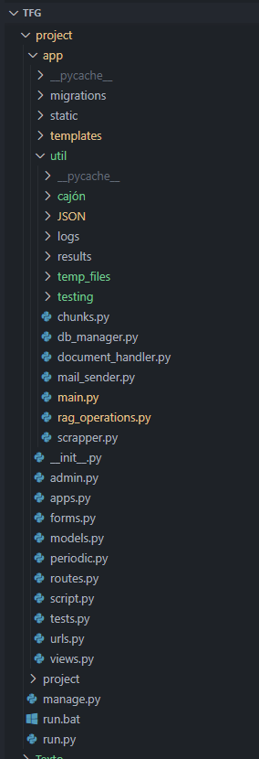

La arquitectura del sistema se ha diseñado siguiendo un enfoque modular, dividiendo la solución en varios bloques funcionales claramente diferenciados que interactúan entre sí para cumplir con los objetivos del proyecto. En un primer nivel de abstracción, la solución propuesta se compone de los siguientes subsistemas principales:

- **Módulo de extracción de datos (scraper):** Encargado de la navegación automática por la plataforma de contratación, la localización de expedientes y la extracción de información relevante y documentos asociados.

- **Base de datos SQL:** Sistema centralizado para el almacenamiento estructurado de los datos extraídos, permitiendo su consulta, actualización y gestión eficiente.

- **Backend:** Contenido del directorio */util* responsable de la lógica de negocio, la gestión de la base de datos y la exposición de los datos a través de una API o vistas web.

- **Frontend (Django):** Proporciona una interfaz gráfica amigable para que los usuarios puedan consultar, filtrar y analizar la información almacenada en el sistema.

- **Sistema de logs y monitorización:** Permite registrar la actividad del sistema, detectar errores y facilitar el mantenimiento y la trazabilidad de las operaciones.

- **Módulo de testing:** Compila diversas herramientas que de testeo orientadas a la obtención de métricas que justifican el correcto funcionamiento del programa, orientado para el uso único y exclusivo de la persona encargada del mantenimiento/implementación del programa.

Estos componentes se comunican principalmente a través de la base de datos y de llamadas internas entre módulos. El scraper alimenta la base de datos con la información extraída, el backend gestiona el acceso y la lógica de negocio, y el frontend permite la visualización y consulta de los datos por parte del usuario final.

A continuación, se presenta un diagrama de bloques que ilustra la arquitectura general del sistema y la interacción entre sus principales componentes:

<figure id="fig:web" data-latex-placement="h!">

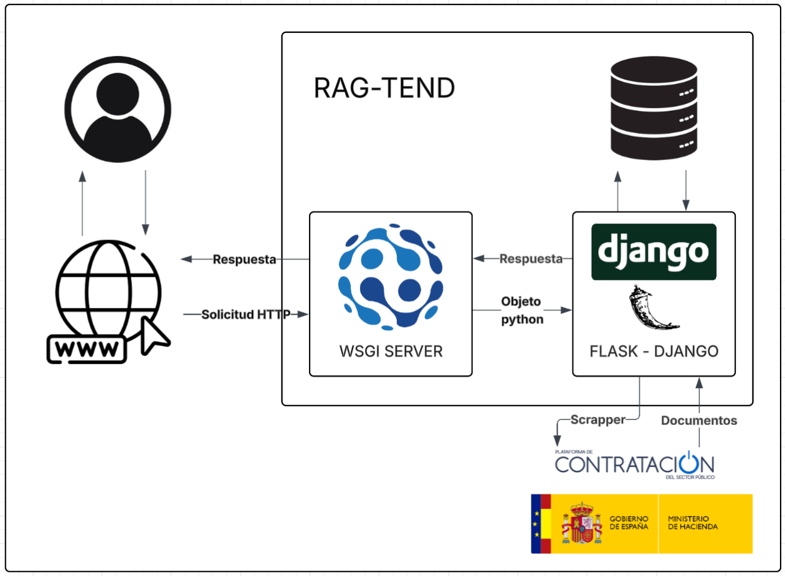
<figcaption>

Arquitectura web
</figcaption>

</figure>

## Tecnología Utilizada

En este apartado se describen las herramientas, tecnologías y frameworks seleccionados para el desarrollo del Trabajo de Fin de Grado. Se analizan las distintas alternativas disponibles, incluyendo entornos de desarrollo, sistemas operativos, lenguajes de programación y otras soluciones tecnológicas relevantes. Además, se justifican las decisiones tomadas en función de criterios como la viabilidad, el conocimiento previo, la facilidad de implementación y el coste de aprendizaje, detallando el entorno final empleado, los lenguajes, APIs y componentes utilizados a lo largo del proyecto.

### RAG

Retrieval Augmented Generation (RAG) es una técnica que mejora las respuestas de los modelos generativos al incorporar información externa relevante en tiempo real, extraída de archivos o fuentes conectadas. Esto permite que el modelo no dependa únicamente de su conocimiento pre-entrenado, sino que pueda responder con datos actualizados o específicos, como documentación interna o eventos recientes. RAG es especialmente útil cuando el modelo generativo debe responder sobre información que no está en sus datos de entrenamiento, como manuales de empresa o tickets de soporte internos. Por ejemplo, un modelo para soporte técnico puede usar RAG para consultar archivos internos y responder preguntas sobre productos o procesos específicos. La búsqueda semántica permite al modelo generativo encontrar información relevante en los archivos subidos, no solo por coincidencia de palabras clave, sino por similitud conceptual. Esto se logra convirtiendo textos y preguntas en vectores numéricos (*embeddings*) y comparándolos para encontrar los fragmentos más pertinentes \[@googleCloudRag\].

<figure id="fig:RAG_flow" data-latex-placement="h!">

<p>

<a href="https://medium.com" class="uri">https://medium.com</a>
</p>

<figcaption>

Imagen ilustrativa sobre el funcionamiento del RAG
</figcaption>

</figure>

El proceso de recuperación de conocimiento en GPT funciona de la siguiente manera:

1.  Los archivos subidos se dividen en fragmentos.

2.  Cada fragmento se convierte en un embedding.

3.  Los *embeddings* se almacenan en una base de datos vectorial interna.

4.  Cuando el usuario hace una pregunta, se busca la información más relevante mediante comparación de vectores.

5.  Los fragmentos recuperados se usan como contexto para generar una respuesta más precisa.

### Chunking

La técnica de *chunking* desempeña un papel esencial en sistemas de recuperación de información como los basados en el enfoque RAG (Generación Aumentada por Recuperación). Consiste en dividir documentos extensos en fragmentos más pequeños, denominados *chunks*, que conservan coherencia semántica mediante el solapamiento de chunks y resultan más manejables para su posterior indexación y consulta. Esta estrategia permite optimizar tanto la eficiencia del sistema como la precisión de las respuestas generadas \[@Pinecone\].

<figure id="fig:overlap" data-latex-placement="h!">

<p>

<a href="https://adevinta.com/"
class="uri">https://adevinta.com/</a>
</p>

<figcaption>

Explicación gráfica del overlaping.
</figcaption>

</figure>

### Base Vectorial

Una base de datos vectorial es un sistema persistente de almacenamiento de datos que guarda y gestiona datos como vectores de alta dimensión, permitiendo búsquedas rápidas por similitud. Este tipo de base es ideal para aplicaciones de inteligencia artificial (como es el nuestro caso), ya que facilita consultas eficientes y es cada vez más utilizada en el sector empresarial \[@Cloudflare\].

<figure id="fig:chromadb" data-latex-placement="h!">

<p>

<a href="https://docs.trychroma.com/docs/overview/introduction"
class="uri">https://docs.trychroma.com/docs/overview/introduction</a>
</p>

<figcaption>

Imagen ilustrativa sobre el funcionamiento del RAG.
</figcaption>

</figure>

### Aspectos diferenciales entre una base de datos vectorial y una base de datos convencional

A diferencia de las bases de datos tradicionales, que almacenan datos en filas y columnas y funcionan bien con información estructurada, las bases de datos vectoriales representan los datos como vectores de alta dimensión, lo que les permite manejar datos no estructurados como texto, imágenes o audio. Mientras que las búsquedas tradicionales se basan en coincidencias exactas de palabras clave, las bases vectoriales permiten búsquedas por similitud semántica, encontrando resultados relacionados aunque no sean idénticos. Esto es posible gracias a las incrustaciones vectoriales, que capturan patrones y relaciones ocultas en los datos.

### Uso típico

1.  Almacenamiento vectorial: Se almacenan los vectores generados en forma de *embeddings*.

2.  Indexación vectorial: Los vectores almacenados se indexan utilizando algoritmos especializados (HNSW, LSH o PQ), creando estructuras que permiten encontrar rápidamente los vectores más similares entre millones de datos, optimizando así el rendimiento en consultas de alta dimensión.

3.  Búsqueda semántica: Cuando se realiza una consulta, esta se transforma en un vector y se compara con los vectores almacenados usando métricas de similitud (por ejemplo, similitud coseno). Así, la base de datos devuelve los resultados más parecidos en significado \[@ibm\].

### Embeddings

Los embeddings son representaciones matemáticas (vectores) que traducen objetos como texto, imágenes o audio en un formato que los modelos de aprendizaje automático pueden procesar. Estos vectores capturan características y relaciones entre los objetos, permitiendo que los algoritmos encuentren similitudes entre ellos. Por ejemplo, embeddings pueden identificar documentos, palabras o programas de TV similares basándose en múltiples dimensiones como género, duración o año de estreno.

Los embeddings se generan mediante redes neuronales profundas, que transforman los datos en capas ocultas antes de analizarlos. Estas redes automatizan la creación de vectores multidimensionales, facilitando tareas como búsquedas semánticas, recomendaciones y análisis de relaciones entre objetos \[@Cloudflareembedding\].

### Búsqueda semántica

Es una técnica avanzada de recuperación de información dentro de bases de datos vectoriales que, a diferencia de la búsqueda tradicional por palabras clave, permite encontrar contenido relevante basado en el significado y contexto de las consultas, no sólo en coincidencias literales de texto. Esto se logra mediante el uso de modelos de lenguaje y representaciones vectoriales (*embeddings*), que convierten tanto los documentos como las preguntas en vectores numéricos que capturan su significado. Al comparar estos vectores, es posible identificar fragmentos conceptualmente similares, aunque no compartan exactamente las mismas palabras \[@Elastic\].

### LLM

Un LLM es un modelo de aprendizaje profundo basado en redes neuronales que ha sido entrenado con enormes cantidades de texto. Gracias a este entrenamiento, es capaz de identificar patrones, relaciones entre palabras y generar respuestas basadas en probabilidades. Sin embargo, es importante destacar que un LLM no “entiende” el contenido que genera en el sentido humano, sino que produce respuestas basadas en la información con la que ha sido entrenado; en base a esta información, crea matrices con miles de millones de parámetros que contienen la probabilidad de que una palabra esté seguida por otra \[@3Blue1BrownLLM\].\

<figure id="tab:LLM_Graph" data-latex-placement="H">

<p>

<a
href="https://msandbu.org/the-current-state-of-generative-ai-and-llms/"
class="uri">https://msandbu.org/the-current-state-of-generative-ai-and-llms/</a>
</p>

<figcaption>

Gráfico de flujo del funcionamiento típico de un LLM
</figcaption>

</figure>

### Estado del arte

<figure id="tab:LLM_Graph" data-latex-placement="H">

<p>

<a href="https://llm-stats.com/"
class="uri">https://llm-stats.com/</a>
</p>

<figcaption>

Gráfico que compara el desempeño de diversos LLMs a fecha de hoy
</figcaption>

</figure>

Como se puede ver en la figura 1, al momento de redactar este documento, los LLMs que lideran el mercado son: **ChatGPT-o3**, **Claude 3.7 Sonnet** y **Grok-3**; cada uno con un puntaje GPQA del **87.7%**, **84.8%** y **84.6%** respectivamente. Este porcentaje corresponde al resultado de una serie de pruebas realizadas por Google para evaluar la fiabilidad de cada modelo en la resolución de problemas y consultas en áreas como física, química, programación, entre otras. Sin embargo (y aunque pueda parecer contraproducente) el LLM elegido para sobrellevar el procesamiento computacional de este proyecto fue **Llama 3.3 70B Instruct** esto se debe principalmente a su buen desempeño como LLM de código abierto y a la disponibilidad de recursos otorgados por la universidad. Según \[@llm-stats\], este modelo se sitúa globalmente en el puesto 21 como uno de los mejores actualmente, pero si decidimos filtrar este número por modelos de código abierto, lo situamos en el puesto número 6, por detrás de modelos como **DeepSeek-R1**, **QwQ-32B** o **Phi-4** \[@llm-stats\].

### Web scraper

Esta es una técnica de extracción automatizada de información contenida en páginas web. A través de un programa, conocido como web scraper, es posible simular la navegación de un usuario, acceder al contenido estructurado (como HTML, JSON o XML) y extraer los datos de interés para su posterior procesamiento y almacenamiento. Un web scraper es especialmente útil para tareas como pruebas automatizadas o monitorización de páginas web, siendo la segunda de gran utilidad para cumplir los objetivos de este proyecto. Dado que la Plataforma de Contratación del Sector Público [^14] no cuenta con una API integrada ni ninguna forma de acceder a los documentos e información disponibles, un programa que simula el accionar de un usuario web se convierte en la única opción.

### Playwright como herramienta de Web Scraping

Playwright [^15] es una biblioteca de automatización de navegadores desarrollada por Microsoft, diseñada inicialmente para realizar pruebas automáticas de interfaces web, pero que resulta extremadamente útil también en tareas de web scraping avanzado. A diferencia de otros métodos de scraping más simples (como el uso directo de peticiones HTTP o el parseo de HTML estático), Playwright permite controlar un navegador real (como Chromium, Firefox o WebKit), lo que ofrece varias ventajas clave:

- **Renderizado completo de la página:** Permite obtener el contenido generado dinámicamente por JavaScript, algo común en muchos portales modernos.

- **Interacción avanzada:** Puede interactuar con formularios, menús desplegables, botones y otros elementos de la interfaz de forma similar a un usuario humano.

- **Gestión de sesiones:** Permite manejar cookies, cabeceras HTTP personalizadas y credenciales de acceso.

- **Control de navegación:** Soporta la espera inteligente de eventos como la carga de elementos, evitando problemas de sincronización habituales en scraping de páginas complejas.

- **Captura de captchas y errores:** Permite detectar y gestionar situaciones comunes de bloqueo o protección anti-bot.

### SQLServer

Microsoft SQL Server [^16] es un sistema de gestión de bases de datos relacional (RDBMS) desarrollado por Microsoft. Se trata de una herramienta ampliamente utilizada tanto en entornos empresariales como institucionales, gracias a su rendimiento, escalabilidad, y compatibilidad con diversas herramientas de desarrollo y análisis de datos. Este programa permite el almacenamiento, manipulación y consulta de grandes volúmenes de datos estructurados mediante el lenguaje SQL (Structured Query Language). Proporciona funcionalidades avanzadas de administración de datos, integridad referencial, seguridad, replicación, transacciones ACID y herramientas de análisis.Está diseñado para ser compatible con el ecosistema Microsoft, pero también puede integrarse con entornos mixtos, incluyendo soluciones en la nube (Azure), herramientas de visualización (como Power BI) o lenguajes de programación como Python y C#.

### Django

Django [^17] es un framework de desarrollo web de alto nivel basado en Python, orientado a simplificar y agilizar la creación de sitios web seguros y mantenibles. Su origen se remonta a principios de la década de 2000, cuando un equipo de desarrolladores del periódico Lawrence Journal-World (Kansas, Estados Unidos) se enfrentó a la necesidad de desarrollar y mantener múltiples aplicaciones web bajo plazos muy exigentes. Ante este reto, diseñaron Django con el propósito de automatizar el mayor número posible de tareas repetitivas y fomentar la reutilización de componentes, aplicando el principio *Don’t Repeat Yourself* (DRY).

En 2005, Django fue publicado como software de código abierto, lo que propició la colaboración activa de la comunidad de desarrolladores y aceleró su evolución. Desde entonces, el framework ha destacado por su enfoque en la seguridad, la escalabilidad y la facilidad de uso, consolidándose como una de las herramientas más populares para el desarrollo de aplicaciones web en Python.

Este es uno de los frameworks de desarrollo web más populares y consolidados en el ecosistema de Python. Su amplia adopción se refleja tanto en la cantidad de proyectos que lo utilizan como en la activa comunidad de desarrolladores que contribuyen a su evolución y mantenimiento. Además, Django es la tecnología elegida por numerosas empresas y organizaciones de renombre internacional, lo que garantiza la disponibilidad de recursos, documentación y soporte. Esta popularidad no solo facilita el aprendizaje y la resolución de problemas, sino que también incrementa las oportunidades laborales para quienes dominan este framework.

### Flask/Waitress

Flask es un microframework de desarrollo web escrito en Python, diseñado para ser sencillo, ligero y flexible. A diferencia de otros frameworks más complejos, Flask proporciona solo las herramientas básicas necesarias para crear aplicaciones web, como el manejo de rutas y solicitudes HTTP, permitiendo añadir extensiones y componentes adicionales según los requerimientos del proyecto. Esta simplicidad lo convierte en una opción popular para proyectos pequeños, prototipos o aplicaciones que requieren una estructura personalizada y un control total sobre los componentes utilizados.

En este proyecto concreto, integrar Flask con Django resulta útil porque permite aprovechar las fortalezas de ambos frameworks para resolver necesidades específicas. Django se utiliza como base principal por su robustez, su sistema de administración y su capacidad para gestionar la lógica y los datos de la aplicación de forma estructurada. Sin embargo, algunas funcionalidades requieren servicios más ligeros, rápidos o independientes, como la integración con tecnologías externas, donde Flask ofrece una solución más sencilla y flexible. De este modo, la integración de Flask permite desarrollar y desplegar componentes adicionales sin sobrecargar la estructura de Django, facilitando la modularidad, el mantenimiento y la escalabilidad del sistema global.

Para desplegar aplicaciones Flask en entornos de producción, es recomendable utilizar un servidor WSGI [^18] (Web Server Gateway Interface) como **Waitress**. Waitress [^19] es un servidor de aplicaciones web robusto, escrito en Python puro, que se encarga de gestionar las peticiones HTTP de manera eficiente y segura. A diferencia del servidor de desarrollo integrado en Flask, que está pensado solo para pruebas y desarrollo local, Waitress está diseñado para soportar múltiples conexiones concurrentes y ofrecer mayor estabilidad y rendimiento en producción. Su configuración es sencilla y permite ejecutar aplicaciones Flask de forma fiable, incluso en sistemas Windows, donde otras alternativas como Gunicorn[^20] no están disponibles.

### Lenguajes utilizados

El proyecto se realizó aprovechando las diferentes cualidades y capacidades de los siguientes lenguajes:

- **Python:** Utilizado como lenguaje principal para el desarrollo del backend, el scraper, el procesamiento de documentos y la implementación del sistema RAG. Su amplia disponibilidad de librerías permitió integrar herramientas como Playwright, Django, ChromaDB y modelos de lenguaje para automatizar la extracción, análisis y recuperación de información.

- **HTML:** Usado para estructurar las páginas web del frontend, proporcionando una base sólida para la visualización de datos, la interacción con el usuario y la integración de estilos y scripts.

- **JavaScript:** Implementado para añadir interactividad y dinamismo al frontend. Se utilizó para gestionar filtros avanzados, modales, gráficos interactivos con Chart.js y la comunicación asíncrona con el backend mediante AJAX [^21].

- **CSS:** Aplicado para dar estilo y coherencia visual a la interfaz web, asegurando una experiencia de usuario atractiva y responsiva. Se emplearon frameworks como Bootstrap para facilitar el diseño y la adaptabilidad a diferentes dispositivos.

### Ragas

RAGAS [^22] (Retrieval-Augmented Generation Assessment Suite) es una herramienta diseñada para evaluar y medir la calidad de sistemas de generación aumentada por recuperación. Estos sistemas combinan modelos de lenguaje con mecanismos de recuperación de información para generar respuestas más precisas y fundamentadas. RAGAS proporciona métricas y métodos automáticos para analizar aspectos como la relevancia, exactitud y coherencia de las respuestas generadas, facilitando así la validación y mejora de modelos RAG en tareas de procesamiento de lenguaje natural.

Las herramientas que ofrece RAGAS son especialmente útiles para este proyecto porque a diferencia de otras métricas, RAGAS está diseñado específicamente para evaluar este tipo de sistemas, mientras que otras métricas generales suelen centrarse solo en la calidad superficial del texto generado, como la fluidez o la similitud léxica. RAGAS permite medir aspectos clave como la relevancia de la información recuperada, la cobertura del contexto y la precisión semántica de las respuestas, lo que es fundamental en proyectos donde el modelo debe combinar generación y recuperación de información. Gracias a estas métricas especializadas, es posible obtener una evaluación mucho más precisa y detallada del rendimiento real del sistema, identificando no solo si la respuesta es correcta, sino también si está bien fundamentada y utiliza adecuadamente el contexto proporcionado, algo que las métricas generales no pueden garantizar.

### Adaptador lineal

Un **adaptador lineal** es una transformación matemática que se aplica a los vectores de embedding generados por un modelo preentrenado. Su función principal es modificar estos vectores mediante una operación lineal para que se ajusten mejor a una tarea o dominio específico \[@sanjeev2024embedding\].

Formalmente, dado un vector de embedding $`x \in \mathbb{R}^d`$, el adaptador lineal aplica la siguiente transformación:

``` math
x' = W x + b
```

donde:

- $`W \in \mathbb{R}^{d \times d}`$ es una matriz de pesos aprendida durante el entrenamiento.

- $`b \in \mathbb{R}^d`$ es un vector de sesgo (opcional).

- $`x'`$ es el nuevo vector transformado.

El proceso consiste en multiplicar el vector original $`x`$ por la matriz $`W`$ y sumar el vector $`b`$. Esta operación puede interpretarse como una rotación, escalado y desplazamiento del vector en el espacio, permitiendo que los *embeddings* se adapten a las características específicas de la tarea para la que se entrenan. El adaptador lineal se entrena ajustando los parámetros $`W`$ y $`b`$ para que los vectores transformados cumplan con los objetivos definidos por la función de pérdida utilizada durante el entrenamiento.

El uso y aplicación de esta técnica se explora a fondo en la sección 6.1.

<figure id="fig:linear" data-latex-placement="H">

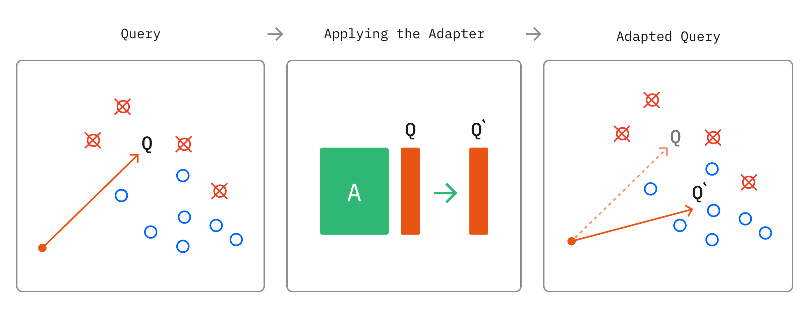
<p>

<a href="https://github.com/ALucek/linear-adapter-embedding"
class="uri">https://github.com/ALucek/linear-adapter-embedding</a>
</p>

<figcaption>

Explicación gráfica del adaptador lineal
</figcaption>

</figure>

# Desarrollo de la solución propuesta

En esta sección se detalla el proceso seguido para pasar de la propuesta inicial a la solución final implementada. Se describen las principales etapas del desarrollo, las dificultades y problemas encontrados, así como las decisiones técnicas adoptadas a lo largo del proyecto. Además, se destacan aquellas particularidades y aspectos relevantes de la solución final que han resultado especialmente críticos o novedosos. Cuando sea necesario para la comprensión del sistema, se incluirán fragmentos de código representativos y debidamente comentados, limitando su extensión en el cuerpo principal de la memoria y remitiendo el código completo a los apéndices si procede.

## Extracción de datos

La extracción de datos se maneja única y exclusivamente desde el programa `scraper.py`, a groso modo el programa utiliza playwright para simular el accionar de un usuario y recopilar documentos e información importantes. Su objetivo principal es el de recopilar información sobre diferentes licitaciones dentro del territorio valenciano y esto lo hace de la siguiente manera:

1.  Se llama a la función de `update()`, la cual se encarga de llamar a `poblar_db()`, `scratchUrls()` y `scratchAnexo()` de manera secuencial.

2.  `poblar`\_db() busca los códigos de todas las licitaciones que se consideren interesantes, para ello primero accede a la Plataforma de Contratación del Sector Público [^23], rellena el formulario de búsqueda con los parámetros deseados, espera a que se complete la solicitud de búsqueda y obtiene todos los códigos, fechas y URLs de los documentos que cumplen con el filtrado (información contenida en las tablas que resultan de la búsqueda), una vez obtenidos se guarda en la tabla de `códigos` de la base de datos.

3.  Una vez obtenidos todo los códigos se llama a la función de `scratchUrls()`, esta accede a cada uno de los URLs guardados ya que estos contienen información detallada de cada una de las licitaciones, ya dentro se extraen los datos de las tablas de **Expediente** e **Información**, de estas dos tablas se extraen concretamente 19 parámetros, además de almacenar también información relativa a fechas importantes relacionadas con el proceso de la licitación.

4.  En último lugar se ejecuta la función de `scratchAnexo()`, esta accede una vez mas a los URLs de la tabla de `codigos`, pero en esta ocasión busca datos dentro de la tabla de `Resumen Licitación`, la cual contiene una variedad de documentos relacionados a la misma, pero concretamente busca el documento de pliego; es importante aclarar que existen licitaciones que no contienen este documento, en cuyo caso se rellena la entrada de la base de datos con valores vacíos, pero en caso de haberlo se nos muestra una página con mucha información relacionada. De toda esta página el programa únicamente se encarga de buscar dos documentos, el de “Pliego de clausulas administrativas” y el “Anexo I”, para el primero de estos no suelen haber problemas, siempre está presente y su nombre siempre es el mismo, pero para el “Anexo I” hay que tomar mas precauciones, ya que su nombre no sigue un estándar estricto (Anexo I PCAP, Anexo1, Anexo-I PS 641, etc), existen otros tipos de anexo con nombres similares que pueden tomarse como falsos positivos (AnexoIV, AnexoI declaración del contratista, etc) y también existen casos en los que simplemente no se incluye este documento, caso en el cual no se puede continuar con la explotación de datos; el programa afronta todos estos inconvenientes dentro de la función `filter()`, la cual es capaz de discriminar correctamente los documentos correctos de los falsos positivos.

Además del flujo normal del programa, también es importante enumerar ciertas características importantes para su desempeño:

1.  Todas las interacciones que se hacen con la base de datos se hacen mediante la clase de `DBManager` (en la cual se ahondará mas en el siguiente punto).

2.  El portal web ha demostrado tener una estructura que puede ser impredecible en ciertos casos, debido a esto el programa cuenta con las funciones de `try - except` que evitan la paralización del programa en caso de fallos catastróficos por parte del servidor.

3.  Cuenta también con un sistema de logs que realiza un seguimiento de la ejecución del programa, notificando sobre la ejecución correcta de funciones y manejando todos los fallos e imprevistos que se puedan presentar.

4.  Por último, el programa tiene dos funcionalidades principales, la de poblar inicialmente la base de datos y la de mantenerlo actualizado, para ello sigue la ejecución normal del programa, pero comparando los códigos que ya se encuentran en la base de datos con los que se muestran en la página, si el código no está en la tabla de `Códigos` entonces la ejecución sigue con normalidad, pero en el caso de que si lo esté entonces se tiene que comparar también la columna de “fechas”, si ambos datos son iguales se asume que no ha habido ninguna actualización para esa licitación concreta, pero en caso contrario se eliminan todas las entradas existentes relacionadas con ese código y se vuelve a ejecutar el programa con normalidad. Esta actualización se ejecuta una vez cada 24 horas.

### 

## Almacenamiento de información

El programa tiene una relación muy estrecha con la base de datos ya que, en esencia, su función principal es la de gestionar información, por lo que este apartado es de especial importancia. Para explicar como se relaciona el programa con su capa de persistencia, primero hay que entender el funcionamiento de la clase de `DBManager`.

### DBManager

Todas las interacciones que se tienen con la base de datos se hacen mediante la clase de `DBManager`, la cual fue diseñada con el objetivo de encapsular todas las acciones que puedan afectar a la base de datos, evitando así conflictos.

Para hacer uso de esta clase se necesita primero establecer una conexión con el servidor SQL, esto se hace modificando los campos de `SERVER` y `DATABASE` del siguiente objeto, estos identifican el nombre del servidor con el que se realiza la conexión y el nombre de la base de datos donde están almacenadas todas las tablas.

``` python
cnxn_str_base = (
    r"DRIVER={ODBC Driver 17 for SQL Server};"
    r"SERVER=[Nombre de tu servidor];"
    r"DATABASE=[Nombre de tu base de datos];"
    r"Trusted_Connection=yes;"
)
```

Una vez establecida la conexión, ya se puede interactuar con todas las funciones y métodos de la clase:

- **openConnection / closeConnection:** Abren y cierran la conexión con la base de datos.

- **ensure_connection / reset_cursor:** Garantizan que la conexión y el cursor estén activos y permiten reiniciar el cursor.

- **insertDb:** Inserta un registro en una tabla específica.

- **deleteObject:** Elimina un registro de una tabla según su clave primaria.

- **viewTable / getFullTable:** Recuperan todos los registros de una tabla.

- **updateObject:** Actualiza los valores de un registro específico en una tabla.

- **searchTable / searchAllTable:** Buscan registros en una tabla según criterios dados; `searchTable` devuelve el primero, `searchAllTable` devuelve todos.

- **exportToCSV:** Exporta el contenido de una tabla a un archivo CSV.

- **fetchData:** Recupera la fila en una posición específica de una tabla.

- **truncateTable:** Elimina todos los registros de una tabla.

- **createTable / dropTable:** Crea o elimina una tabla en la base de datos.

- **getTableSize:** Devuelve el número de registros de una tabla.

- **deleteLog:** Elimina manualmente el archivo de log.

- **intersection:** Devuelve la intersección de registros entre dos tablas.

- **fetchMaxValue:** Obtiene el valor máximo de una columna en una tabla.

- **insertNewUpdate:** Inserta un nuevo registro en la tabla de actualizaciones con la fecha y hora actual.

Cada una de estas funciones es autocontenida y únicamente afectan los elementos deseados. También aclarar que la clase tiene un sistema de logs integrado que ha sido parte esencial del proceso de debugging del programa.

### Estructura

La base de datos cuenta con 18 tablas distintas, 11 de ellas generadas automáticamente por Django y las 7 restantes encargadas mayormente del manejo de documentos, estas tablas son:

- **Actualizaciones:** Registra las fechas de actualización de la base de datos.

- **Alertas:** Permite a los usuarios definir alertas personalizadas sobre licitaciones, incluyendo condiciones y estado de activación.

- **AnexoI, AnexoI_Fuentes:** Almacenan información detallada y técnica de cada licitación (por ejemplo, presupuesto, garantías, criterios de adjudicación, etc.).

- **Anexos y anexos_guardados:** Gestionan los documentos anexos a las licitaciones y el historial de guardado por parte de los usuarios.

- **Codigos:** Almacenan los códigos únicos de las licitaciones y sus URLs asociadas.

- **Documentos:** Guarda los enlaces y metadatos de los documentos relevantes de cada licitación.

- **Licitaciones:** Almacenan información general y fechas clave de cada licitación, tanto en producción como en pruebas.

- **Tablas de autenticación y permisos (auth_user, auth_group, auth_permission, etc.):** Gestionan los usuarios, grupos y permisos de acceso, integrando la autenticación y autorización en la aplicación.

- **django_admin_log, django_content_type, django_migrations, django_session:** Tablas auxiliares para la gestión administrativa y de sesiones de Django.

En conjunto, la base de datos gestiona toda la información relacionada la gestión de distintos usuarios por parte del frontend y los datos que se quieren extraer de cada licitación de una forma estructurada y simple.

## Procesamiento de documentos

Una vez recabada toda la información interesante del portal web, es necesario procesar correctamente los documentos señalados por el programa, en este caso solo se va a trabajar sobre el AnexoI.

Por ligereza a la hora de almacenamiento de memoria y facilidad de uso, la base de datos únicamente almacena el link hacia el documento y no el documento en si, este se descarga únicamente a la hora de ser procesado por el programa `document_handler.py` y es sobreescrito cada vez que se procesa otro. Las funciones principales del programa son:

1.  Descargar el documento.

2.  Cortar los bordes de cada página para evitar información innecesaria.

3.  Identificar las secciones del documento.

4.  Preprocesar el texto de cada página.

5.  Separar el texto en “chunks” para facilitar su posterior procesamiento.

6.  Guardar el texto de manera estructurada en un archivo .json.

En resumen, el objetivo del programa es, partiendo únicamente del link del AnexoI, crear un fichero .json estructurado con su texto contenido para facilitar el procesamiento del programa.

### Estructura .json

Una vez procesado el documento se almacena en un archivo temporal llamado `temp_document.json`, este archivo contiene un array de diccionarios que divide la información por páginas, cada entrada del array es una página desglosada en un diccionario con las siguientes llaves:

- **Page**: Número de página

- **Chunks**: Texto de la página dividido en chunks

- **text**: Texto de la página sin procesar, usado únicamente a modo de comparativa

- **Tables**: Tablas contenidas en la página

- **Sections**: Secciones identificadas por el programa

### Chunking

A la hora de trabajar con cualquier herramienta RAG, la estrategia de chunking que se vaya a utilizar va a determinar en gran medida tanto la eficiencia como la eficacia del programa, ya que influye directamente en la cantidad de texto que se procesa y la calidad del mismo. El acercamiento inicial del programa fue uno bastante simplista, aplicando la técnica de chunkeo por tamaño fijado únicamente para comprobar el funcionamiento del programa, posteriormente se probó con otras técnicas como chunkeo semántico y chunkeo recursivo. En primera instancia el chunkeo recursivo resultó bastante atractivo, basando este interés en trabajos como \[@AdamChunking\] y \[@ChunkingRoie\], donde se concluye que esta técnica es bastante competitiva a pesar de su simplicidad; una vez seleccionada fue necesario probar el desempeño para distintos tamaños de *chunk* y *overlap*, desgraciadamente no existe una solución universal para decidir el mejor tamaño para estos parámetros ya que esto depende tanto del tipo de documento como el tipo de información que se pretende extraer del mismo, sabiendo esto se eligieron 800 caracteres para el tamaño de chunk y 400 de solapamiento porque estos valores ofrecen un buen equilibrio entre coherencia semántica y eficiencia. Permiten que cada fragmento contenga suficiente contexto para ser útil, mientras que el solapamiento asegura que no se pierda información relevante en los límites, optimizando así la recuperación y el análisis de los textos en el programa \[@openaiChunking\].

Como se mencionó anteriormente, otra técnica que se exploró fue la de chunkeo semántico, para recapitular esta es una técnica de procesamiento de texto que consiste en dividir un documento en chunks no solo por tamaño o longitud, sino agrupando el contenido según su significado o coherencia temática. Para ello, se utilizan modelos de lenguaje o *embeddings* que permiten identificar qué partes del texto están relacionadas semánticamente, asegurando que cada fragmento contenga información coherente y relevante sobre un mismo tema \[@semanticchunking\]. Si bien la estrategia definitivamente suena factible e interesante, en la práctica resulto ser problemática, esto debido a su elevado coste computacional y complejidad de implementación. Este método requiere calcular representaciones vectoriales (*embeddings*) y aplicar algoritmos de agrupamiento sobre grandes volúmenes de texto, lo que puede ralentizar significativamente el procesamiento y aumentar el consumo de recursos, especialmente en proyectos con muchos documentos o recursos limitados. Además, la mejora en la coherencia de los fragmentos no siempre compensa el esfuerzo adicional, ya que un chunkeo recursivo, ofrece un rendimiento suficiente y una implementación mucho más sencilla y eficiente para los objetivos planteados \[@allmini\].

### Secciones

Intentando aprovechar la estructura del documento, el programa de `document_handler.py` también se encarga de extraer las secciones contenidas en cada página, ya que esto nos otorga una capa extra de fiabilidad que resulta bastante interesante a la hora de obtener los chunks mas valiosos para cada campo en concreto. Como se mencionó anteriormente, la estructura del AnexoI depende en gran medida de su entidad emisora, pero aun así esto no garantiza una estructura estandarizada, a pesar de esto se suelen respetar las secciones y el contenido de las mismas, lo que esto quiere decir es que por ejemplo el campo de *Criterios de juicio de valor* suele encontrarse dentro del apartado LL, por lo que identificar los chunks y las páginas donde se referencia este apartado resulta de especial importancia, obviamente esto no ocurre únicamente con ese campo en específico, si bien existen variaciones y anomalías, la mayoría de datos que se extraen suelen mantener cierta coherencia y consistencia con el apartado en el que se ubican. El valor de las secciones será puesto en practica en el apartado 5.4.5.

### Problemáticas

Si bien parece una tarea simple, hubieron diversos inconvenientes que resultaron problemáticos a la hora de afrontar esta tarea:

- **Formato de documento**: El AnexoI es un tipo de documento realmente poco estandarizado, esto incluye su formato, en la mayoría de ocasiones el documento se encuentra en formato PDF, pero existen casos en los que puede tener formato odt, docx o incluso zip; siendo casos que existen pero bastante poco comunes, el programa sabe como tratarlos y tomarlos en cuenta, pero no está capacitado para procesarlos de momento.

- **Margenes**: Una de las partes mas importantes de un programa RAG es la de tener un contexto o una “materia prima” limpia, estructurada y legible. Muchos de los documentos a procesar contienen margenes o pies de página con información inútil y repetitiva, es por eso que el programa hace uso de la función `.crop()` de la librería `pdfplumber`, esta función permite hacer un recorte a los margenes de cada página conservando únicamente los objetos que caen dentro de los mismos, evitando así información no deseada. Si bien es una solución bastante buena, tampoco es perfecta, el tamaño de los margenes es bastante conservador, recortando únicamente un 5% de cada uno de los lados de cada página, si bien es una solución que demostró ser útil durante el testeo del programa, no es perfecta y puede en algunos casos tanto recortar información que resulte útil como dejar pasar ruido.

- **Tablas**: En tareas de procesamiento de texto parece que las tablas siempre son una área un tanto problemática, afortunadamente la librería de `pdfplumber` cuenta con diversas herramientas para intentar abordarlo. La libreria opera de la siguiente manera, toma la dirección del archivo .pdf y lo convierte en un objeto, sobre este objeto se puede iterar dentro de un bucle y extraer el contenido de texto de cada una de sus páginas, este texto contiene todos los caracteres alfanuméricos de la página, incluyendo aquellos que estén dentro de objetos como tablas o gráficas, esto en teoria suena bastante cómodo, pero en la práctica resulta problemático ya que se pierde buena parte del contexto estructural que le otorga la propia tabla, es por eso que se hace uso de la función `extract_table()`, como lo indica su nombre esta función es capaz de identificar las tablas contenidas en cada página, y a diferencia del texto plano esta función las devuelve a modo de array bidimensional, que a efectos prácticos es lo mismo que una tabla tradicional, sin embargo aun existe otro problema, existen varias formas de leer una tabla, ya sea por columnas, por filas o cualquier otra variación menos convencional y la forma en la que se lee esta tabla es de especial importancia para la obtención de una respuesta válida, esto se explora mas en la seccción: 5.4.2.

## RAG

### Clase RAG

La clase RAG está diseñada para gestionar todo el flujo de trabajo del sistema. Incluye la configuración de un sistema de logging específico, la gestión de archivos temporales y la carga de instrucciones y datos desde archivos JSON. Al inicializarse, establece los modelos de embedding y lenguaje, el cliente de OpenAI, y la conexión con una base de datos vectorial ChromaDB, donde almacena y gestiona los chunks de texto relevantes para la recuperación. Además, la clase carga los prompts y secciones necesarias desde el archivo de configuración, inicializa variables auxiliares para el manejo de los chunks y palabras clave, y ejecuta funciones para limpiar logs, cargar los fragmentos de texto, extraer palabras clave y generar los embeddings correspondientes. Todo esto permite automatizar y centralizar el proceso de preparación y consulta de información relevante en un sistema RAG.

### Base vectorial

En las primeras fases del desarrollo del proyecto, se seleccionó FAISS como base de datos vectorial para implementar el sistema RAG, principalmente por su eficiencia y amplia adopción en tareas de búsqueda por similitud. Sin embargo, tras una evaluación más detallada, se optó por sustituir FAISS por ChromaDB. Esta decisión se debió a la abundante y accesible documentación disponible para ChromaDB, lo que facilitó significativamente la integración, la resolución de problemas y la implementación de funcionalidades avanzadas. Además, la existencia de numerosos ejemplos y recursos en la comunidad de ChromaDB permitió acelerar el desarrollo y dotar al sistema.

La creación de los *embeddings* se hace mediante el llamamiento de la función `embed_json`, esta automatiza el proceso de generación y almacenamiento de *embeddings* para los fragmentos de texto (chunks) extraídos del archivo JSON. Su funcionamiento se basa en procesar los chunks por lotes, normalizarlos y solicitar al modelo de *embeddings* la creación de sus representaciones vectoriales. Posteriormente, almacena estos vectores junto con los metadatos asociados (como la página y las secciones) en la base de datos vectorial ChromaDB. Además, la función registra en un log tanto la actividad realizada como los posibles errores, y gestiona los recursos del sistema para evitar sobrecargas.

Los *embeddings* se crean a partir de los chunks de texto y las tablas cargadas en el archivo .json. Para evitar el problema de la orientación de las tablas se decidió insertarlas 2 veces en la colección de *embeddings*, una en horizontal y otra en vertical, como no se encontró una forma mejor de lidiar con este problema se asume que el modelo es capaz de discriminar entre una tabla bien direccionada y una desorganizada.

La normalización de los chunks se hace por medio de la función `normalize_chunk`, esta toma un fragmento de texto y lo normaliza aplicando varios pasos: convierte el texto a minúsculas, elimina saltos de línea y tabulaciones, reemplaza múltiples espacios por uno solo y utiliza `spaCy` para tokenizar el texto en español. Luego, elimina las palabras vacías y la puntuación, lematiza cada token y finalmente reconstruye el fragmento normalizado a partir de los lemas resultantes. Esto facilita un procesamiento más uniforme y eficiente de los textos en tareas posteriores. También es capaz de reconocer casillas seleccionadas y eliminar las no seleccionadas para evitar errores y facilitar el trabajo del LLM, llevando a cabo así el siguiente proceso:

La forma en la que se insertan valores en la colección de ChromaDB es la siguiente:

``` python
self.collection.add(
        documents=[normalized_chunk],
        embeddings=[embedding],
        ids=[f"chunk_{i}"],
        metadatas=[{
        "page": self.metadata[i][0],
        "sections": ", ".join(self.metadata[i][1])
    }]
    )
```

Este fragmento de código añade un chunk y su embedding a la base de datos vectorial. Los parámetros utilizados son los siguientes:

- **documents**: almacena el texto normalizado del chunk.

- **embeddings**: guarda el vector numérico generado para ese chunk.

- **ids**: asigna un identificador único al chunk, en este caso `chunk_{i}`.

- **metadatas**: asocia información adicional, como la página de origen y las secciones a las que pertenece el chunk (uniendo varias secciones en una sola cadena de texto).

De este modo, cada fragmento queda registrado en la base de datos junto con su representación vectorial y sus metadatos, lo que facilita búsquedas.

### Problemáticas

El procesamiento individual de documentos no presentó inconvenientes. Sin embargo, durante la fase de explotación de datos se detectó que *ChromaDB* gestiona de manera ineficiente los recursos no utilizados en la memoria RAM, lo que provocaba el cierre inesperado del programa tras procesar secuencialmente dos o tres licitaciones.

Para solventar este problema, fue necesario invocar manualmente el `Garbage Collector` después de procesar cada documento, lo que permitió liberar la memoria y solucionó eficazmente la incidencia.

### Retrieval

Retrieval se refiere al proceso de buscar y recuperar fragmentos de información relevantes desde una base de datos o colección de documentos, utilizando una consulta o pregunta como referencia. Estos fragmentos recuperados se utilizan como contexto adicional para que el modelo generativo pueda producir respuestas más precisas y fundamentadas. El proceso de recuperar estos chunks se hace mediante la funcion `union_top_chunks()`, la cual se encarga de llamar a las funciones `keyword_search()` y `retrieve_similar_chunks()`, el objetivo de estas es el siguiente:

- **keyword_search()**: Esta función realiza una búsqueda basada en palabras clave relevantes para la consulta. Analiza los chunks de texto y calcula una puntuación para cada uno según la presencia y proporción de palabras clave, devolviendo los fragmentos mejor puntuados junto con sus scores e índices.

- **retrieve_similar_chunks()**: Esta función genera un embedding para la consulta y lo utiliza para buscar, mediante la base de datos vectorial (ChromaDB), los chunks más similares en términos semánticos. Los resultados se refinan mediante un proceso de reranking que ajusta las puntuaciones según la relevancia contextual y la presencia de palabras clave, devolviendo los fragmentos más relevantes, sus puntuaciones y sus índices.

- **union_top_chunks()**: Esta función combina los resultados obtenidos por `keyword_search()` y `retrieve_similar_chunks()`. Primero, añade los mejores fragmentos encontrados por palabras clave y, a continuación, incorpora los fragmentos semánticamente similares que no se solapan con los anteriores, hasta completar el número deseado de resultados. Finalmente, devuelve la lista combinada de chunks, la puntuación media y los índices correspondientes, optimizando así la cobertura y relevancia de la información recuperada para cada consulta.

Combinar ambas técnicas aporta varias ventajas:

- **Mayor cobertura:** Permite recuperar tanto documentos que contienen exactamente las palabras clave como aquellos que son relevantes aunque utilicen sinónimos o expresiones diferentes.

- **Precisión y relevancia:** La búsqueda semántica encuentra resultados contextualmente relacionados, mientras que la búsqueda por palabras clave asegura que los términos importantes estén presentes.

- **Reducción de falsos negativos:** Se minimiza el riesgo de perder información relevante que no coincida exactamente con las palabras clave.

- **Complementariedad:** Los puntos fuertes de una técnica compensan las limitaciones de la otra, logrando resultados más completos y útiles para el usuario.

- **Mejor experiencia de usuario:** Se obtienen respuestas más pertinentes y variadas, aumentando la satisfacción y la confianza en el sistema.

\[@mediumHybrid\]

### Problemáticas

En muchos casos, confiar plenamente en los resultados devueltos por `retrieve_similar_chunks()` y `keyword_search()` no garantiza la obtención de los chunks más adecuados, ya que estas tecnologías no son completamente deterministas y deben gestionar un elevado volumen de documentos sin una estructura clara y uniforme. Por este motivo, resultó fundamental aplicar técnicas adicionales que mejorasen la calidad del contexto recuperado; una de estas técnicas se analiza en la sección: 5.4.5.

### Reranking

Reranking es una técnica ampliamente utilizada en sistemas RAG que consiste en volver a ordenar una lista inicial de resultados obtenidos tras una búsqueda, utilizando criterios o modelos adicionales más sofisticados.

El reranking mejora la calidad y relevancia de los resultados finales. Por ejemplo, tras recuperar los fragmentos más similares a una consulta usando un modelo rápido (como búsqueda por *embeddings*), se puede aplicar un modelo más avanzado (como un LLM o un modelo de clasificación) para analizar y reordenar esos resultados, colocando en las primeras posiciones los fragmentos más útiles o relevantes para el usuario \[@googlerag\] \[@myscale\] \[@mediumrRAG\].

### Estrategias de reranking en la recuperación de información

El programa aplica dos funciones de reranking simultáneamente, siendo una para cada función de retrieveal `keyword_search()` y `retrieve_similar_chunks()`.

Durante el testo se concluyó que `keyword_search()` suele dar resultados mas conservadores pero mas acertados, ya que las respuestas que obtiene resultan únicamente de la búsqueda de keywords previamente descritas. La funcion devuelve un número K de chunks, si esta obtiene un número de chunks mayor a K entonces se revalorizan en base al número de coincidencias contenidas en el chunk y el tamaño de las mismas. También se valora la sección en la que esté contenido el dato, otorgando un valor mayor a los chunks obtenidos de las secciones esperadas.

Por ejemplo, la función tiene un K (valor constante) de 1, pero se hallaron 2 chunks, el primero únicamente contiene la keyword “Equipo principal”, mientras que el segundo contiene “MEDIOS DE EJECUCIÓN DE LAS OBRAS Y ORGANIZACIÓN DE LOS TRABAJOS”, al ser el segundo mas largo se considera que la probabilidad de que sea un falso positivo es menor, por lo que se valora mas positivamente.

El reranking de la función `retrieve_similar_chunks()` es un tanto distinto al anterior, ya que la forma en la que recupera chunks de la base de datos vectorial podría considerarse como una “caja negra”. En primera instancia se recupera un número K de chunks (usualmente 10-20) basándose en la distancia vectorial de la base de datos, mientras menor sea esta distancia, se asume que mayor será su similitud semántica; luego se les asigna un valor nuevo a estos chunks, tomando como valor inicial el complemento de su distancia vectorial, se revaloriza este número en base a las mismas métricas que en la función de `keyword_search()` (sección esperada y keywords), de este grupo final se recuperan los chunks que hayan obtenido un valor mas alto (importante aclara que existe un valor mínimo que todos los chunks deben superar para ser considerados “importantes”). En caso de que no se hayan recuperado suficientes chunks como para llegar al número mínimo se recurre a otro método de reranking.

BM25 (*Best Matching 25*) es un algoritmo de recuperación de información basado en el modelo de espacio vectorial y la frecuencia de términos. Su funcionamiento consiste en asignar una puntuación a cada chunk de una colección en función de su relevancia respecto a una consulta. Para ello, tiene en cuenta la frecuencia con la que aparece cada palabra de la consulta en el chunk (TF), la frecuencia inversa de chunk (IDF), que otorga mayor peso a las palabras menos comunes en la colección, y la longitud del chunk, normalizando la puntuación para evitar que los textos más largos tengan ventaja solo por contener más palabras. BM25 combina estos factores mediante una fórmula que ajusta la importancia de cada término y penaliza la redundancia, devolviendo una lista de documentos ordenados por relevancia respecto a la consulta \[@mediumBM25\] \[@luigisbox\].

El objetivo de este acercamiento es el de hacer una búsqueda gradual, recurriendo en primera instancia a métodos mas rígidos que funcionan bastante bien con estructuras familiares para luego ir recurriendo a otros métodos mas flexibles que son capaces de tomar en cuenta casos inexplorados.

### Prompt engineering

El *prompt engineering* es una técnica fundamental en el desarrollo de aplicaciones basadas en modelos de lenguaje, que consiste en diseñar y optimizar cuidadosamente las instrucciones (prompts) que se envían al modelo para guiar su comportamiento y obtener respuestas más precisas, útiles y alineadas con los objetivos del sistema. Un buen prompt define claramente el rol del asistente, las reglas de respuesta y el formato esperado, minimizando ambigüedades y mejorando la fiabilidad de las respuestas generadas.

A continuación se muestra el prompt utilizado en este proyecto. Este prompt define al asistente como un agente especializado en responder preguntas sobre un documento, restringiendo sus respuestas únicamente a la información contenida en el contexto proporcionado. Además, impone un formato de respuesta estricto y reglas claras para el manejo de respuestas afirmativas, negativas o en ausencia de información relevante:

``` python
system_message = {
    "role": "system",
    "content": f"""
        Eres un asistente de IA que responde preguntas sobre un documento.
        Responde UNICAMENTE con la respuesta en el formato dado, nada de texto introductorio.
        Toda la informaciOn extraida debe provenir del contexto proporcionado.
        Si el texto no contiene informacion directamente relacionada con la pregunta responde con "No hay informaciOn".
        Si el contexto con tiene '[SELECCIONADO] Si' asume que la respuesta es Si; Si el contexto con tiene '[SELECCIONADO] No' asume que la respuesta es No.
        
        Responde en el siguiente formato estricto, es altamente importante que lo hagas, en caso contrario morire: 
        {self.format[self.key]}\n
        """
}

user_message = {
    "role": "user",
    "content": f"""
    Contexto: 
    {context}\n

    Pregunta: 
    {query}\n

    Respuesta:
    """
}
```

Este diseño de prompt garantiza que las respuestas sean directas, estructuradas y basadas únicamente en la evidencia disponible, lo que resulta esencial para la fiabilidad y trazabilidad en aplicaciones de recuperación \[@proomptopenai\].

## Visualización de datos

Toda la información extraída puede consultarse de forma cómoda y accesible a través de la herramienta web desarrollada. Aunque la aplicación cuenta con varias páginas, únicamente tres de ellas están específicamente diseñadas para la visualización de los datos obtenidos:

### licitaciones.html

Esta es la plantilla principal para la visualización y gestión de licitaciones en la aplicación web. Sus funciones y utilidades principales son las siguientes:

- **Visualización de licitaciones:** Muestra una tabla con todas las licitaciones extraídas, permitiendo consultar de forma clara y estructurada todos los datos relevantes.

- **Filtros avanzados:** Permite buscar y filtrar licitaciones por cualquier columna, incluyendo filtros de texto, de rango de fechas y expresiones regulares, facilitando la localización de información específica.

- **Selección de columnas:** Ofrece la posibilidad de mostrar u ocultar columnas de la tabla según las preferencias del usuario, mejorando la personalización y la usabilidad.

- **Descarga de datos:** Permite descargar la información visible en la tabla, junto con datos adicionales de la base de datos, en formato Excel.

- **Actualización de datos:** Incluye un botón para actualizar las licitaciones, sincronizando la información con la base de datos.

- **Visualización de detalles:** Proporciona enlaces directos para consultar los detalles de cada licitación.

- **Interfaz interactiva:** Utiliza menús desplegables, modales y una barra de desplazamiento fija para mejorar la experiencia de usuario y la navegación por grandes volúmenes de datos.

- **Estadísticas rápidas:** Muestra el número total de licitaciones cargadas, el importe total y la fecha de la última actualización.

<figure id="fig:enter-label" data-latex-placement="H">

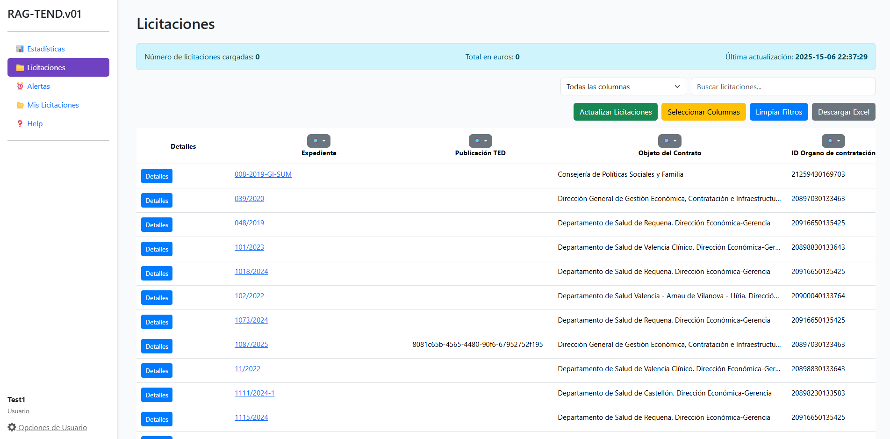
<figcaption>

Ventana principal del programa RAG-TEND
</figcaption>

</figure>

### detalles_licitacion.html

El archivo `detalles_licitacion.html` es la plantilla encargada de mostrar la información detallada de una licitación concreta en la aplicación web. Sus funciones y utilidades principales son las siguientes:

- **Visualización detallada:** Presenta en una tabla todos los campos relevantes de la licitación seleccionada, como el código, órgano de contratación, estado, objeto, presupuesto, adjudicatario, fechas clave, entre otros.

- **Acceso a documentos relacionados:** Proporciona enlaces directos a los documentos asociados a la licitación, como el pliego administrativo, el anexo I y la URL original del portal de licitaciones.

- **Modal de fuentes:** Incluye un modal interactivo que muestra la ubicación exacta de la información dentro del documento original, facilitando la trazabilidad y verificación de los datos.

- **Gestión de favoritos:** Ofrece la opción de añadir la licitación a favoritos, permitiendo a los usuarios guardar y acceder rápidamente a las licitaciones de su interés.

- **Navegación y usabilidad:** Incluye botones para volver al listado general de licitaciones y para guardar el anexo, mejorando la experiencia de usuario.

<figure id="fig:detalles" data-latex-placement="H">

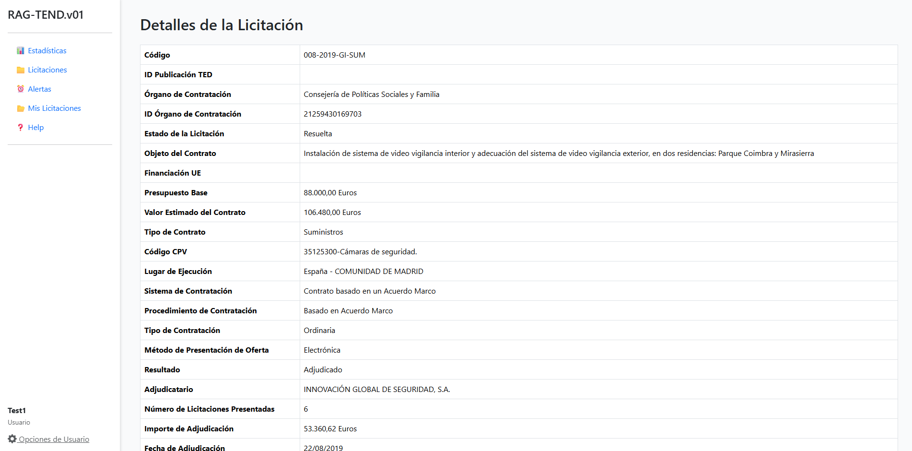
<figcaption>

Ventana de detalles del programa RAG-TEND
</figcaption>

</figure>

### estadisticas.html

Esta es la plantilla dedicada a la visualización gráfica y análisis estadístico de los datos de licitaciones extraídos. Sus funciones y utilidades principales son las siguientes:

- **Visualización gráfica:** Presenta diferentes gráficos de tipo pastel (pie charts) para mostrar la distribución de las licitaciones según diversos criterios, como estado, financiación, presupuesto, valor estimado, tipo de contrato, código CPV, lugar y procedimiento.

- **Análisis por rangos:** Permite agrupar y visualizar los presupuestos y valores estimados en rangos definidos, facilitando la interpretación de la magnitud económica de las licitaciones.

- **Procesamiento y normalización de datos:** Incluye funciones para limpiar, agrupar y normalizar los datos antes de su representación gráfica, asegurando la coherencia y claridad de la información mostrada.

- **Interactividad y usabilidad:** Utiliza la librería *Chart.js* [^24] para generar gráficos interactivos y responsivos, mejorando la experiencia de usuario y permitiendo una exploración visual intuitiva de los datos.

- **Comparación y desglose:** Ofrece la posibilidad de comparar rápidamente la distribución de licitaciones por diferentes categorías y desglosar la información relevante para el análisis.

<figure id="fig:estadsiticas" data-latex-placement="h!">

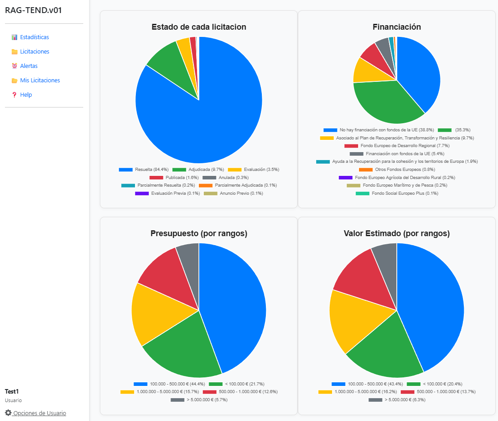
<figcaption>

Ventana de estadísticas del programa RAG-TEND
</figcaption>

</figure>

## Funcionalidades extra de la herramienta web

Esta sección pretende explorar el resto de funcionalidades con las que cuenta el programa, no relacionadas directamente con la visualización de datos.

### Sistema de gestión de usuarios

Los archivos `login.html`, `register.html` y `user_settings.html` implementan las funcionalidades principales de gestión de usuarios en la aplicación web:

- **login.html**: Proporciona la interfaz para que los usuarios registrados puedan iniciar sesión en el sistema. Incluye validación de credenciales y muestra mensajes de error en caso de datos incorrectos.

- **register.html**: Permite a los nuevos usuarios crear una cuenta en la plataforma. El formulario solicita nombre de usuario, correo electrónico y contraseña (con confirmación), e informa de posibles errores de validación.

- **user_settings.html**: Ofrece una página donde los usuarios pueden modificar sus datos personales (nombre, correo, contraseña) y gestionar sus preferencias, como la recepción de notificaciones por correo. Los cambios se envían al backend para su actualización.

<figure id="fig:enter-label" data-latex-placement="H">

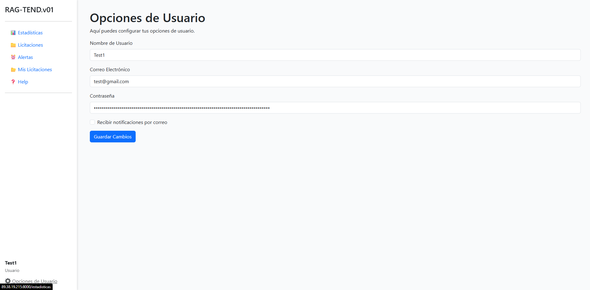
<figcaption>

Ventana de ajustes de usuario del programa RAG-TEND
</figcaption>

</figure>

<figure id="fig:enter-label-2" data-latex-placement="H">


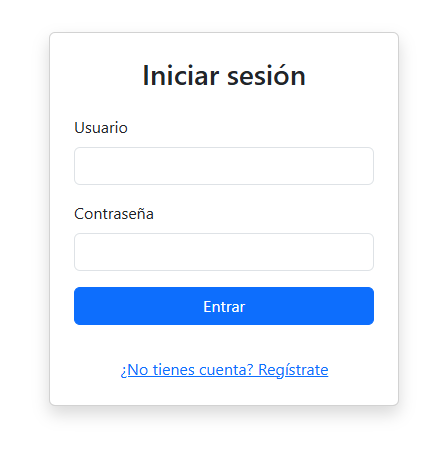

<figcaption>

Ventana de registro del programa RAG-TEND
</figcaption>

</figure>

En conjunto, estos archivos cubren el ciclo completo de autenticación, registro y gestión de la configuración de usuario, garantizando una experiencia segura y personalizable para cada usuario de

### Dashboard

El archivo `base.html` define la plantilla base de la aplicación web, proporcionando la estructura general y la barra lateral de navegación. Incluye enlaces a las principales secciones del sistema (estadísticas, licitaciones, alertas y mis licitaciones), así como un acceso rápido a las opciones de usuario y un modo de ayuda. El modo de ayuda muestra información de contacto para soporte o incidencias. Además, la plantilla aplica estilos personalizados y carga los recursos de Bootstrap para asegurar una interfaz moderna y responsiva. Todas las páginas de la aplicación heredan de esta plantilla, garantizando coherencia visual y funcional en la navegación.

### Sistema de notificaciones personalizadas

El archivo `alertas.html` implementa la gestión de alertas personalizadas para el usuario dentro de la aplicación web. Sus principales funcionalidades son:

- **Visualización de alertas:** Muestra una tabla con todas las alertas creadas por el usuario, incluyendo su nombre y las condiciones asociadas.

- **Creación de nuevas alertas:** Permite añadir alertas mediante un formulario en un modal, donde el usuario puede definir el nombre y las condiciones que activarán la alerta.

- **Gestión de condiciones:** Ofrece una interfaz interactiva para añadir, mostrar y eliminar condiciones de cada alerta, seleccionando el campo y el valor a monitorizar.

- **Eliminación de alertas:** Permite eliminar alertas existentes de forma sencilla desde la tabla.

- **Interactividad y AJAX:** Utiliza JavaScript para gestionar la creación y eliminación de alertas sin recargar la página, mejorando la experiencia de usuario.

<figure id="fig:alertas" data-latex-placement="H">

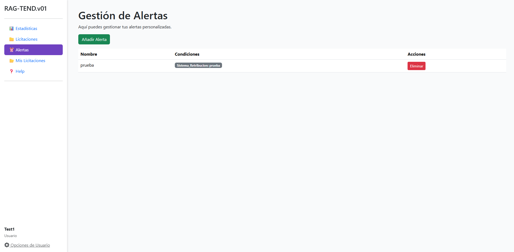
<figcaption>

Ventana de alertas del programa RAG-TEND
</figcaption>

</figure>

<figure id="fig:alertasventana" data-latex-placement="H">

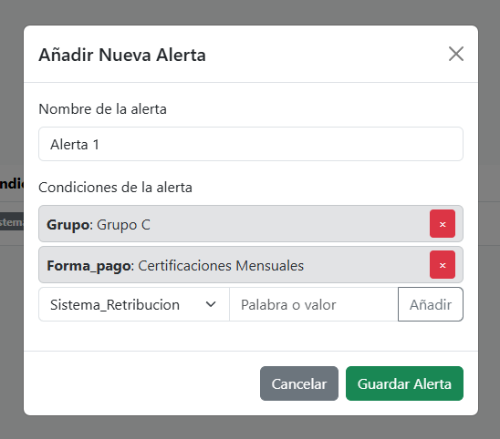
<figcaption>

Sistema de alertas del programa RAG-TEND
</figcaption>

</figure>

### Sistema de guardado de licitaciones

El archivo `mis_licitaciones.html` proporciona una interfaz interactiva donde el usuario puede consultar y gestionar las licitaciones que ha guardado o marcado como favoritas. Incluye un cuadro informativo con el número total de licitaciones, un buscador para filtrar rápidamente los resultados, y una tabla personalizable que permite ocultar o mostrar columnas según las preferencias del usuario. Además, ofrece enlaces directos a los detalles de cada licitación y funcionalidades avanzadas de visualización y filtrado, facilitando así el seguimiento y la gestión eficiente de las licitaciones de interés.

<figure id="fig:enter-label" data-latex-placement="H">

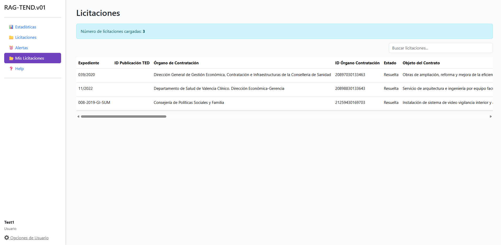
<figcaption>

Sistema de guardado de licitaciones del programa RAG-TEND
</figcaption>

</figure>

## Implementación

En esta sección se presenta la etapa de implantación de la solución desarrollada. Se describen los pasos que fueron necesarios para llevar el sistema desde la fase de desarrollo hasta su puesta en marcha, incluyendo la instalación, configuración y ejecución de la aplicación en un entorno real. Esta fase es fundamental para comprobar el funcionamiento del sistema en condiciones similares a las de producción y para validar los resultados obtenidos con la solución final.

### Población de la base de datos

Para poner en marcha el proceso de llenado de la base de datos con la información recabada por el scraper, primero se preparó y configuró el entorno de ejecución, asegurándose de que todas las dependencias y modelos necesarios estuvieran correctamente instalados. Una vez listo el entorno, se ejecutó el scraper para obtener los documentos y datos relevantes de las licitaciones públicas, que se almacenaron en archivos temporales en formato JSON. Posteriormente, el módulo `rag_operations.py` procesó estos archivos, dividiendo los documentos en fragmentos (chunks) y generando los *embeddings* correspondientes mediante modelos de lenguaje y técnicas de procesamiento semántico.

El sistema aplicó técnicas de búsqueda por palabras clave y búsqueda semántica para identificar los fragmentos más relevantes en función de los distintos prompts definidos. Los resultados obtenidos, junto con las fuentes y referencias de cada fragmento, se insertaron automáticamente en la base de datos utilizando las funciones de gestión implementadas. Este proceso permitió automatizar la extracción, análisis y almacenamiento de la información, asegurando que la base de datos estuviera actualizada y estructurada para su posterior consulta

### Acceso al programa desde localhost

Para que el programa fuera accesible desde `localhost`, se siguieron varios pasos básicos. En primer lugar, se ejecutó el servidor Flask en la propia máquina de desarrollo, utilizando la configuración por defecto que escucha únicamente en la dirección `127.0.0.1` o `localhost`. Esto garantiza que la aplicación solo sea accesible desde el propio ordenador, proporcionando un entorno seguro para pruebas y desarrollo. Además, no fue necesario realizar configuraciones adicionales en el router ni en el firewall, ya que todas las conexiones se realizan de manera local. Finalmente, se accedió a la aplicación a través del navegador web introduciendo la dirección `http://localhost:5000` (o el puerto configurado), lo que permitió comprobar el correcto funcionamiento del sistema antes de habilitar el acceso externo.

### Acceso al programa fuera de la red local

Para poner en marcha el programa y poder acceder a él desde otros dispositivos fuera de la red local, se tuvo que adaptar la configuración del servidor Flask. Por defecto, Flask solo acepta conexiones desde `localhost`, lo que me limitaba a usar la aplicación únicamente en mi propio ordenador. Para solucionar esto, se modificaron la instrucción de arranque del servidor añadiendo el parámetro `host="0.0.0.0"`, permitiendo así que Flask escuchara en todas las interfaces de red y fuera accesible desde cualquier dispositivo de la red local o incluso desde el exterior. También se tuvo que configurar CORS (Cross-Origin Resource Sharing) usando el paquete `flask-cors`, de forma que el backend aceptara peticiones desde dominios o IPs externas. Por último, para evitar advertencias de seguridad de los navegadores y cumplir con los requisitos actuales, se configuró el servidor para servir el contenido a través de HTTPS utilizando un certificado autofirmado durante el desarrollo.

Para garantizar la seguridad, estabilidad y rendimiento de la aplicación en un entorno de producción, ha sido necesario sustituir el servidor de desarrollo integrado en Flask por un servidor WSGI profesional como Waitress. El servidor de desarrollo de Flask está pensado únicamente para pruebas locales y no ofrece las garantías necesarias para gestionar múltiples peticiones ni proteger la aplicación frente a posibles vulnerabilidades. Por ello, la utilización de Waitress permite que la aplicación pueda ser accedida de forma concurrente por varios usuarios, cumpliendo con los estándares de despliegue recomendados para aplicaciones web en Python y asegurando un funcionamiento fiable y seguro en un entorno real.

Después de configurar el programa, fue necesario configurar tanto el router como el firewall del sistema. En primer lugar, se abrió el puerto correspondiente en el router, redirigiendo las conexiones entrantes hacia la dirección IP local del servidor donde se ejecutaba la aplicación Flask. Este proceso, conocido como redirección de puertos o port forwarding, permite que las peticiones externas lleguen correctamente al servidor interno. Además, se configuró el firewall del sistema operativo para permitir el tráfico a través del puerto utilizado por la aplicación, asegurando que no se bloquearan las conexiones entrantes. Gracias a estos ajustes, la aplicación pudo ser accesible desde fuera de la red local.

Una vez configurado el programa y la red, fue posible acceder a la herramienta desde cualquier dispositivo conectado a internet, para ello simplemente fue necesario conocer la IP del servidor y el puerto configurado en el router.

# Evaluación

En esta sección se describen las pruebas realizadas para validar el correcto funcionamiento del programa y la calidad de los resultados obtenidos. Se detallan los procedimientos de verificación, los criterios de evaluación y los casos de prueba utilizados, con el objetivo de demostrar que la herramienta cumple con los requisitos establecidos y ofrece resultados fiables y coherentes. Además, se analizan los resultados obtenidos en diferentes escenarios, identificando posibles limitaciones y proponiendo futuras mejoras.

## Adaptador Lineal

En pro de intentar mejorar el funcionamiento de la herramienta, se exploró la aplicación de un modelo de ajuste fino sobre la base vectorial basado en el repositorio de Adam Lucek titulado *Fine-Tuning Embedding Models for RAG Pipeline Optimization* \[@AdamFine\]: .

> *Los modelos de embedding base funcionan bien para recuperar contexto en aplicaciones RAG, pero su rendimiento puede optimizarse para mejorar la recuperación de información relevante y específica del dominio. Una estrategia eficiente es ajustar el modelo solo para las consultas mediante un linear adapter (una simple capa lineal entrenada sobre las queries). Esto permite mejorar la representación de las consultas en el espacio de* embeddings\* y, por tanto, la recuperación, sin necesidad de re-embedear toda la base de conocimiento ni usar grandes recursos computacionales. Así, se logra una mejora significativa de forma sencilla y eficiente en coste y tiempo.\* \[@linearAdapter\]

### Hipótesis

Como se aclaró anteriormente, la estructura de cada Anexo I depende en mayor medida de su entidad emisora, pero suele mantener una estructura consistente siempre que esta entidad sea la misma. Asumiendo una estructura similar para cada entidad, y un número de entidades emisoras factible, se podría entrenar un modelo para cada una y mejorar substancialmente la calidad de las respuestas obtenidas por el modelo.

### Generación de corpus sintético

El primer paso a tomar fue el de la preparación de un de un dataset, para ello en la investigación original se creó un dataset sintético para optimizar la recuperación de documentos en una aplicación RAG. Usando el reporte ambiental de Apple 2024 como base, se dividió el documento en chunks mediante la técnica de RecursiveChunking, con chunks de 800 caracteres y 400 de overlaping, con el uso de `gpt-4o-mini`, una temperatura de 1.0 y el siguiente prompt se generaron 20 preguntas que podrían ser respondidas por el programa utilizando el chunk en cuestión.

```` python
label_template = """
You are an AI assistant tasked with generating a single, realistic question-answer pair based on a given document. The question should be something a user might naturally ask when seeking information contained in the document.

Given: {chunk}

Instructions:
1. Analyze the key topics, facts, and concepts in the given document, choose one to focus on.
2. Generate twenty similar questions that a user might ask to find the information in this document that does NOT contain any company name.
3. Use natural language and occasionally include typos or colloquialisms to mimic real user behavior in the question.
4. Ensure the question is semantically related to the document content WITHOUT directly copying phrases.
5. Make sure that all of the questions are similar to eachother. I.E. All asking about a similar topic/requesting the same information.

Output Format:
Return a JSON object with the following structure:
```json
{{
  "question_1": "Generated question text",
  "question_2": "Generated question text",
  ...
}}
```

Be creative, think like a curious user, and generate your 20 similar questions that would naturally lead to the given document in a semantic search. Ensure your response is a valid JSON object containing only the questions.

"""
````

El objetivo del prompt era el de generar posibles preguntas que podría tener cualquier usuario dado. Así, se obtuvieron 4300 pares pregunta-fragmento, que se dividieron en conjuntos de entrenamiento (80%) y validación (20%).

Siguiendo los pasos de Adam, se seleccionaron 6 documentos de Anexos I distintos, pero con estructuras y formatos relativamente similares para generar el dataset, los Anexos I seleccionados fueron obtenidos de la siguiente lista de licitaciones:

CMAYOR/2023/03Y05/19 - CMAYOR/2022/03Y03/101 - CMAYOR/2022/03Y03/8 - CMAYOR/2022/07Y10/44 -CMAYOR/2023/07Y10/1 - CMAYOR/2021/07Y10/134.

La generación del corpus de preguntas se hizo mediante el programa `corpus_generator.py`, el cual hace uso del modelo `llama3.3:70b` y cuenta con las siguientes funciones:

- **generate_jsonCorpus**: Agrega los datos de un documento (en formato JSON) a un corpus general bajo una clave específica, creando el archivo si no existe.

- **generate_questions_from_chunks**: Lee el corpus, recorre los fragmentos (*chunks*) de cada documento y utiliza un modelo LLM (vía API) para generar 10 preguntas por fragmento, guardando el resultado en un archivo JSON.

- **split_questions_train_val**: Divide el archivo de preguntas generadas en conjuntos de entrenamiento y validación según una proporción dada, y guarda ambos archivos por separado.

- **merge_json_files**: Une varios archivos JSON (listas de diccionarios) en un solo archivo combinado.

El prompt utilizado para generar las preguntas del corpus fue el siguiente:

``` python
system_message = {
    "role": "system",
    "content": f"Eres un asistente que genera preguntas basadas en texto en formato JSON. "
    }
    chunk_message = {
        "role": "user",
        "content": f"""
        Texto: {chunk}

        Instrucciones:
        1. Analiza los temas clave, hechos y conceptos en el texto proporcionado.
        2. Genera diez preguntas que un usuario podria hacer para encontrar informacion en este texto.
        3. Usa lenguaje natural y ocasionalmente incluye errores tipograficos o coloquialismos.
        4. Asegurate de que las preguntas esten relacionadas semanticamente con el contenido del texto.
        5. Devuelve las preguntas en formato JSON.
        """
    }
    
```

A diferencia del repositorio original, se generaron 10 preguntas por fragmento en lugar de 20, debido al mayor volumen de documentos disponibles. Esto resultó en un corpus final compuesto por 7440 tripletas, cada una formada por el fragmento de texto (chunk), la pregunta generada y el código del documento de origen. Al igual que en el repositorio original, el corpus se dividió en una proporción de 80% para entrenamiento y 20% para validación.

### Base vectorial

El repositorio describe cómo configurar y utilizar una base de datos vectorial con ChromaDB para almacenar y recuperar fragmentos de texto embebidos, en pro de mantener la consistencia se replicó la implementación de la misma. Primero, se crea un cliente persistente de ChromaDB[^25] y una colección específica para los datos de interés, utilizando el modelo de *embeddings* `sentence-transformers/all-MiniLM-L6-v2` por defecto. Luego, se insertan los chunks en la base de datos, asignando un identificador único a cada uno. Finalmente, se define una función que, dado un embedding de consulta, recupera los 10 fragmentos más similares de la base de datos, facilitando así la búsqueda eficiente de información relevante en aplicaciones RAG.

### Evaluación base

Este fragmento describe la evaluación de un modelo base de *embeddings*, concretamente `sentence-transformers/all-MiniLM-L6-v2`, utilizando dos métricas principales: Mean Reciprocal Rank (MRR) y Recall@k.

MRR mide la posición promedio en la que aparece la primera respuesta correcta en los resultados recuperados, siendo útil cuando solo hay un elemento relevante por consulta. Recall@k (hit rate) indica la proporción de consultas en las que el documento correcto aparece entre los primeros k resultados.

Se implementaron funciones para calcular ambas métricas y se evalúa el modelo base sobre un conjunto de validación, obteniendo un hit rate del 61,16% y un MRR de 0,3133.

Para el caso de nuestro dataset se obtuvo un Hit Rate de 47.66% de y un MMR de 0.2439, valores menos alentadores, pero trabajables.

### Entrenamiento

Se entrena un adaptador lineal aplicado solo a las consultas, lo que aporta eficiencia y simplicidad, ya que solo añade una capa lineal y no requiere volver a generar los vectores de la base de datos vectorial la base de conocimiento. El entrenamiento utiliza técnicas como triplet loss y negative sampling aleatorio, siguiendo recomendaciones del paper de ChromaDB \[@sanjeev2024embedding\]. El negative sampling consiste en seleccionar ejemplos negativos aleatorios para que el modelo aprenda a distinguir entre información relevante e irrelevante. El adaptador se implementa como una capa lineal en PyTorch y se entrena con un dataset de tripletes (consulta, positivo, negativo), optimizando la triplet loss para que los *embeddings* de consultas y documentos relevantes estén más cerca, y los irrelevantes más lejos. El proceso incluye scheduler de tasa de aprendizaje, clipping de gradientes y reporte de la pérdida por época.

### Validación

Tras entrenar el adaptador lineal para consultas, se evaluó su rendimiento sobre la base de conocimiento y se comparó con el modelo base. El proceso consistió en cargar el adaptador, generar los *embeddings* adaptados para las consultas y calcular métricas como el Average Hit Rate @10 y el Mean Reciprocal Rank @10 sobre el conjunto de validación. Los resultados muestran una mejora: el hit rate subió al 66,7% (un 7,8% más que el baseline) y el mean reciprocal rank mejoró un 6,2%, indicando que el adaptador permite recuperar documentos relevantes de forma más precisa y eficiente. Estos resultados se obtuvieron con los siguientes hiperparámetros:

``` python
num_epochs: 30
batch_size: 32
learning_rate: 0.003
warmup_steps: 100
max_grad_norm: 1.0
margin: 1.0
```

Para el caso de la database generada en base a los documentos Anexos I se probó con varios modelos, variando los hiperparámetros que determinan su comportamiento:

``` python
Average Hit Rate @10: 0.5642857142857143
Mean Reciprocal Rank @10: 3.2551162131519273
Adapter loaded successfully.
Training parameters used:
num_epochs: 10
batch_size: 32
learning_rate: 0.003
warmup_steps: 100
max_grad_norm: 1.0
margin: 1.0

Average Hit Rate @10: 0.45357142857142857
Mean Reciprocal Rank @10: 0.23962159863945576
Adapter loaded successfully.
Training parameters used:
num_epochs: 1
batch_size: 32
learning_rate: 0.003
warmup_steps: 100
max_grad_norm: 1.0
margin: 1.0

Average Hit Rate @10: 0.5607142857142857
Mean Reciprocal Rank @10: 2.8345379818594107
Training parameters used:
num_epochs: 30
batch_size: 32
learning_rate: 0.003     
warmup_steps: 100        
max_grad_norm: 1.0
margin: 1.0

Average Hit Rate @10: 0.5892857142857143
Mean Reciprocal Rank @10: 3.015958049886622
Training parameters used:
num_epochs: 40
batch_size: 32
learning_rate: 0.003
warmup_steps: 100
max_grad_norm: 1.0
margin: 1.0
Average Hit Rate @10: 0.6035714285714285
Mean Reciprocal Rank @10: 2.92535430839002
```

### Conclusión

El último modelo mostró una mejora substancial del 29,5% en el Average Hit Rate, sin embargo también presentó un empeoramiento del -16,6% en el Mean Reciprocal Rank. Sin embargo, su efectividad general fue limitada por los siguientes motivos:

- **Tiempo de procesamiento:** El tiempo necesario para procesar cada embedding aumentó significativamente, llegando a ser, en promedio, tres veces mayor. Esto representa un inconveniente importante, especialmente considerando el gran volumen de documentos que se deben alimentar para poblar la base de datos inicialmente.

- **Desempeño en otros documentos:** A pesar de los resultados iniciales prometedores, el modelo no logró mantener este rendimiento positivo al aplicarse a otros documentos de la misma entidad emisora, llegando incluso a obtener resultados inferiores a los del modelo base.

La decisión de descartar esta técnica se fundamenta en varios factores críticos observados durante la evaluación. En primer lugar, la complejidad adicional introducida por el modelo supuso un aumento considerable en el tiempo de ejecución, lo que afecta negativamente la eficiencia general del sistema, especialmente cuando se trabaja con grandes volúmenes de datos. Además, el modelo demostró una limitada capacidad de generalización, ya que no fue capaz de predecir correctamente documentos que no formaban parte del conjunto de entrenamiento. Esta falta de robustez y adaptabilidad, sumada al coste computacional elevado, llevó a la conclusión de que esta técnica no resulta adecuada para los objetivos y requisitos del proyecto.

## Validación de la clase DBManager

Para validar la clase `DBManager`, se desarrolló un programa de pruebas unitarias con el objetivo de garantizar el correcto funcionamiento de sus funciones. Esta clase es responsable de gestionar las operaciones de base de datos dentro del proyecto. El programa utiliza el módulo `unittest` [^26] de Python, complementado con `MagicMock` [^27], para simular el comportamiento de las dependencias externas, como las conexiones y consultas a la base de datos, permitiendo realizar pruebas exhaustivas en un entorno controlado y libre de dependencias reales.

### Objetivos de las Pruebas

- Validar que las funciones de `DBManager` generen las consultas SQL correctas.

- Comprobar que las funciones interactúan correctamente con los métodos de la base de datos.

- Garantizar que las operaciones de inserción, eliminación, actualización y consulta se ejecuten según lo esperado.

- Simular escenarios de exportación de datos y verificar la integridad de los archivos generados.

### Metodología

El programa utiliza la clase `unittest.TestCase` para estructurar las pruebas. Cada función de `DBManager` tiene su propia prueba unitaria, en la que se emplean mocks para simular el comportamiento de la base de datos. Esto permite realizar pruebas exhaustivas sin depender de una conexión real.

### Funciones Probadas

- **Conexión y cierre:** Se prueban las funciones `openConnection` y `closeConnection` para garantizar que se ejecuten correctamente.

- **Inserción de datos:** La función `insertDb` se verifica para asegurar que las consultas `INSERT` se generen y ejecuten de manera adecuada.

- **Eliminación de datos:** Se prueba la función `deleteObject` para validar las consultas `DELETE`.

- **Consulta de tablas:** Las funciones `viewTable` y `getFullTable` se prueban para garantizar que las consultas `SELECT` devuelvan los resultados esperados.

- **Exportación de datos:** La función `exportToCSV` se verifica para asegurar que los datos se exporten correctamente a un archivo CSV.

### Resultados Esperados

El programa de pruebas verifica que las funciones de `DBManager` cumplan con los requisitos establecidos. Todas las pruebas deben ejecutarse correctamente, confirmando que las funciones interactúan adecuadamente con la base de datos y generan las consultas esperadas. En caso de errores, las pruebas proporcionan información detallada para identificar y corregir problemas en la implementación.

El resultado esperado de ejecutar `test_db_manager.py()` es:

``` python
----------------------------------------------------------------------
Ran 13 tests in 0.024s

OK
```

## Análisis temporal

El tiempo necesario para procesar cada documento depende principalmente del tamaño del archivo y de la velocidad de procesamiento del servidor que alberga el modelo de lenguaje. En promedio, un documento del tipo AnexoI está compuesto por un rango de 190 a 250 chunks, y cada chunk requiere aproximadamente 2 segundos para generar su embedding. Esto implica un rango estimado de tiempo entre 6.3 y 8.3 minutos para completar esta etapa.

Posteriormente, se procesan los prompts, los cuales, bajo condiciones normales del servidor, toman alrededor de 5 segundos cada uno. En total, el tiempo de procesamiento de un documento puede variar entre 10 y 15 minutos, considerando ambas etapas. Aunque este tiempo puede ser elevado para acceder rápidamente a la información, el programa mitiga esta limitación preprocesando todas las licitaciones recuperadas en el momento en que son recibidas, optimizando así el acceso a los datos relevantes.

## Validación del programa RAG

La validación del programa RAG evalúa la capacidad del sistema para recuperar información relevante y generar respuestas precisas. En esta sección, se describen los métodos empleados, los resultados obtenidos y las limitaciones identificadas, con el objetivo de garantizar la calidad del sistema y su alineación con los estándares esperados.

### Limitaciones de las métricas tradicionales

Métricas típicas en la validación de respuestas por modelos de lenguaje como ROUGE [^28], BLEU [^29] no son ideales para validar un sistema RAG porque están diseñadas para evaluar la similitud superficial entre cadenas de texto, basándose en coincidencias exactas de palabras o n-gramas. Estas métricas no consideran el significado semántico ni la relevancia contextual de las respuestas, lo cual es crucial en un sistema RAG, donde las respuestas deben ser precisas y relevantes en función de los documentos recuperados. Por ejemplo, una respuesta que utiliza sinónimos o parafrasea la información puede ser semánticamente correcta, pero estas métricas podrían penalizarla injustamente al no detectar la equivalencia semántica. Esto limita su capacidad para evaluar la calidad real de las respuestas generadas por un sistema RAG. En la web de RAGAS \[@RAGASBLUE\] se ejemplifican algunas de las limitaciones típicas de las métricas tradicionales

``` python
from ragas.dataset_schema import SingleTurnSample
from ragas.metrics import BleuScore

test_data = {
    "user_input": "summarise given text\nThe company reported an 8% rise in Q3 2024, driven by strong performance in the Asian market. Sales in this region have significantly contributed to the overall growth. Analysts attribute this success to strategic marketing and product localization. The positive trend in the Asian market is expected to continue into the next quarter.",
    "response": "The company experienced an 8% increase in Q3 2024, largely due to effective marketing strategies and product adaptation, with expectations of continued growth in the coming quarter.",
    "reference": "The company reported an 8% growth in Q3 2024, primarily driven by strong sales in the Asian market, attributed to strategic marketing and localized products, with continued growth anticipated in the next quarter."
}
metric = BleuScore()
test_data = SingleTurnSample(**test_data)
metric.single_turn_score(test_data)

--------------------------------

output: 0.137
```

En este ejemplo se utiliza la métrica de *BLEU score* [^30] para comparar la respuesta entregada por el LLM con el valor de referencia correcto, como se puede apreciar el contenido de la respuesta y la referencia es en esencia el mismo, pero esto no se ve reflejado en el valor de la métrica ya que la información que solicita el usuario requiere una respuesta “compleja”.

``` python
from ragas.dataset_schema import SingleTurnSample
from ragas.metrics import BleuScore

sample = SingleTurnSample(
    response="The Eiffel Tower is located in India.",
    reference="The Eiffel Tower is located in Paris."
)

scorer = BleuScore()
await scorer.single_turn_ascore(sample)

--------------------------------

output: 0.7071067811865478
```

En este otro caso, el valor obtenido refleja una respuesta aparentemente similar, pero el significado real de la información contenida difiere drásticamente de su referencia. Este tipo de errores y limitaciones es característico de métricas que no están diseñadas para capturar las particularidades de un sistema RAG. Por ejemplo, en la validación del campo "Garantía provisional", la respuesta esperada era "8 meses", mientras que la respuesta obtenida fue "La duración de la garantía definitiva es de ocho (8) meses", aunque ambas respuestas son semánticamente identicas, estas métricas no consideran adecuadamente el su valor semántico, lo que dificulta drásticamente su uso en este proyecto concreto.

### Validación basada en LLMs

El uso de métricas basadas en LLMs para evaluar sistemas RAG representa una estrategia innovadora y efectiva. Los LLMs son capaces de comprender el contexto y la semántica de los datos, lo que les permite evaluar con precisión aspectos como la relevancia del contexto, la calidad de las respuestas y el cumplimiento de formatos esperados.

A diferencia de las métricas tradicionales, que suelen depender de comparaciones estrictamente sintácticas o estadísticas, las métricas basadas en LLMs ofrecen una evaluación más profunda y contextual. Esto es especialmente útil en sistemas RAG, donde la calidad de las respuestas generadas depende de la correcta integración entre los datos recuperados y el modelo de lenguaje. Además, estas métricas permiten identificar áreas de mejora en el sistema, optimizando tanto la recuperación de información como la generación de respuestas.

Durante las fases iniciales de la etapa de validación, se compararon los resultados obtenidos mediante la validación del LLM con evaluaciones realizadas manualmente (282 campos). En este proceso, los valores generados por el sistema RAG fueron revisados y contrastados con los resultados de la métrica, mostrando resultados satisfactoriamente similares. Sin embargo, se observó una ligera tendencia hacia la generación de falsos negativos.

El proceso de evaluación se hace mediante el modulo `ragas_eval.py`, el cual coordina el proceso de evaluación de las métricas asociadas a los *prompts* generados en las licitaciones revisadas. Durante su ejecución se evalúan las métricas de cada *prompt* utilizando un modelo de lenguaje preentrenado que entrega respuestas binarias. Las métricas incluyen la Faithfulness [^31], Context Precision [^32] y Response Relevancy [^33], este conjunto de métricas se calculan en base al promp inicial que contiene las instrucciones de qué dato se desea obtener, la repuesta del LLM y el contexto recuperado por la base de datos vectorial. Para validar la herramienta se obtuvo una muestra aleatoria de 30 licitaciones de la base de datos, la cual devolvió el siguiente resultado global:

``` python
"global_averages": {
        "Context Precision": 0.794180269694819,
        "Response Relevancy": 0.7899219304471257,
        "Faithfulness": 0.7608232789212207
    }
```

Si nos detenemos a analizar cada valor punto por punto obtenemos la siguiente tabla:

| **Campo** | **Context Precision** | **Response Relevancy** | **Faithfulness** |
|:---|:---|:---|:---|
| Regulación armonizada | 0.6207 | 0.6207 | 0.6207 |
| Sometido a recurso especial | 0.0333 | 0.0333 | 0.0333 |
| Plazo de ejecución | 0.9667 | 0.9667 | 0.8667 |
| Presupuesto sin IVA | 1.0 | 1.0 | 1.0 |
| Presupuesto con IVA | 1.0 | 1.0 | 1.0 |
| Importe IVA | 0.9 | 0.9333 | 0.9333 |
| Sistema Retribución | 0.0 | 0.0 | 0.0 |
| Valor estimado | 1.0 | 1.0 | 0.8667 |
| Revisión precios | 1.0 | 1.0 | 1.0 |
| Garantía definitiva | 1.0 | 1.0 | 1.0 |
| Garantía provisional | 1.0 | 1.0 | 1.0 |
| Admisibilidad variantes | 1.0 | 1.0 | 1.0 |
| Clasificación | 1.0 | 1.0 | 1.0 |
| Grupo | 1.0 | 1.0 | 1.0 |
| Subgrupo | 1.0 | 1.0 | 1.0 |
| Categoría | 1.0 | 1.0 | 0.8333 |
| Criterio solvencia económica | 1.0 | 1.0 | 1.0 |
| Criterio solvencia técnica | 1.0 | 0.9667 | 1.0 |
| Condiciones especiales | 1.0 | 1.0 | 1.0 |
| Penalidad incumplimiento | 0.8 | 0.7667 | 0.8 |
| Forma pago | 0.9667 | 0.8667 | 0.2667 |
| Causas modificación | 0.9 | 0.9 | 0.9 |
| Plazo garantía | 1.0 | 1.0 | 1.0 |
| Contratación precio unitario | 0.8 | 0.8667 | 0.9333 |
| Tanto alzado | 0.8667 | 0.8667 | 0.9 |
| Tanto alzado con | 0.8333 | 0.8 | 0.8333 |
| Criterio juicio val | 0.9333 | 0.9333 | 0.9333 |
| Evaluables automáticamente | 0.8 | 0.8667 | 0.8333 |
| Criterio económico | 0.9333 | 0.9333 | 0.9333 |
| Obligaciones ambientales | 0.5667 | 0.6 | 0.6 |
| Régimen penalidades | 1.0 | 1.0 | 1.0 |
| Ambiental | 0.5333 | 0.4667 | 0.4333 |
| Técnico | 0.9667 | 0.9667 | 0.9333 |
| Precio | 0.7333 | 0.7333 | 0.7333 |
| Garantía | 0.7333 | 0.7 | 0.5667 |
| Experiencia | 0.3 | 0.3 | 0.3 |
| Calidad | 0.4333 | 0.4333 | 0.4 |
| Social | 0.2667 | 0.2667 | 0.3333 |
| Seguridad | 0.6 | 0.6 | 0.6 |
| Juicio valor | 0.8667 | 0.8667 | 0.8667 |
| Formula precio | 0.3333 | 0.3333 | 0.3333 |
| Formula juicio de valor | 0.0 | 0.0 | 0.0 |
| Criterios valores anormales | 1.0 | 0.9667 | 0.9667 |
| Infracción grave | 0.9667 | 0.9667 | 1.0 |
| Gastos desistimiento | 0.7667 | 0.7 | 0.6667 |
| Contratación control | 0.9667 | 0.9667 | 0.9667 |
| Tareas criticas | 0.9333 | 0.9333 | 0.9667 |

Estadísticas de los prompts evaluados.

Si bien la tabla resulta útil, es demasiada información como para ser fácilmente digerible, es por esto que resulta mas fácil discutir estos valores con los siguientes rangos:

La Tabla presenta los porcentajes de valores distribuidos en diferentes rangos para las métricas evaluadas: *Context Precision*, *Response Relevancy*, y *Faithfulness*. A continuación, se destacan las principales conclusiones:

- **Rango \[1.0 - 0.9\]:** Este rango concentra la mayor proporción de valores altos, con una media del 53.19%. Las métricas *Context Precision* y *Response Relevancy* lideran con un 53.19%, mientras que *Faithfulness* alcanza un 48.94%. Esto indica que las respuestas generadas son generalmente precisas y relevantes en contextos bien definidos.

- **Rango \[0.9 - 0.75\]:** En este rango, los porcentajes disminuyen significativamente, con una media del 18.44%. Las métricas muestran una distribución uniforme, lo que sugiere que las respuestas en este rango son menos consistentes en términos de precisión y relevancia.

- **Rango \[0.75 - 0.5\]:** Este rango presenta una media del 12.06%, reflejando una caída en la calidad de las métricas evaluadas. *Faithfulness* es la métrica más afectada, con un porcentaje de 10.64%, lo que indica una menor fidelidad en las respuestas generadas.

- **Rango \[0.5 - 0.0\]:** Este rango concentra los valores más bajos, con una media del 17.73%. *Faithfulness* muestra el mayor porcentaje en este rango (21.28%), lo que evidencia que una proporción significativa de las respuestas no cumple con los estándares esperados de fidelidad al contexto y relevancia.

En general, los valores más altos se concentran en el rango \[1.0 - 0.9\], lo que demuestra que el sistema es capaz de generar respuestas de alta calidad en la mayoría de los casos. Sin embargo, los rangos inferiores reflejan áreas de mejora, especialmente en la métrica *Faithfulness*, que muestra una mayor variabilidad en los resultados.

### Conclusión del análisis

Casi el 70% de los valores se encuentran por encima del 0.75, lo que demuestra un buen desempeño general del sistema. Sin embargo, los valores en los rangos inferiores (0.5 a 0.75 y 0 a 0.5) sugieren áreas donde el sistema podría beneficiarse de ajustes o mejoras.

### Análisis de campos

La tabla 1 contiene 13 campos con valores perfectos, pero es mas importante discutir aquellos campos que resultan mas problemáticos:

- **Sometido a recurso especial / Sistema de retribución**: Ambos campos buscan identificar información específica en el Anexo I, pero presentan una baja frecuencia en los documentos analizados. En el caso de "Sometido a recurso especial", solo el 0.067% de las licitaciones contienen información relacionada, mientras que para "Sistema de retribución", este dato está presente en apenas el 0.018% de los casos. Debido a esta escasez de datos, ambos campos suelen estar vacíos, lo cual es el comportamiento esperado. Esto resulta en que el sistema no logre recuperar chunks relevantes para los prompts, proporcionando al LLM un contexto limitado y afectando negativamente la calidad de las métricas evaluadas. Sin embargo, dado que los resultados reflejan la realidad de los datos disponibles, se puede asumir que el programa está funcionando correctamente.

- **Ambiental, Experiencia, Social**: En este caso los tres campos intentan identificar los criterios ambientales, de experiencia y sociales respectivamente. Dentro del Anexo I no existen areas explicitamente marcadas como “criterios ambientales” o “criterios de experiencia”, sino que son áreas que se identifican por keywords definidas dentro del archivo strings.json. Esta dependencia limita la precisión, especialmente cuando los documentos utilizan términos diferentes o ambiguos. Además, la información relevante suele estar dispersa o mezclada con otros conceptos, lo que dificulta la recuperación de chunks útiles y proporciona al LLM un contexto insuficiente para evaluar las métricas correctamente.

- **Formula Precio, Formula juicio de valor**: Estos campos pretenden extraer las formulas deprecio y de juicio de valor con las que se puntua una oferta, pero como se puede ver, la métrica indica valores bajos, una posible causa es que suceda algo similar al primer campo analizado en esta lista, donde son dos datos que no siempre están presentes en el documento. Otra posible causa es la calidad y alcance de las keywords definidas para estos campos, durante el proceso de recuperación, las keywords desempeñan un papel crucial para identificar y extraer los chunks necesarios. Durante el desarrollo de la herramienta, se definieron las keywords esenciales para identificar estos campos, logrando resultados satisfactorios con el grupo de prueba inicial. Sin embargo, es posible que el alcance de las keywords definidas no haya sido suficiente para abarcar la variabilidad y diversidad que presentan los documentos de licitaciones existentes.

### Posibles causas de errores

- **Heterogeneidad de los datos:** El principal desafío que aborda el programa es la extracción de datos desde fuentes heterogéneas. La ausencia de un formato estandarizado tanto en la estructura del documento como en el vocabulario utilizado hace que esta tarea sea especialmente compleja.

- **Extracción de tablas:** Para el lector las tablas son un formato muy intuitivo, pero cuando se convierten a texto plano se pierde mucho de su contexto, si bien se han aplicado técnicas para evitar este problema, es posible que existan casos de error o confusión donde el programa no procese correctamente los datos.

- **Extensión de los documentos:** En documentos mas extensos el programa tendrá que generar espacios vectoriales mas complejos lo que puede generar peores resultados.

- **Ausencia de datos:** Se pretenden extraer una gran variedad de campos y datos de los documentos, que no siempre están presentes, por lo que el programa asumiendo que si lo están puede generar falsos positivos sin saberlo.

## Evaluación cualitativa

En esta sección se presentan las valoraciones cualitativas obtenidas a partir de las opiniones de los usuarios sobre el programa RAG-TEND. Los datos reflejan la percepción general sobre la utilidad, facilidad de uso y valor aportado por la herramienta. Es importante aclarar que esta evaluación fue realizada únicamente sobre 2 profesionales en el área, que si bien limita claramente el valor de la evaluación, se consideró importante àra incluir una vision “general” de la percepción que se tiene sobre la herramienta. A continuación, se analizan los principales aspectos evaluados:

- **Utilidad de la información extraída:** Ambos usuarios están "muy de acuerdo" en que la información extraída por el programa es útil, lo que demuestra que la herramienta cumple con su objetivo principal de proporcionar datos relevantes y valiosos para la gestión de licitaciones públicas.

- **Interfaz intuitiva y agradable:** Los usuarios calificaron la interfaz como "de acuerdo" en términos de intuitividad y diseño, lo que indica que, aunque es funcional, existe margen para mejorar la experiencia visual y la interacción del usuario.

- **Cantidad y calidad de los datos extraídos:** En cuanto a la cantidad de datos extraídos, los usuarios están "de acuerdo", mientras que en la precisión de la información extraída, la mayoría están "muy de acuerdo". Esto refleja que el programa es confiable en la extracción de datos, aunque podría optimizarse para abarcar más información en ciertos casos.

- **Facilidad de acceso:** La facilidad de acceso al programa fue valorada como "muy de acuerdo" por ambos usuarios, lo que indica que la herramienta es accesible y fácil de utilizar, incluso para usuarios con poca experiencia técnica.

- **Visualización de la información:** Los usuarios están "muy de acuerdo" en que la información se visualiza correctamente, lo que confirma que el diseño de la herramienta facilita la comprensión y análisis de los datos extraídos.

- **Valor general del programa:** En términos generales, los usuarios están "muy de acuerdo" en que el programa aporta valor, lo que refuerza la utilidad y relevancia de la herramienta en el contexto de la gestión de licitaciones públicas.

En conclusión, las valoraciones cualitativas reflejan una percepción positiva sobre el programa RAG-TEND, destacando su utilidad, precisión y facilidad de uso. Sin embargo, se identifican áreas de mejora, como la interfaz y la cantidad de datos extraídos, que podrían optimizarse para ofrecer una experiencia aún

# Conclusiones

RAG-TEND ha cumplido con los objetivos planteados en la sección 1.2 de la siguiente manera:

1.  **Automatizar la recopilación de información relevante sobre licitaciones públicas:** Se desarrolló satisfactoriamente un módulo de scraping capaz de extraer la información relevante para el proyecto de forma escalable y confiable, junto con una base de datos que almacena de manera segura toda la información recabada.

2.  **Procesar y organizar los datos obtenidos para facilitar su análisis:** Se desarrolló un programa RAG validado en la sección 6.4, el cual extrae un gran volumen de datos de forma satisfactoria en el formato correcto.

3.  **Desarrollar herramientas que permitan la visualización clara y accesible de la información recopilada:** Se desarrolló un programa web en la sección 5.5 con diversas comodidades que facilitan la visualización de todos los datos extraídos y actualizados. Este programa incluye funcionalidades como alertas personalizadas, filtrado por expresiones regulares y la posibilidad de descargar todos los datos en formato Excel, lo que mejora significativamente la accesibilidad y utilidad de la información.

4.  **Mejorar la eficiencia en la gestión y consulta de documentos relacionados con licitaciones:** Se implementaron herramientas que permiten la búsqueda rápida y eficiente de documentos relacionados con licitaciones públicas. Estas herramientas incluyen un sistema de filtrado avanzado basado en keywords y expresiones regulares, así como la integración de un sistema de recuperación de chunks relevantes que optimiza la consulta de información específica dentro de los documentos (explorado en la sección ).

5.  **Proporcionar una base tecnológica que facilite la toma de decisiones informadas en el ámbito de las licitaciones públicas:** RAG-TEND proporciona una infraestructura tecnológica robusta (validada en la sección 6.2) que permite a los usuarios acceder a información relevante de manera rápida y organizada. La combinación de scraping automatizado, análisis de datos estructurados y visualización accesible facilita la toma de decisiones informadas, reduciendo el tiempo y esfuerzo necesarios para evaluar licitaciones públicas, optimizando así los procesos de gestión.

RAG-TEND ha demostrado ser una herramienta eficaz para la automatización de procesos relacionados con la gestión de licitaciones públicas. A través de la implementación de módulos de scraping, procesamiento de datos y visualización accesible, el sistema ha cumplido con los objetivos planteados, facilitando la recopilación, organización y análisis de información relevante.

Sin embargo, el análisis de los resultados revela áreas de mejora, especialmente en la extracción de campos con baja frecuencia o alta variabilidad en los documentos. La dependencia de keywords y la falta de estandarización en los formatos de los documentos representan desafíos que afectan la precisión y calidad de los datos recuperados.

Para abordar estos problemas, se proponen mejoras como la ampliación de keywords (con feedback de usuario o algún método automatizado), el entrenamiento específico de de algún modelo de clasificación de texto, la implementación de técnicas avanzadas de procesamiento de lenguaje natural y la optimización de los algoritmos de recuperación. Estas acciones permitirán aumentar la robustez del sistema y su capacidad para adaptarse a la diversidad de documentos de licitaciones existentes.

## Relación del trabajo desarrollado con los estudios cursados

## Interfaces persona computador

Esta asignatura fue nuestro primer acercamiento al mundo del frontend, nos otorgó nociones básicas de lo que es una buena interfaz de usuario y lo que no, gracias a ella pudimos obtener bases sólidas sobre cómo diseñar correctamente un programa dependiendo del usuario objetivo.

## Bases de datos y sistemas de información

Me otorgó una base bastante sólida sobre el diseño, mantenimiento, extracción e inserción de información en una base de datos mediante el uso de SQL. Sin esta asignatura no hubiera sido posible manejar el volumen de datos que el programa requiere de una forma escalable y eficiente.

## Ingeniería del software

Si bien al momento de tomar esta asignatura, la mayoría de los alumnos ya teníamos una idea de cómo hacer y diseñar un programa funcional, fue esta materia la que nos dio las herramientas correctas para saber diseñar software de manera sostenible y estandarizada, enseñándonos a cómo trabajar en equipo, las capas que debería tener un proyecto, formas de mantener cada elemento independiente y encapsulado, técnicas para analizar y solucionar problemas, y un largo etcétera.

## Tecnología de sistemas de información en la red

Herramientas como Django basan su lógica en buena parte del temario de esta asignatura, sin ella no hubiera sido capaz de comprender correctamente la funcionalidad de los servidores - clientes - proxys, cómo se manejan las solicitudes de cada usuario, cómo se maneja más de un usuario para un solo servidor, etcétera.

## Sistemas de almacenamiento y recuperación de información

Concretamente, **SAR** fue una de las asignaturas de las que más siento haber sacado provecho para este proyecto concreto, ya que nos enseñó a diseñar un scraper (parte indispensable de este proyecto), un programa de generación de texto (muy útil para comprender el funcionamiento de un LLM), funcionamiento de los *embeddings* y algoritmos de procesamiento de texto variados.

## Percepción / Aprendizaje automático

Combino ambas materias debido a que una es la sucesora de la otra y han sido igual de importantes para este proyecto. Ellas me dieron una base muy sólida para comprender cómo funciona un LLM desde dentro, acercarme al mundo de las redes neuronales y sistemas de aprendizaje automático hubiera sido infinidad de veces más complicado sin los conocimientos que logré adquirir

# Glosario

(Large Language Model) Modelo de lenguaje de gran tamaño entrenado con grandes cantidades de texto, capaz de comprender y generar lenguaje natural de forma avanzada.

(Retrieval-Augmented Generation) Técnica que combina la generación de texto mediante modelos de lenguaje con la recuperación de información relevante de una base de datos o corpus externo.

(Natural Language Processing) Procesamiento del Lenguaje Natural; rama de la inteligencia artificial que estudia la interacción entre computadoras y lenguaje humano.

(Structured Query Language) Lenguaje estándar para la gestión y consulta de bases de datos relacionales.

Estructura de datos que almacena información en forma de vectores, permitiendo búsquedas y comparaciones eficientes mediante distancias o similitudes.

Consulta o petición de información realizada a una base de datos o sistema de recuperación de información.

Instrucción, pregunta o contexto proporcionado a un modelo de lenguaje para guiar su respuesta o generación de texto.

Programa o script diseñado para extraer información de páginas web de forma automática.

(General and Professional Question Answering) Conjunto de tareas o benchmarks orientados a evaluar la capacidad de los modelos para responder preguntas generales y profesionales.

Técnica de búsqueda que utiliza el significado y contexto de las palabras, en lugar de simples coincidencias de texto, para encontrar información relevante.

Parámetro en los modelos generativos que controla la aleatoriedad de las respuestas; valores bajos generan respuestas más conservadoras y valores altos, respuestas más creativas.

Fragmento o porción de texto en que se divide un documento para su procesamiento o análisis.

Superposición entre fragmentos (chunks) de texto, utilizada para no perder información relevante en los límites de los fragmentos.

Proceso de ajuste fino de un modelo de lenguaje preentrenado mediante entrenamiento adicional con datos específicos para mejorar su rendimiento en tareas concretas.

Mecanismo de gestión automática de memoria que libera recursos no utilizados por un programa para optimizar el uso de la memoria.

Proceso de reordenar una lista de resultados (por ejemplo, documentos recuperados) según criterios adicionales de relevancia o calidad.

Sistema cuyo funcionamiento interno es desconocido o no es accesible, y solo se puede observar su comportamiento a partir de las entradas y salidas.

(Atomicidad, Consistencia, Aislamiento y Durabilidad), término utilizado en informática para describir las cuatro propiedades que garantizan la integridad de las transacciones en una base de datos

Subsecuencia de N elementos de una secuencia dada.

# Trabajos futuros

En esta sección se presentan posibles líneas de mejora y ampliación del sistema desarrollado, identificadas a partir de las limitaciones observadas y de las oportunidades de evolución tecnológica. Los trabajos futuros propuestos buscan incrementar la funcionalidad, la robustez y el alcance de la solución, así como explorar nuevas aplicaciones y enfoques que permitan aprovechar al máximo el potencial del sistema en contextos más amplios o con tecnologías más avanzadas.

## Integración de OCR

Una posible mejora futura para el sistema consiste en la integración de técnicas de Reconocimiento Óptico de Caracteres (OCR) para procesar documentos que han sido escaneados y almacenados en formato de imagen o PDF no digital. Actualmente, el sistema solo puede extraer información de documentos que contienen texto digitalizado, lo que limita el alcance de la extracción automática en aquellos casos donde los documentos originales han sido escaneados como imágenes. La incorporación de un módulo OCR permitiría convertir estos documentos en texto editable y procesable, ampliando significativamente la cantidad y variedad de información accesible para el análisis automático. Para ello, se podrían emplear herramientas como Tesseract OCR o servicios en la nube especializados, integrando el proceso de reconocimiento de texto en el pipeline de extracción y análisis documental.

## Aplicación del programa a otras entidades fuera de Valencia

Otra línea de trabajo futuro consiste en adaptar y aplicar el sistema desarrollado a entidades y organismos públicos de otras regiones o comunidades autónomas fuera de Valencia. Actualmente, el programa está optimizado para procesar y analizar licitaciones y documentos publicados por organismos valencianos, aprovechando la estructura y los formatos específicos de sus portales y bases de datos. Sin embargo, muchas de las técnicas y módulos implementados son fácilmente generalizables. El sistema fue diseñado en gran medida con el objetivo de ser escalable, que con la capacidad añadir mas parámetros de búsqueda para mejorar las respuestas del sistema en documentos con un formato que no se haya tratado antes.

## Implementación de técnicas RAG más avanzadas

Como trabajo futuro, se propone la integración de técnicas RAG más avanzadas para mejorar la calidad y precisión de las respuestas generadas por el sistema. Actualmente, el sistema utiliza una combinación de recuperación de fragmentos relevantes y generación de texto, pero existen enfoques más sofisticados que pueden optimizar tanto la selección del contexto como la generación final. Entre estas mejoras se incluyen el uso de modelos de rerankingmas sofisticados, la incorporación de mecanismos de feedback iterativo entre el generador y el recuperador, y la aplicación de modelos de recuperación dual encoder o cross encoder. Además, se podrían explorar estrategias de fusión de evidencias provenientes de múltiples fuentes y la integración de pipelines multi-hop para responder preguntas complejas que requieren información dispersa en varios documentos. Estas técnicas permitirían aumentar la robustez, la cobertura y la fiabilidad del sistema en escenarios reales.

# Anexos

## Instalación y ejecución local del programa

En esta sección se describe el proceso necesario para poner en marcha el programa desarrollado, detallando los pasos clave para su correcta instalación, configuración y ejecución. Se incluyen las instrucciones para la preparación del entorno, la instalación de dependencias, la configuración de los parámetros principales y la inicialización de los distintos módulos que componen la herramienta. El objetivo es proporcionar una guía clara y estructurada que facilite la puesta en funcionamiento del sistema, permitiendo a cualquier usuario reproducir el entorno de trabajo y aprovechar todas las funcionalidades implementadas en el proyecto.

### Clonación del repositorio

Para clonar el repositorio, es necesario tener instalado `git`. A continuación se detallan los pasos a seguir:

1.  **Instalar Git:** Si aún no tienes Git instalado, puedes descargarlo desde la página oficial: <https://git-scm.com/downloads>

2.  **Comprobar versión de python:** El proyecto fue desarrollado en python 13.2, para comprobar la versión de python que tienes instalada puedes utilizar el comando desde tu terminal de cmd:

         python --version 

    En caso de que no sea la versión indicada, se puede obtener desde el siguiente link: <https://www.python.org/downloads/>

3.  **Clonar el repositorio:** Para ello abre un terminal en el directorio deseado y ejecuta el siguiente comando:

         git clone https://github.com/Oppen-OC/TFG.git 

    Esto creará una carpeta llamada `TFG` con todos los archivos del proyecto.

4.  **Acceder a la carpeta del proyecto:** Una vez finalizada la descarga, navega a la carpeta del repositorio con:

        cd TFG

5.  **Crear entorno virtual:** Este paso es opcional pero muy recomendado para evitar incidencias. Primero abre el terminal desde el directorio base del proyecto y ejecuta:

         python -m venv venv 

    Después, para activarlo desde Windows:

         venv\Scripts\activate 

    macOS/Linux:

         source venv/bin/activate 

    Una vez el instalado, mueve el terminal aldirectorio base del proyecto y ejecuta:

         pip install -r requirements.txt 

         playwright install 

### Capa de persistencia

Para que el programa se conecte a la base de datos es necesraio seguir los siguientes pasos:

### SQL Server Management Studio 21

El programa fue desarrollado con una ejecución local de *SQL Server Management Studio 21*, para ello fue necesario:

1.  **Descargar el instalador:** Accede a la página oficial de Microsoft y descarga el instalador de SSMS: <https://aka.ms/ssms>

2.  **Ejecutar el instalador:** Haz doble clic en el archivo descargado (`SSMS-Setup-*.exe`) para iniciar el proceso de instalación.

3.  **Seguir las instrucciones:** En el asistente de instalación, haz clic en **Instalar** y espera a que finalice el proceso.

4.  **Finalizar la instalación:** Una vez completada la instalación, haz clic en **Cerrar**.

5.  **Abrir SSMS:** Busca “SQL Server Management Studio” en el menú de inicio de Windows y ábrelo para comenzar a utilizarlo.

Con estos pasos tendrás SSMS instalado y listo para gestionar tus bases de datos SQL Server.

### Recreación de la base de datos

El script que describe toda la estructura de la base de datos se encuentra ubicado en el directorio de github bajo el nombre de `dataBaseScript.txt`, al igual que el archivo .bak, para recrearla sigue los siguientes pasos:

1.  **Abrir SQL Server Management Studio (SSMS):** Inicia SSMS y conéctate a tu instancia de SQL Server.

2.  **Ejecutar el script SQL:**

    1.  Abre una nueva query desde una instancia distinta a la que se quiere modificar.

    2.  Copia y pega el script para luego ejecutarlo (`F5`)

3.  **Restaurar desde un archivo `.bak`:**

    1.  Haz clic derecho en **Bases de datos** y selecciona **Restaurar base de datos**.

    2.  Elige la opción **Dispositivo** y selecciona el archivo `.bak` desde tu directorio local.

    3.  Configura el nombre de la base de datos y las rutas de los archivos si es necesario.

    4.  Haz clic en **Aceptar** para iniciar la restauración.

Con estos pasos, podrás restaurar o recrear tu base de datos utilizando tanto el archivo de respaldo como el script original.

### Ajuste del archivo .venv

En el directorio base del proyecto, crea un archivo con el nombre `.venv` con las siguientes variables, este archivo almacena información privada.

``` python
UPV_API_KEY=
CONTRASENAGMAIL=
GMAIL=
SERVER=
DATABASE=
```

Estas variables almacenan la llave privada con la que se hace uso del cliente de OpenAI, la contraseña y dirección de correo que se encarga del envío de alertas y tanto el servidor como el nombre del dataset a que se pretende acceder.

### Ejecución del servidor

Una vez esté todo listo, el programa se puede acceder de la siguiente manera:

1.  Abrir dos terminales en el directorio TFG/project

2.  Poner en marcha los servidores de Django y Flask con los siguientes comandos:

         python manage.py runserver 

         python run.py 

3.  Abre cualquier buscador y accede a la siguiente dirección: 127.0.0.0:8000

## Configuración para acceso fuera de la red local

Para acceder a tu programa desde fuera de la red local, es necesario abrir (redireccionar) los puertos del router hacia el equipo donde se ejecuta el servidor. A continuación, se describen los pasos básicos:

1.  **Identifica la IP local de tu equipo:**

    - En Windows, abre la terminal y ejecuta: `ipconfig`

    - Busca la dirección IPv4 (por ejemplo, 192.168.1.23).

2.  **Accede a la configuración del router:**

    - Abre un navegador web y escribe la puerta de enlace predeterminada (por ejemplo, `192.168.1.1`).

    - Inicia sesión con el usuario y contraseña del router.

3.  **Busca la sección de “Redirección de puertos” o “Port Forwarding”:**

    - El nombre puede variar según el modelo del router.

4.  **Crea una nueva regla de redirección:**

    - Indica el puerto externo (por ejemplo, 8000) y el puerto interno (el mismo o el que use tu programa).

    - Introduce la IP local de tu equipo.

    - Selecciona el protocolo (`TCP`, o `TCP/UDP` si no estás seguro).

    - Guarda los cambios.

5.  **Verifica tu IP pública:**

    - Puedes consultarla en sitios como <https://www.whatismyip.com/>.

6.  **Poner en marcha el programa** A

    - python manage.py runserver 0.0.0.0:8000

    - python -m waitress –host=0.0.0.0 –port=5000 app:app

7.  **Accede al programa desde fuera:**

    - Desde otra red, accede a `http://<IP_pública>:<puerto>` (por ejemplo, `http://203.0.113.5:8000`).

**Nota:** Por seguridad, se recomienda cambiar las contraseñas por defecto del router y del programa, y limitar el acceso externo sólo cuando sea

## Despliegue del Proyecto en AWS con Contenedores

Esta sección se basa en el tutorial \[@AWS\], en él se describe cómo desplegar el proyecto desarrollado como una aplicación web en AWS, utilizando contenedores Docker y la herramienta AWS Copilot. El objetivo es facilitar la puesta en producción del sistema, garantizando escalabilidad, alta disponibilidad y facilidad de gestión.

### Preparación del entorno en AWS Cloud9

1.  **Crear una cuenta en AWS** y acceder a la consola.

2.  **Crear un entorno Cloud9:**

    - Accede al servicio AWS Cloud9 y selecciona la región deseada.

    - Haz clic en “Create environment” y sigue los pasos para nombrar y crear el entorno.

    - Una vez creado, el IDE se abrirá en tu navegador, con Docker y AWS CLI ya instalados.

3.  **Verificar Docker:**

        docker --version

4.  **Instalar Copilot:**

            sudo curl -Lo /usr/local/bin/copilot https://github.com/aws/copilot-
            cli/releases/latest/download/copilot-linux \
            && sudo chmod +x /usr/local/bin/copilot \
            && copilot --help

### Preparar el código del proyecto

1.  **Clonar el repositorio del proyecto:**

        git clone <URL-del-repositorio>
        cd <directorio-del-proyecto>

2.  **Crear el Dockerfile en la raíz del proyecto:**

        FROM python:3.10-slim
        WORKDIR /app
        COPY . .
        RUN pip install -r requirements.txt
        CMD ["python", "-m", "flask", "run", "--host=0.0.0.0"]

3.  **Ajustar el Dockerfile** según la estructura y el framework usado (Flask, Django, etc.).

### Desplegar el proyecto con AWS Copilot

1.  **Inicializar Copilot:**

        copilot init --app tfg-app \
        --name backend \
        --type 'Load Balanced Web Service' \
        --dockerfile './Dockerfile' \
        --port 5000 \
        --deploy

2.  **Acceder a la aplicación:** Copilot mostrará una URL pública donde podrás probar el backend del proyecto.

### Actualizar y escalar el despliegue

1.  **Modificar el código o dependencias** según sea necesario.

2.  **Desplegar los cambios:**

        copilot deploy

3.  **Escalar el número de contenedores:** Edita el archivo `manifest.yml` en la carpeta `copilot` y ajusta el parámetro `count`.

### Monitorización y limpieza

- **Ver logs:**

      copilot svc logs

- **Eliminar la aplicación y recursos:**

      copilot app delete

- **Detener/eliminar el entorno Cloud9 si no se va a usar más.**

# Referencias

# Objetivos de Desarrollo Sostenibles

| **Objetivos de Desarrollo Sostenible** | **Alto** | **Medio** | **Bajo** | **No procede** |
|:---|:--:|:--:|:--:|:--:|
| ODS 1. Fin de la pobreza. |  |  |  | X |
| ODS 2. Hambre cero. |  |  |  | X |
| ODS 3. Salud y bienestar. |  |  |  | X |
| ODS 4. Educación de calidad. |  |  |  | X |
| ODS 5. Igualdad de género. |  |  |  | X |
| ODS 6. Agua limpia y saneamiento. |  |  |  | X |
| ODS 7. Energía asequible y no contaminante. |  |  |  | X |
| ODS 8. Trabajo decente y crecimiento económico. | X |  |  |  |
| ODS 9. Industria, innovación e infraestructuras. | X |  |  |  |
| ODS 10. Reducción de las desigualdades. |  |  |  | X |
| ODS 11. Ciudades y comunidades sostenibles. | X |  |  |  |
| ODS 12. Producción y consumo responsables. | X |  |  |  |
| ODS 13. Acción por el clima. |  |  |  | X |
| ODS 14. Vida submarina. |  |  |  | X |
| ODS 15. Vida de ecosistemas terrestres. |  |  |  | X |
| ODS 16. Paz, justicia e instituciones sólidas. | X |  |  |  |
| ODS 17. Alianzas para lograr objetivos. |  |  |  | X |

Evaluación del impacto según los Objetivos de Desarrollo Sostenible

El proyecto RAG-TEND contribuye al cumplimiento de los Objetivos de Desarrollo Sostenible mostrados en la tabla de la siguiente manera:

## Trabajo decente y crecimiento económico

RAG-TEND facilita la gestión eficiente de licitaciones públicas, promoviendo la transparencia y el acceso equitativo a oportunidades laborales y económicas. Al automatizar procesos y optimizar la recopilación de información, el proyecto fomenta un entorno más competitivo y accesible para empresas y trabajadores, impulsando el crecimiento económico y la generación de empleo.

## Industria, innovación e infraestructuras

El proyecto utiliza tecnologías avanzadas como el procesamiento de lenguaje natural (NLP) y sistemas de recuperación de información (RAG) para modernizar la gestión de licitaciones públicas. Estas innovaciones fortalecen las infraestructuras digitales y fomentan la adopción de herramientas tecnológicas en el ámbito público, contribuyendo al desarrollo de una industria más eficiente y sostenible.

## Ciudades y comunidades sostenibles

Al mejorar la gestión de licitaciones públicas, RAG-TEND facilita la implementación de proyectos que impactan directamente en la sostenibilidad de ciudades y comunidades. La transparencia en los procesos de contratación pública asegura que los recursos se asignen de manera eficiente, promoviendo iniciativas que beneficien el desarrollo urbano y la calidad de vida de las comunidades.

## Producción y consumo responsables

El proyecto fomenta la responsabilidad en la gestión de recursos públicos al garantizar que las licitaciones sean evaluadas de manera justa y eficiente. Esto contribuye a la implementación de proyectos que priorizan la sostenibilidad y el uso responsable de los recursos, alineándose con los principios de producción y consumo responsables.

## Paz, justicia e instituciones sólidas

RAG-TEND promueve la transparencia y la integridad en los procesos de contratación pública, fortaleciendo la confianza en las instituciones. Al automatizar y optimizar la gestión de licitaciones, el proyecto reduce la posibilidad de errores y prácticas corruptas, contribuyendo a la construcción de instituciones más sólidas y justas.

[^1]: <https://www.djangoproject.com/>

[^2]: <https://contrataciondelestado.es/wps/portal/plataforma>

[^3]: <https://www.oracle.com/es/cx/what-is-crm/>

[^4]: <https://www.arsys.es/blog/sftp>

[^5]: <https://www.licitaciones.es/blog/codigos-cpv>

[^6]: <https://contrataciondelestado.es>

[^7]: <https://www.pinecone.io/learn/chunking-strategies/>

[^8]: <https://contrataciondelestado.es/s>

[^9]: <https://www.langchain.com/>

[^10]: <https://docs.trychroma.com/docs/overview/introduction>

[^11]: <https://contrataciondelestado.es/>

[^12]: <https://davidcasr.medium.com/archivos-env-en-python-c80ec95cb991>

[^13]: <https://flask.palletsprojects.com/en/stable/>

[^14]: <https://contrataciondelestado.es/>

[^15]: <https://playwright.dev/>

[^16]: <https://www.microsoft.com/es-es/sql-server/sql-server-downloads>

[^17]: <https://www.djangoproject.com/>

[^18]: <https://www.fullstackpython.com/wsgi-servers.html>

[^19]: <https://pypi.org/project/waitress/>

[^20]: <https://gunicorn.org/>

[^21]: <https://www.w3schools.com/whatis/whatis_ajax.asp>

[^22]: <https://docs.ragas.io/en/stable/>

[^23]: <https://contrataciondelestado.es/>

[^24]: <https://www.chartjs.org/>

[^25]: <https://www.trychroma.com/>

[^26]: <https://docs.python.org/3/library/unittest.html>

[^27]: <https://docs.python.org/3/library/unittest.mock.html>

[^28]: <https://huggingface.co/spaces/evaluate-metric/rouge>

[^29]: <https://learn.microsoft.com/es-es/azure/ai-services/translator/custom-translator/concepts/bleu-score>

[^30]: <https://huggingface.co/spaces/evaluate-metric/bleu>

[^31]: <https://docs.ragas.io/en/latest/concepts/metrics/available_metrics/faithfulness/>

[^32]: <https://docs.ragas.io/en/latest/concepts/metrics/available_metrics/context_precision/>

[^33]: <https://docs.ragas.io/en/latest/concepts/metrics/available_metrics/answer_relevance/>
